# Soma 全产品 UI 优化实施计划

- 日期：2026-08-23
- 状态：已完成
- 视觉结论：黑白负责结构与主交互，业务图标和数据标记使用稳定语义色；深色纯黑、浅色纯白
- 产品范围：现有 iOS App 页面、共享组件、关键状态、设计资产、UI Skill 与工程报告
- 事实边界：界面压缩不能损失逐组、逐侧、次数/时长、重量、间歇或录像证据

## 1. 完成定义

- [x] 深色以 `#000000` 为页面、`#191919` 为分组卡、`#232323` 为内嵌块。
- [x] 浅色以 `#FFFFFF` 为页面、`#F7F7F7` 为分组卡、`#EFEFEF` 为内嵌块。
- [x] 主交互只使用黑白；训练、饮食、身体、趋势、提醒只在少量图标或状态点使用语义色。
- [x] 类别色、指标色、状态色分层；频率/连续性用青色，容量/负荷用橙色，恢复用绿色，表现用紫色，
  身体测量用蓝色，生命体征用珊瑚色；数据线、点、柱、面积和热力格不回退为黑色。
- [x] 训练、饮食、身体、足迹、动作库和健身房入口统一使用语义色与柔和底，不显示一排黑色业务 logo。
- [x] 四个根 Tab 固定为教练、训练、进展、设置；未选中图标为线框，当前项可使用填充图标和中性选中底。
- [x] 根标题紧凑居中；不使用大标题。
- [x] 聊天正文和用户消息使用 Dynamic Type `Subheadline Light`；章节标题和显式强调只升到 Medium，元信息使用 Caption。
- [x] 用户消息使用主题内灰色气泡，不在暗色主题重复铺大面积白色。
- [x] 输入区只保留加号、文本、语音和发送；三个快捷 Skill 紧凑显示但保持 44 pt 触达。
- [x] 每条消息固定显示日期与时间；跨年消息额外显示年份。
- [x] AI 回复只使用受控 Markdown，并由本地映射为段落、分隔线、标题和列表。
- [x] 设置页外观位于倒数第二组，反馈直接位于最后；浅色分组必须能从纯白页面中辨认。
- [x] 聊天与详情共用无损训练记录编辑投影；正常界面不显示“第 1 组”等组号。
- [x] 更新 PRD、ADR、验收矩阵、UI Skill、工程报告和所有引用。
- [x] 进展页浅/深同视口对比已纳入 `design-qa.md`。
- [x] 运行 `make format`、`make check`、`make verify`。

## 2. 最终视觉基准

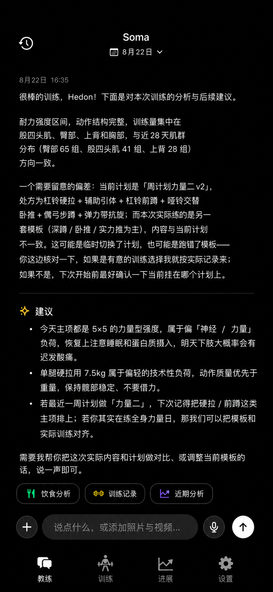
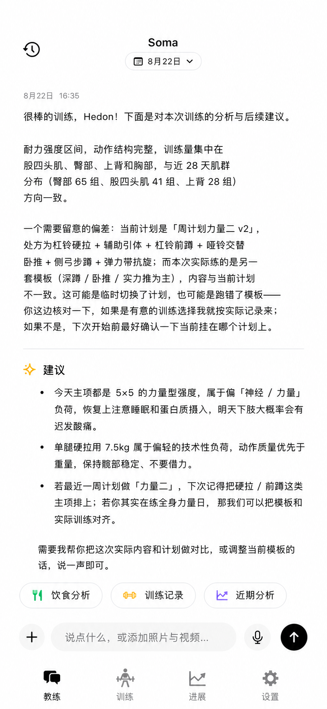

### 2.1 表面与色彩

- [x] 页面、安全区、导航栏和 TabBar 使用同一 page token，不出现不同底色拼接。
- [x] 主卡与页面至少相差一个清晰色阶；卡内逻辑组再使用 inset token。
- [x] 浅色设置使用浅灰圆角分组卡和 18 pt 组间距，避免列表融成一片。
- [x] 普通卡默认不使用彩色背景；语义色只点缀 SF Symbols、状态轨迹或必要提示。
- [x] 浅色语义色适度提高明度与饱和度并保持至少 4.5:1 对比度；暗色语义色保持既定色值。
- [x] 业务入口图标统一通过 `AppSemanticRole` 与 `SemanticIconBadge` 映射，不用黑白交互色替代分类色。
- [x] 黑白主控件使用 `onAccent` 反色前景，保证浅色黑底白字、深色白底黑字。
- [x] 删除/失败使用系统红；颜色不能代替标题、顺序、留白和可访问文案。

### 2.2 字体、间距和形状

- [x] 聊天与列表正文：Subheadline Light；列表标记：Subheadline Regular；标题：Headline/Title3 Medium。
- [x] 数值优先使用等宽数字；时间、位置和辅助文案使用 Caption/secondary。
- [x] 页面左右 16 pt，独立区块 20 pt，同组卡 12 pt，卡内 20 pt，紧凑编辑卡 14 pt。
- [x] 主卡圆角 18 pt，内嵌块和输入控件圆角 12 pt，边界为 0.5 pt separator。
- [x] 所有点击目标至少 44×44 pt；可见按钮可以更紧凑，但不能缩小触达区域。

## 3. 根导航与四个页面

### 3.1 根导航

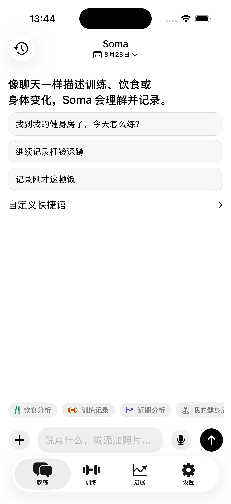
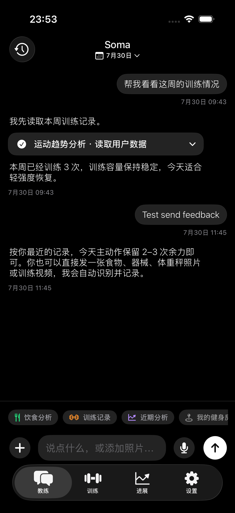

- [x] 四 Tab 各自保留导航栈；切换不 pop，再点当前 Tab 回根。
- [x] 未选中使用 `bubble...`、`dumbbell`、`chart.line...`、`gearshape` 线框图标。
- [x] 当前教练/训练/设置使用对应 fill 图标；系统 TabBar 选中底保持中性。
- [x] TabBar 不放品牌主色，不自绘设备系统元素。

### 3.2 教练

- [x] 顶部只保留历史、Soma 和业务日期；根标题紧凑居中。
- [x] AI 消息使用开放阅读版式；用户消息使用较小灰色气泡并右对齐。
- [x] AI 消息不显示重复头像或装饰列，正文直接对齐消息区左边界。
- [x] 消息元信息固定为日期 + 时间，位置存在时合并在同一 Caption 行。
- [x] AI 正文使用 Subheadline Light；结构标题只在确有章节时出现。
- [x] Markdown 仅允许 1–3 级标题、段落、分隔线、有序和无序列表；未知内容退化为普通段落。
- [x] “建议/下一步”“分析/趋势”“训练/结论”“注意/风险”分别映射稀疏语义图标。
- [x] 三个快捷 Skill 采用小胶囊和语义图标；可见高度紧凑、触达高度 44 pt。
- [x] Composer 只保留加号、文本、麦克风和发送；没有独立相机按钮。
- [x] 发送按钮在浅色为黑底白箭头，在深色为白底黑箭头。
- [x] Tool/Skill 过程保持可展开；记录卡继续可审查、可编辑、可删除。

### 3.3 训练

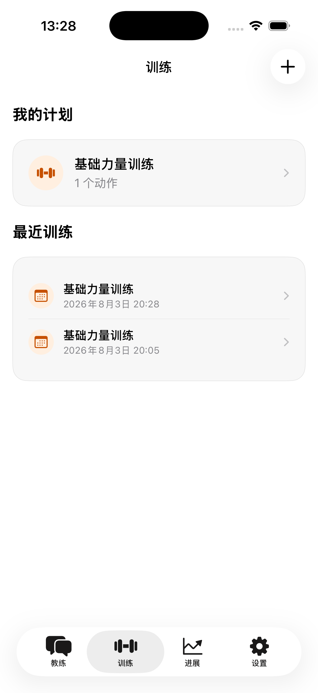
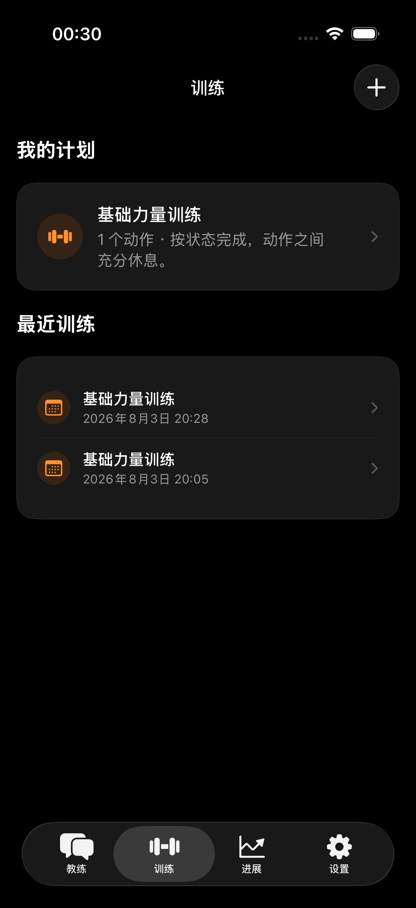

- [x] 顺序固定为进行中训练、我的计划、最近训练；无进行中 Session 时不显示占位卡。
- [x] 新建计划保持右上角加号；开始/继续训练是最短路径。
- [x] 训练橙只用于训练类别或进度，不作为全局导航主色。
- [x] 计划与最近训练的业务图标使用训练橙和柔和语义底，不使用无差别黑色图标。
- [x] 计划、历史和当前训练使用相同 page/card/inset 层级。

### 3.4 进展

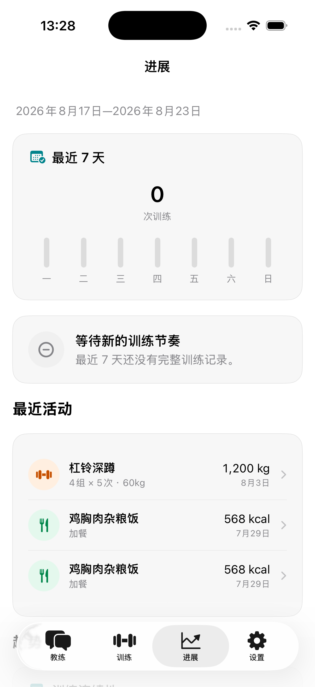
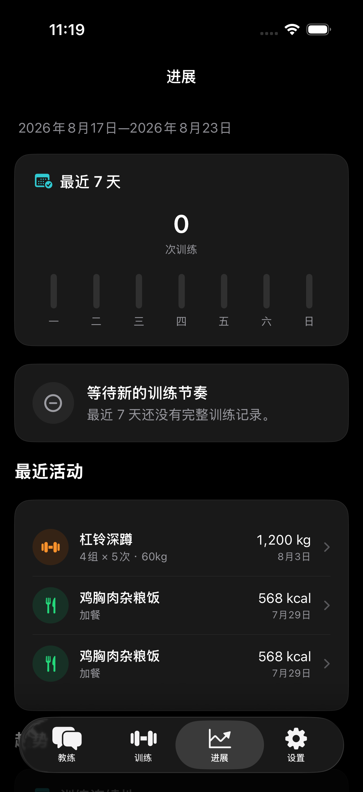
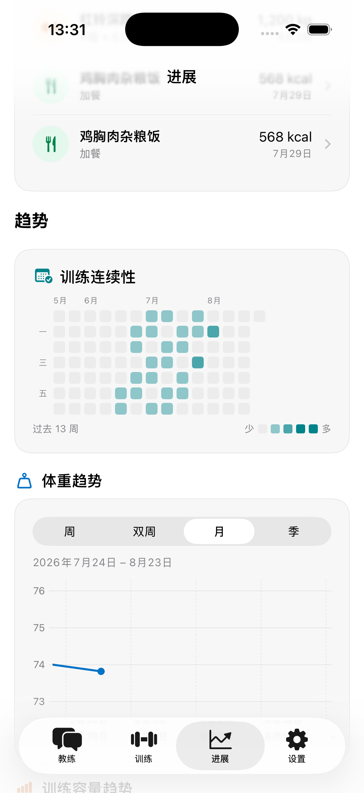
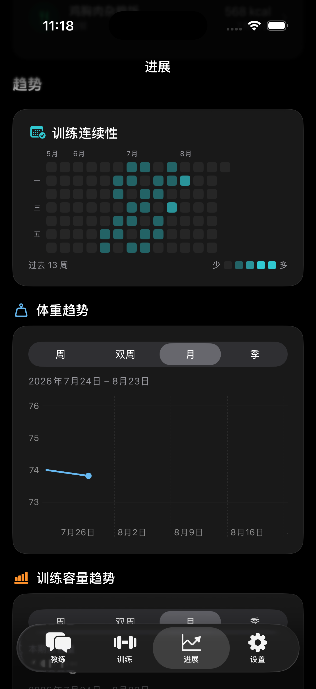

- [x] 顺序固定为最近 7 天摘要、一条结论、最近三项混合活动、趋势、全部数据入口。
- [x] 只展示有可靠证据的指标；未知项不补零。
- [x] 最近活动按时间混排训练、饮食和身体记录，语义色只落在小图标。
- [x] 最近 7 天训练柱与连续性热力格使用频率青，训练容量为负荷橙线/点/面积，体重为身体蓝线/点。
- [x] 指标标题使用对应 SF Symbol；同一曲线仅在确定阈值或区间存在时使用状态色分段，不装饰性彩虹化。
- [x] 数据与全部记录、足迹、动作库和健身房入口按训练橙、饮食绿、身体蓝、趋势紫映射。
- [x] 卡片、分隔线和标题形成阅读节奏，不用连续彩色大底制造层级。

### 3.5 设置

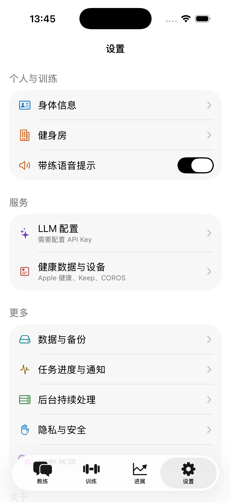
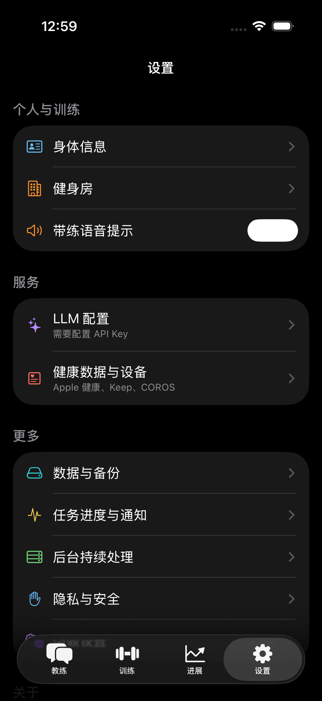

- [x] 顺序固定为个人与训练、服务、更多、关于、显示、反馈。
- [x] 每个分组使用清晰的 card surface；浅色不让行、卡和页面融成一片。
- [x] 根设置分区标题与卡片外沿对齐；反馈输入使用 inset 表面和 1 pt separator 边界。
- [x] 外观位于倒数第二组，支持跟随系统、浅色和深色即时切换。
- [x] 反馈直接位于最后一组，支持文字、照片/视频、发送和失败恢复。
- [x] 高级设置承载低频调试；反馈不隐藏在关于或二级页。

## 4. 训练记录编辑与带练

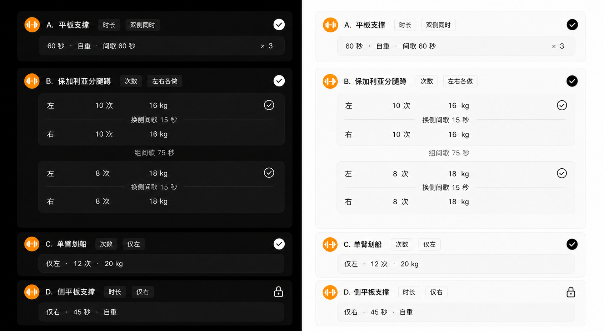

- [x] 卡头显示动作、次数/时长和侧别；普通界面不显示组号。
- [x] 支持双侧同时、左右各做、仅左、仅右；左右各做在同一逻辑组显示两行。
- [x] 支持次数目标、时长目标、外部重量、自重、缺失值、换侧间歇和组间间歇。
- [x] 连续逻辑组的侧别、类型、目标、次数/时长和重量相同即可显示 `×N`；间歇不参与相同判断。
- [x] 动作最后一个逻辑组不显示也不编辑组间歇；左右动作最后一组仍保留必要的换侧间歇。
- [x] 保存只修改显式编辑字段，保留顺序、`logicalSetIndex`、`nil`、另一侧和录像元数据。
- [x] 最新消息卡可编辑；旧消息只显示锁图标，不显示冗余解释。
- [x] 带练进度按动作和逻辑组分段，左右各做仍算一个逻辑组。
- [x] 相机失败不回滚已完成训练；重试不清空成功进度或草稿。

### 4.1 训练计划当前态

- [x] 计划详情直接展示当前动作参数，并提供清晰的修改与保存路径。
- [x] 计划、动作定义和训练记录不显示或维护业务版本号、版本历史、恢复版本与版本后缀。
- [x] 修改当前计划只影响之后开始的训练；已开始和已完成 Session 继续使用不可变处方快照。
- [x] Agent 使用 `update_program` 直接更新当前计划，与 GUI 共用同一验证和保存边界。

## 5. 共享组件和工程边界

- [x] `AppTheme` 提供全部类别、指标、状态色和尺寸 token，业务 View 不散落十六进制值。
- [x] `AppSemanticRole`、`AppMetricRole`、`AppStatusRole` 固定类别、指标和状态角色。
- [x] `SemanticIconBadge`、`MetricHeading`、`AppCard` 和 `somaCardSurface` 统一业务图标与表面层级。
- [x] `CoachResponseView` 负责受控 Markdown 解析与原生布局。
- [x] `WorkoutRecordEditorProjection` 负责无损编辑投影，聊天和详情共同使用。
- [x] `SomaUILayoutContract` 固定根页面顺序与高频路径，避免页面漂移。
- [x] 原生 Navigation、Tab、Form、Picker、Swipe Action、Text Selection、Charts、HealthKit 和媒体交互继续由系统负责。

## 6. 测试与验证清单

- [x] 主题偏好：system/light/dark 映射、未知值回落、MediaViewer 深色例外。
- [x] 色板：正文对比度、黑白反色主控件、浅深表面明度顺序、业务颜色互异且不等于黑白交互色。
- [x] 色板回归：浅色语义色满足对比度，暗色八组语义色精确保持不变。
- [x] 色彩回归：浅色语义图标不使用阴影、柔光或模糊，暗色语义色精确保持不变。
- [x] 消息元信息：同日仍显示日期时间、跨年显示年份、位置合并。
- [x] AI 布局：标题、段落、分隔线、有序/无序列表和未知 Markdown 降级。
- [x] 编辑投影：顺序、legacy、四种侧别、次数/时长、相同组压缩、异构组展开、录像无损。
- [x] 模拟器：标准 iPhone 浅色/深色、进展图表、业务入口、滚动、四 Tab 与安全区。
- [x] 同视口实现截图复核图标角色、线/点/面积/热力格、Tab 中性和卡片层级。
- [x] 完整运行 `make format`、`make check`、`make verify`。

## 7. 文档与长期迭代

- [x] PRD 039 固定用户结果、页面顺序、聊天布局、主题和无损编辑验收。
- [x] ADR 0089 固定语义主题、受控 AI 布局和无损训练编辑投影。
- [x] 工程报告解释设计动机、规则、页面映射、未采用方案和验证方法。
- [x] `soma-ui-development` Skill 固化黑白主视觉、细字体、线框 Tab、频率优先和视觉 QA。
- [x] Skill 固化业务当前态直接编辑与 Session 事实快照规则，禁止重新引入业务版本 UI。
- [x] 所有 UI 章节引用当前设计稿或实现截图。
- [x] README 只承担索引；正文保存在独立 PRD、ADR、工程报告与 Skill reference。
