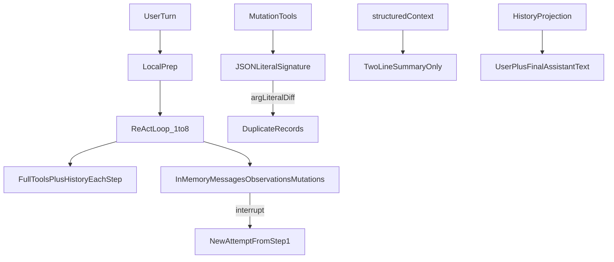

# ReAct 可靠性与上下文感知改造

## 已锁定语义

- **交付**：一次性做完，最后统一 `make verify` + 真机验收；提交仍按逻辑目的拆开。
- **中断续跑**：复用 `job.responseMessageID` 指向的同一条 `CoachMessage`；检查点落在 step 边界；丢弃未完成 step 的半截文本；续跑不递增 `attemptNumber`（仅真正失败或用户手动重试递增）。
- **性能四项全做**：滚动节流、历史抽帧缓存、工具组预选 + 并行 tool_calls、前缀稳定与历史帧 tool-result clearing。
- **摘要策略**：只用确定性 digest，不用 LLM 滚动摘要。

## 现状根因（摘要）

- 上下文：[`structuredContext`](Soma/Services/ConversationProcessingContextFactory.swift) 只有两行；[`ConversationContextProjection`](Soma/Services/ConversationContextProjection.swift) 丢弃历史 tool 事实；`query_user_data` 无时间范围/聚合。
- 恢复：[`AppServices.runAgent`](Soma/Services/AppServices.swift) 的 `messages`/`executedMutations` 纯内存；已持久化的 span 账本未用于续跑。
- 去重：[`AgentToolCall.signature`](Soma/Services/ReActAgent.swift) 是字面 JSON；Receipt 只在成功后写；跨轮依赖纠错语义。
- 延迟：每 token 双 `onChange` 动画滚动；历史视频每轮重抽帧；21 工具 schema 每步全量发送；`parallelToolCalls: false`。

## 实现顺序（去重先于并行）

### 1. 延迟：滚动节流 + 历史抽帧缓存

- [`Soma/Views/CoachView.swift`](Soma/Views/CoachView.swift)：流式期间合并 `liveAssistantText`/`liveEventRevision` 滚动为约 10Hz 非动画跟随（仅用户贴近底部时）；结束后一次动画归位。
- [`Soma/Services/ConversationProcessingService.swift`](Soma/Services/ConversationProcessingService.swift) + 新缓存服务：`prepareStoredMedia` 按「路径 + size/mtime + 抽帧策略」缓存帧到 `Library/Caches`，带体积上限与 LRU。

### 2. 去重：规范化幂等键 + pending 账本 + 业务级识别

- 改 [`AgentToolCall.signature`](Soma/Services/ReActAgent.swift)：trim、同义字段归一（`exercise`/`exercise_name`）、数值归一、nil≡缺省；`set_entries` **保持顺序**（ADR 0023）。
- [`AgentMutationReceipt`](Soma/Models/ConversationTurnSupport.swift)：增加 `pending | committed | failed`；失败不挡同键重试；成功才 committed。
- `record_*`：确定性业务键（日期桶 + exerciseID + 逐组指纹）；命中时返回既有 ID +「疑似重复」，**不静默合并**。
- 计划/版本：复用 [`TrainingIntelligenceService.planFingerprint`](Soma/Services/TrainingIntelligenceService.swift)；`start_guided_workout` 同模板未完成 session 时返回既有 session。
- 循环内只读同签名结果复用，并告知模型已查过。

### 3. 延迟：工具组预选 + 并行 tool_calls + 前缀稳定

- 新 [`Soma/Services/AgentToolExposurePolicy.swift`](Soma/Services/AgentToolExposurePolicy.swift)：分组 `core` / `plans` / `gym` / `review`；core + 固定 `expand_tool_group` 常驻；其余按关键词/active 计划/进行中 session/视频信号预选；**整轮固定**；仅逃生工具可中途扩展。
- [`AppServices.runAgent`](Soma/Services/AppServices.swift)：`parallelToolCalls = true`；本地仍顺序执行以配合幂等。
- step ≥ 2：历史视觉帧改为占位说明；当前轮媒体不变。
- 单测：同 session 连续两轮 system+tools 字节前缀一致。

### 4. 上下文：确定性上下文包 + 查询扩展 + 跨轮事实

- 新 [`Soma/Services/AgentContextPackBuilder.swift`](Soma/Services/AgentContextPackBuilder.swift) 替换两行 `structuredContext`：7/28 天频次与肌群组数、最近 3 训练日、active 计划与上次完成度、进行中 session、近 7 日热量/体重趋势、本 session 近期写入 ID；字数预算 + 确定性截断；缺失即空。
- Factory fetch 加谓词/条数上限。
- `query_user_data`：`date_from`/`date_to`/`group_by`/`metric`；聚合进新确定性服务。
- 历史投影附加：最近 N 次已执行写入摘要（来自 `PersistentAgentEvent.span`）+ 十轮外意图关键词/事实 ID digest。
- 修 [`AgentJobStore.events`](Soma/Models/AgentJob.swift) 全表 fetch。

### 5. 恢复：检查点 + 同气泡续跑

- Job 增加 `lastCompletedStep` / 账本游标等字段（默认值轻量迁移）。
- 每步结束 checkpoint；租约将到期主动落盘。
- 恢复：从事件重建压缩上下文（已完成步骤与结果，不逐字复原 tool_call_id）；复用同一 `CoachMessage`；从下一步继续。
- [`DataIntegrityRepair.finalizeInterruptedAgentTraces`](Soma/Services/ConversationRecorder.swift)：有有效检查点 → 可恢复，不标 failed。
- 切换 session / 退出 App：明确取消与落盘；评估延长 25s 租约并配合分段续跑。

### 6. 文档与验收

- PRD **022**：ReAct 可靠性与上下文感知（修订 004/008/011 相关边界）。
- ADR：
  - **0047** 确定性上下文包与跨轮事实摘要（部分替代 0024）
  - **0048** 循环检查点与同气泡中断续跑（部分替代 0031、0016）
  - **0049** 规范化幂等键与业务级重复识别（部分替代 0018）
  - **0050** 每轮工具组渐进披露与并行调用（部分替代 0003、0004）
- 同步 [`docs/acceptance.md`](docs/acceptance.md)、[`CHANGELOG.md`](CHANGELOG.md)、README、[`docs/react-agent.md`](docs/react-agent.md)、索引 README；双向生命周期链接过 `make check`。
- 用已有 Trace 字段 `time_to_first_delta_ms` / `projection_ms` / `cached_prompt_tokens` 做真机前后对照。

## 关键测试

- 规范化签名等价类与不等价类
- Receipt pending/committed/failed
- 检查点重建 + 同气泡续跑（租约过期模拟）
- 上下文包预算截断与缺失即空
- 聚合查询区间/分组
- 工具组预选与 `expand_tool_group`
- 前缀稳定性
- 并行 tool_calls 下 mutation 不重复写

## 风险与约束

- 工具组猜错 → 一次 `expand_tool_group` 往返，该轮剩余步骤前缀缓存失效（有意取舍）。
- 历史帧占位仅作用于 step≥2 的历史帧，当前轮媒体不替换。
- 幂等改造必须先于打开并行 tool_calls。
- 不引入 LLM 摘要；不静默跨轮合并业务记录。
