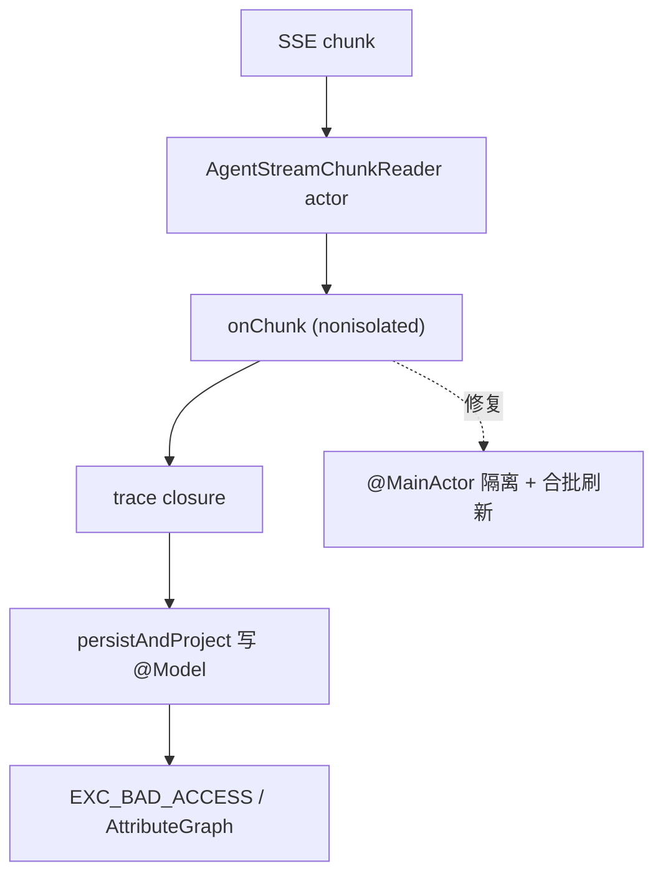

# Soma 七项优化实施计划

## 两个已定位的根因（不是猜测）

**闪退根因**：`AgentStreamDeadline.consume` 与 `onChunk` 都是 nonisolated，chunk 在 actor / URLSession executor 上恢复后，同步回调直链写 SwiftData：

```83:99:Soma/Services/AgentStreamDeadline.swift
        onChunk: (ChatCompletionChunkObject) throws -> Bool
    ) async throws {
        let reader = AgentStreamChunkReader(stream: stream)
        guard enforceFirstDelta else {
            while let chunk = try await reader.next() {
                _ = try onChunk(chunk)
            }
```

调用链是 `AIServiceAgentStreaming.consumeAgentStream` → `trace?(.assistantTextDelta)` → `[ConversationProcessingService.swift](Soma/Services/ConversationProcessingService.swift)` 1160–1174 → `PersistentAgentEventProjection.persistAndProject`（`[AgentJob.swift](Soma/Models/AgentJob.swift)` 907–923），在非主线程改 `@Model` 与 `@Observable`。Swift 5 language mode 下 `@MainActor` 标注不产生运行时跳转，所以静默编译、每个 token 都触发。

**录像根因**：`didStartRecordingTo` → `cameraStateChanged(.recording)` → `mode = .expandedCapture` → SwiftUI 换 preview host → `attachPreviewLayer` 重绑 session 并调用 `applyCaptureGeometry`，后者在录像进行中改写 movieOutput 视频连接：

```1654:1662:Soma/Services/WorkoutCameraService.swift
        let resources = captureResources
        resources.queue.async {
            if let connection = resources.movieOutput.connection(with: .video) {
                if connection.isVideoRotationAngleSupported(
                    CGFloat(geometry.captureRotationAngle)
                ) {
                    connection.videoRotationAngle = CGFloat(
                        geometry.captureRotationAngle
                    )
```

AVFoundation 因此结束录制并留下可播放短文件，正好命中固定文案分支（`WorkoutCameraService.swift:721-728`），错误对象被丢弃，所以看不到原因。




---

## Phase 0 — 稳定性（先做，阻塞其余验证）

### 4a 流式闪退

- 把 `AgentStreamDeadline.consume` 标为 `@MainActor`、`onChunk` 改为 `@MainActor` 闭包，`raceNext` 仍在 actor 读取但恢复点回到主 actor；同步修正 `[AIServiceAgentStreaming.swift](Soma/Services/AIServiceAgentStreaming.swift)` 与 `[ConversationCompactionMiddleware.swift](Soma/Services/ConversationCompactionMiddleware.swift)` 调用方。
- 文字增量改为合批：内存缓冲，按约 100ms 或 span 边界刷新一次 `CoachMessage.text` / `agentTurnItemsData` / `liveAssistantText`，消除每 token 的全量 JSON 解码-编码（`Models.swift:874-949`）与 `MarkdownText` 重排。
- 修 `ForEach` 身份漂移：`AgentChatPresentation.flushProcess`（44 行）用 `process[0].id` 做 segment id，而 `[AgentTurnTranscript.swift](Soma/Views/AgentTurnTranscript.swift)` 26–36 在同一 id 上切换 `AgentTurnItemCard` 与 `AgentProcessGroupCard`；让 id 携带形态标记或统一走 group 容器。
- 可执行防复发：`persistAndProject` 与 `applyLiveAgentEvent` 入口加 DEBUG `MainActor.assertIsolated()`；补 segment id 唯一性单测与合批缓冲单测。

### 6 带练录像

- `applyCaptureGeometry` 的 movieOutput 分支加 `movieOutput.isRecording == false` 守卫（录像前已 `lockCaptureGeometry`，录像中再写既违规又无用），preview 分支保留。
- `attachPreviewLayer`（`WorkoutCameraService.swift:596-615`）在 `layer.session === captureSession` 时不做 `session = nil` 重绑；录像中的 host 交接只更新 preview，不重放几何。
- 配置阶段设 `automaticallyConfiguresApplicationAudioSession = false`（本就没有音频输入），并把 `beginCurrentSet` 的语音播报移到 `didStartRecordingTo` 之后（`GuidedWorkoutCoordinator.swift:238-268`），排除 TTS 抢占音频会话。
- 详细原因：新增 `WorkoutRecordingFailureDiagnosis`，把 `AVError.Code`（`diskFull`、`sessionWasInterrupted`、`maximumDurationReached`、`deviceIsNotAvailableInBackground`、`mediaServicesWereReset`、`unknown`）与 `AVCaptureSessionInterruptionReasonKey`（`videoDeviceInUseByAnotherClient`、`videoDeviceNotAvailableWithMultipleForegroundApps`、`videoDeviceNotAvailableDueToSystemPressure`、`audioDeviceInUseByAnotherClient` 等）映射为具体中文原因加技术后缀 `（domain code · stage）`；替换 `WorkoutCameraService.swift:726` 固定文案，`savedPartial` 路径恢复 `logsDiagnostics: true` 并写入诊断日志。
- 单测覆盖错误码到文案映射、中断原因到文案映射、录像中不改写 movieOutput 连接。

---

## Phase 1 — 可观测性（4b 与 5）

- 新增 `Soma/Services/DiagnosticsLogStore.swift`：文件型滚动日志（Application Support，双文件各约 512KB），串行写入，记录生命周期、LLM 调用、Tool 执行、录像阶段与 turn/session id，恒定脱敏 API Key 与 Authorization，不写媒体 Base64。
- 每次 LLM 调用记录绑定工具列表：在 `[AIServiceAgentPreparation.swift](Soma/Services/AIServiceAgentPreparation.swift)` 85–118 的组装点与 `AIService.modelSpanMetadata`（`AIServiceAgentStreaming.swift` 194–229）写 `exposed_tool_names`、`exposed_tool_count`、`selected_shortcut_id` 与 model/tier，同时写一行日志；`TraceSpanMetadata.swift` 增加展示键，让高级设置的执行日志可见。这条直接解释截图里模型自称「没有饮食记录写入工具」。
- 崩溃检测：`SomaAppDelegate`（`[AgentSystemProjection.swift](Soma/Services/AgentSystemProjection.swift)` 252–271）订阅 MetricKit `MXDiagnosticPayload` 抓 `crashDiagnostics`（异常类型、终止原因、callStackTree），再用启动哨兵标志覆盖 MetricKit 未投递的情况。
- 新增 `CrashReportComposer`：设备与版本、磁盘与热状态、崩溃堆栈、诊断日志尾部、崩溃 session 的完整消息与最后一次 `AgentJob`/`AgentTrace` span（含工具列表、工具入参与结果）。
- 自动发送：新增 `DiagnosticReportMailer` 复用 `QQSMTPTransport` 与 `FeedbackMailConfiguration.recipient`，独立主题「Soma 崩溃诊断」、独立体积上限与 `.txt` 附件路径，不改用户反馈的 5000 字校验；失败留盘、下次启动重试、最多保留 5 份。
- 设置 → 高级设置 → 诊断：开关「自动发送崩溃诊断」（默认开）与「查看上次诊断报告」分享入口。

---

## Phase 2 — 聊天界面（1 与 2）

- 消息元信息单行：`CoachBubble`（`[CoachView.swift](Soma/Views/CoachView.swift)` 1138–1228）底部加一行 caption2 的 `时间 · 位置`；当天只显示 `HH:mm`，跨天显示 `M月D日 HH:mm`；位置取 `message.location.displayName`，长 POI 用 `truncationMode(.middle)`；删除 1155–1163 的独立绿色位置胶囊并合并进这一行；助手消息只显示时间；VoiceOver 合并朗读；补格式化单测。
- 日期入口上移：从 `CoachComposer` 的 `HStack`（1295–1300）移除 `businessDateChip`，改用 `ToolbarItem(placement: .principal)` 的两行 VStack（"Soma" 加紧凑日期按钮），保留左上历史按钮与既有 `changeBusinessDate` 持久化（381–385）；模拟器验证，若 inline 导航栏两行过挤则退回顶部 `safeAreaInset` 居中方案。

---

## Phase 3 — 输入框快捷按钮 CRUD（3）

新实体存 UserDefaults JSON（键 `ai.react.input-shortcuts.v1`），不动 SwiftData schema：

```swift
struct AgentInputShortcut: Codable, Identifiable, Sendable {
    var id: String
    var title: String
    var iconSystemName: String
    var skillID: String?        // 可绑定内置或自定义 Skill
    var toolNames: [String]     // 默认全选，用户可删减
    var isVisible: Bool
    var order: Int
}
```

- Skill 不再绑定工具：删除 `AgentSkill.toolGroups`、`AgentCustomSkill.toolGroupIDs`、`AgentSkillDescriptor.toolGroups`；`[AgentToolExposurePolicy.swift](Soma/Services/AgentToolExposurePolicy.swift)` 改为按快捷按钮的 `toolNames` 曝光，未选快捷按钮时全量曝光，`AgentToolGroup` 只作为选择器分组；`AgentLoopCheckpoint` 增加 `exposedToolNames` 并保留旧 `exposedGroups` 解码以兼容在盘 checkpoint。
- 默认 3 个：饮食分析沿用 `nutrition_analysis`，训练记录新建 Skill，近期分析新建 Skill 复用运动趋势分析内容；其余 5 个内置 Skill 保留但默认不上快捷栏。
- 设置页：新增 `AgentInputShortcutSettingsViews.swift`，支持新增、编辑、删除、拖动排序与显示开关；编辑页含名称、图标、Skill 选择、按 `AgentToolGroup` 分组的工具多选与全选/全不选。原 `AgentSkillsListView`（`[AgentPromptSkillSettingsViews.swift](Soma/Views/AgentPromptSkillSettingsViews.swift)` 16–139）回归纯 Skill 管理。
- AI 推荐工具：新增 `AgentToolRecommendationService`，把快捷按钮名称、Skill 正文与工具目录（名称与描述）送一次非流式 completion，优先 `.small` 档（`AIModelProfiles.swift` 已有独立 provider/baseURL/model/Key 与开关，未启用时回落标准档），返回 `{tools, reason}`；本地校验丢弃未知工具名，UI 展示推荐清单与理由并支持一键采纳；仅在用户点按时触发，不含健康数据。
- 聊天侧 `skillShortcuts`（1431–1458）改读可见快捷按钮，`selectedShortcutID` 替代 `selectedSkillID`；`AgentJob` 增加可选 `selectedShortcutID` 支持排队与恢复，同步 `docs/engineering/database-schema.md`。

---

## Phase 4 — 饮食双卡片（7）

- 删除全仓库无调用点的 `[MealChatResultCard.swift](Soma/Views/MealChatResultCard.swift)`。
- 新增 `MealInlineEditorCards.swift` 替换 `[ChatRecordEditorCards.swift](Soma/Views/ChatRecordEditorCards.swift)` 244–323 的 `InlineMealCard`：
  - 卡片一「菜品拆解」可编辑 `[MealItem]`（名称、份量、kcal、蛋白、碳水、脂肪）并支持增删行与餐次标题，复用 `InlineRecordShell`、`compactMetric` 与 `ChatRecordEditPolicy`，保存走 `replaceItemsAndDeriveTotals` 加 `modelContext.save()` 加 `recordManualCorrection`。
  - 卡片二「汇总」只读派生，随卡片一草稿实时重算，沿用 `sumIfComplete` 规则（缺项显示未估算，不补零），显示 `餐次 · M月D日 HH:mm`，附「查看详情」进入 `MealRecordDetailView`。
- 把派生规则抽成纯函数 `MealNutritionTotals.derive(from:)` 供 `replaceItemsAndDeriveTotals`（`Models.swift` 452–464）与卡片二共用，并补单测。
- 饮食时间：`inferredMealType()`（`ConversationRecorder.swift` 1057–1063）改用 `sourceDate` 而非 `.now`；聊天卡片显示到分钟；饮食分析 Skill 明确「不要猜测时间，省略 `occurred_at` 由系统用发送时刻」；补 `BusinessDateResolver.defaultOccurredAt` 时钟时间单测。

---

## 文档（仓库契约要求）

- 新增 PRD 033 覆盖本批产品范围，与 PRD 024、025、027、030、032 建立双向生命周期链接。
- 新增 ADR 0082（快捷按钮持有工具绑定、Skill 只留方法，取代 ADR 0081，部分取代 0069）、ADR 0083（本地诊断日志与崩溃静默上报的隐私边界与总开关，链接 ADR 0053、0054）、ADR 0084（饮食原位审查双卡片与派生汇总，部分取代 0077、0064，修订 0059）。
- 新增 BUG 0024（流式跨 actor 写入闪退）与 BUG 0025（录像被连接重配置提前终止且原因不可见，链接 BUG 0020 与 ADR 0074）。
- 同步 `docs/prd/README.md`、`docs/adr/README.md`、`docs/bugs/README.md`、`docs/acceptance.md`、`docs/engineering/agent-tool-catalog.md`、`docs/engineering/prompt-source-catalog.md`、`docs/engineering/database-schema.md`、`docs/react-agent.md` 与 `CHANGELOG.md`。

## 验证

- 迭代中跑 `make check`，完成前跑 `make verify`。
- iPhone 模拟器检查消息元信息行、导航栏日期入口、快捷按钮设置与饮食双卡片的浅色/深色、空态、长中文与 Dynamic Type。
- 真机手工场景：带练录像连续 3 组、后台切换、来电中断、语音提示开关对比；崩溃上报先走一次人工触发的诊断邮件。录像根因需真机复验后才写入 BUG 0025 的已验证结论。

