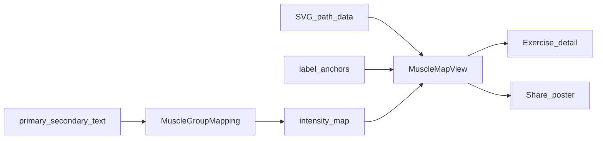

# 受力图视觉升级（解剖轮廓 + 引线标签）

## 目标观感

对齐参考卡的**信息结构**，不是抄其品牌色或账号元素：

- 左前 / 右后两具清晰人体，一眼能分正反面
- 未受力：浅灰底；受力：实心主题色（Soma `AppTheme.tint`，主次用深浅）
- 肌群名用细引线挂在身体两侧；**已点亮加粗加深，未点亮浅灰小字**
- 分享海报改为「左受力图 + 右统计」横向构图；不做头像、「440天」等账号态

继续遵守 [ADR 0044](docs/adr/0044-programmatic-muscle-map-and-training-share-poster.md) 的核心：自由文本 → `MuscleGroup` 映射、程序化叠加、本地渲染、无远程分享。

## 现状问题

[`MuscleMapView`](Soma/Components/MuscleMapView.swift) + [`MuscleMapPathData`](Soma/Models/MuscleMapPathData.swift) 来自 body-highlighter 粗多边形：

- 无头部/整体轮廓层次，块面碎、描边脏
- 正反仅并排，无「正面 / 背面」与标签，辨识度低
- 分享海报把图和统计竖着堆，不像参考卡

## 实现路径

### 1. 升级矢量人体（仍 MIT）

- 评估并移植更高质量的开源 SVG 路径（优先 MIT：`react-muscle-highlighter` / `MuscleMap` 等；保留许可声明，更新 [`BODY_HIGHLIGHTER_LICENSE.txt`](Soma/Resources/ExerciseCatalog/BODY_HIGHLIGHTER_LICENSE.txt) 或拆成对应 NOTICE）。
- 重新生成 [`MuscleMapPathData.swift`](Soma/Models/MuscleMapPathData.swift)：前/背面独立 path，语义 key 对齐现有 [`MuscleGroup.pathKeys`](Soma/Models/MuscleGroup.swift)；必要时补 alias，不改动用户可编辑自由文本字段。
- 渲染层改为「浅灰身体底 + 分肌群填充」：未点亮统一底色，点亮用主题色按强度分 2～3 档；去掉杂乱细描边，用留白缝隙区分块面。

若候选库路径与现有 `MuscleGroup` 粒度对不齐，做一层 `pathKey → MuscleGroup` 表，而不是膨胀枚举到「上胸/中下胸」级（首版保持现有肌群粒度）。

### 2. 引线标签层

在 [`MuscleMapView`](Soma/Components/MuscleMapView.swift) 内为前/背面各定义一组标签锚点（肌肉中心点 + 外侧文字位）：

- 始终画出主要肌群标签（覆盖当前 `MuscleGroup` 集合）
- `intensity > 0`：字号/字重提高，颜色用 tint；否则 secondary 浅色
- 用 `Path` 画短引线，避免与相邻标签重叠（固定布局槽位，不做运行时碰撞求解）
- 每侧底部标注「正面」「背面」
- VoiceOver：继续汇总已点亮肌群名，不读全部浅色标签

### 3. 布局与复用入口

- `MuscleMapView`：加宽默认高度/宽度，支持 `showsLabels`（详情与海报默认开）
- 动作详情 / 记录关联动作：沿用组件，视觉自动升级
- [`WorkoutSharePosterView`](Soma/Views/WorkoutShareViews.swift)：主区改为 `HStack { MuscleMapView; VStack(metrics) }`，下方再接动作明细与 Soma 标识

### 4. 文档

- 修订 [ADR 0044](docs/adr/0044-programmatic-muscle-map-and-training-share-poster.md)：补充「解剖清晰度 + 引线标签」呈现决策，并写明仍不做照片级混合高亮、不做账号天数
- 轻量更新 [PRD 019](docs/prd/019-training-review-plan-management-and-muscle-map-share.md) 验收句：正反面可辨、点亮标签加粗
- [CHANGELOG](CHANGELOG.md) 记一条视觉升级

### 5. 验证

- 既有 [`MuscleGroupMappingTests`](SomaTests/MuscleGroupMappingTests.swift) 保持绿
- 补标签锚点覆盖测试：每个 `MuscleGroup` 在对应侧面有锚点
- 模拟器目视：动作详情与分享海报浅色/深色；`make check`，相关测试通过后 `make verify`

## 明确不做

- 不做头像、训练天数、第三方深蓝品牌色照搬
- 不做照片级人体 + blend（ADR 已否决）
- 首版不拆「上胸 / 中下胸」等比 `MuscleGroup` 更细的解剖分区
- 不引入 WebView 复用 JS 组件
