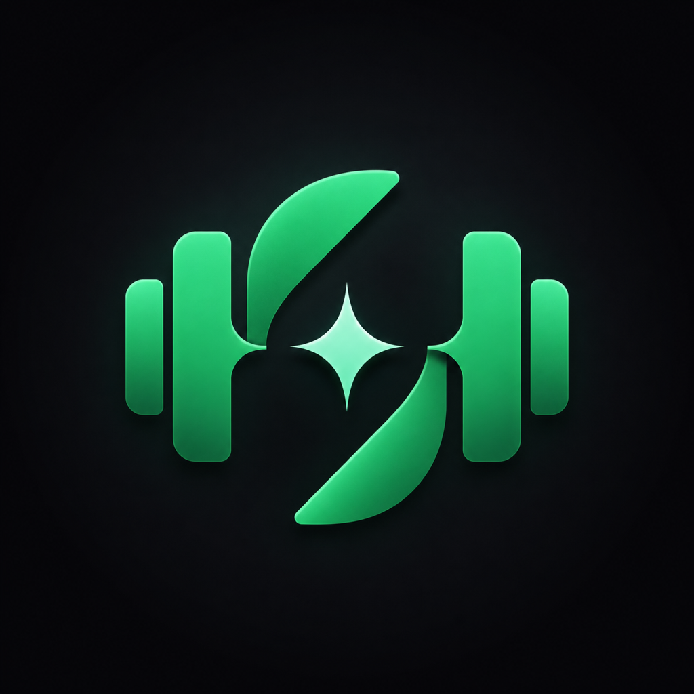
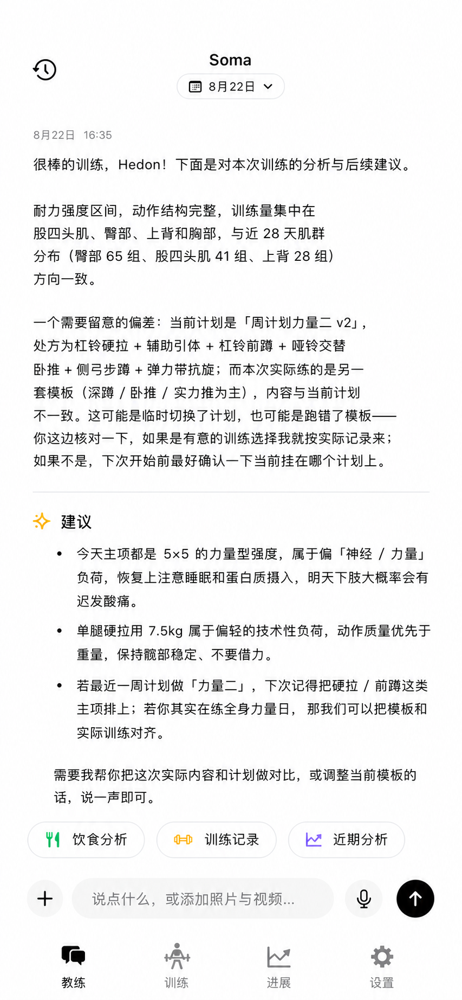
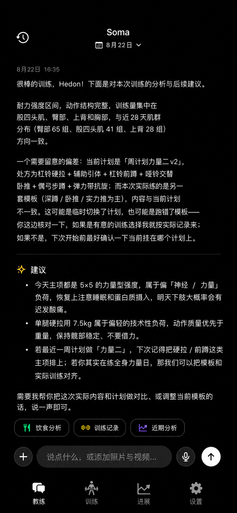
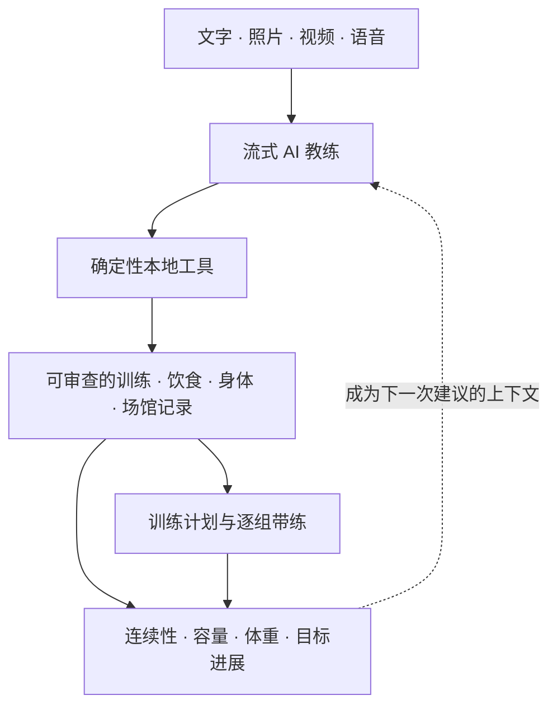
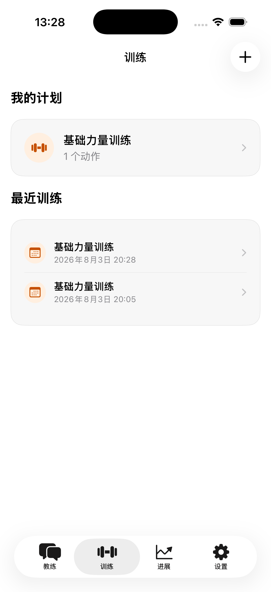
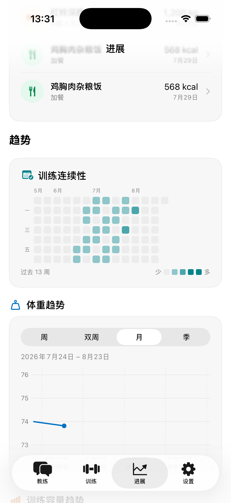
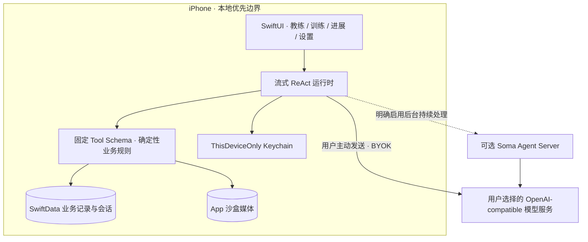

<p align="center">
  
</p>

<h1 align="center">Soma</h1>

<p align="center"><strong>Your body, understood.</strong></p>

<p align="center">
  无账户 · 本地优先 · 多模态对话 · 可审查记录
</p>

Soma 是一位运行在 iPhone 上的私人身体智能教练。你不需要先学习一套健身软件，也不必把每次
训练、每顿饭和每个身体变化拆成表单：像平时说话一样，把文字、照片、视频或语音交给 Soma，
它会把自然表达整理成可以回看、修改和删除的记录，再用这些长期事实帮助你训练和理解进展。

Soma 的目标不是替你制造更多数据，而是让真正发生过的训练、饮食和身体变化逐渐连成一条有用、
可信且属于你的线索。

<table>
  <tr>
    <th width="50%">浅色主题</th>
    <th width="50%">深色主题</th>
  </tr>
  <tr>
    <td></td>
    <td></td>
  </tr>
</table>

> 界面图仅使用虚构演示数据。Soma 不会把真实身体照片、健康记录或密钥放进仓库与测试素材。

## 为什么是 Soma

### 先表达，再结构化

“今天深蹲 3 组，每组 8 次，40 kg”“这是我的午餐”“帮我看看这段硬拉视频”——Soma 从你的
表达开始，而不是要求你先适应数据库字段。训练计划是明确授权的结构化例外，可以在专用界面中
编排和执行，但与聊天使用同一套记录与校验规则。

### AI 结果不是黑盒

AI 创建的训练、饮食、身体和健身房记录都可以审查、纠正和删除。缺少的重量、时长、营养或评分
会保持为空，不会用“常见值”补齐。餐食总计、训练容量和热量等能够确定计算的结果，由本地规则
派生并说明依据。

### 从一次记录走向长期进展

Soma 不只回答一轮问题。训练记录会连接动作库和计划，饮食与身体数据会进入趋势，下一次建议也会
结合你的当前场馆、近期训练与明确提供的身体资料。

### 数据默认留在你手上

Soma 不要求账户。业务数据库、原始媒体和自带的模型 API Key 默认保存在设备上；只有你主动发送
内容时，必要的输入才会交给所选模型。可选后台持续处理默认关闭，服务器也不会成为身体记录的
事实来源。

## 一条完整的使用闭环



每一次 AI 写入都必须落到可审查记录；每一个长期结论都应能回到用户事实或本地确定性计算。

## 四个核心页面

| 页面 | 你可以做什么 |
| --- | --- |
| **教练** | 用文字、照片、视频或语音表达需求；查看流式回复、记录卡和执行日志；停止耗时处理，或从已保存进度手动继续。 |
| **训练** | 管理当前训练计划，从计划一步开始逐组带练；记录实际次数、时长、重量、间歇和可选训练视频。 |
| **进展** | 按目标查看能量与增肌进展、训练连续性、容量、体重趋势，以及最近的训练、饮食和身体活动。 |
| **设置** | 配置身体与训练上下文、模型服务、隐私、导出与加密备份，并直接提交产品反馈。 |

## 你可以用 Soma 做什么

| 能力 | 体验 |
| --- | --- |
| **多模态教练** | 一次发送文字、照片与视频；视频可按模型能力直传，或在设备端提取关键帧后分析。 |
| **训练记录与动作库** | 保存逐组次数或时长、重量和间歇；关联个人动作库、动作说明、示意图、肌群图和容量历史。 |
| **计划与带练** | 从聊天生成计划，或在界面中选择、排序和配置动作；训练时自动推进动作、组次、换侧与休息。 |
| **饮食与身体记录** | 从自然语言或照片形成可编辑记录；未知营养保持未知，已知小计与完整总计明确区分。 |
| **场馆与器械** | 用照片建立自己的电子健身房，维护多个场馆、器械和当前训练环境。 |
| **目标导向进展** | 减脂关注可解释的能量收支，增肌关注训练天数、可计算容量和主要肌群工作组覆盖。 |
| **数据所有权** | 开放导出饮食与训练记录，加密备份完整个人空间，并可主动清除本地个人数据。 |
| **可选模型服务** | 支持 OpenAI、DeepSeek、阿里云百炼、火山引擎、腾讯云、opencode，以及其他 OpenAI-compatible 服务。 |

## 从计划到趋势

Soma 的界面以系统原生交互和低干扰信息层级为主。黑白负责导航、选择和主要操作；训练、饮食、
身体、连续性与趋势只使用少量语义色，帮助你识别信息，而不是装饰页面。

<table>
  <tr>
    <th width="50%">计划与最近训练</th>
    <th width="50%">连续性与长期趋势</th>
  </tr>
  <tr>
    <td></td>
    <td></td>
  </tr>
</table>

## 隐私与可控性

- **无账户**：核心体验不依赖注册、登录或云端身体数据库。
- **本地数据库**：训练、饮食、身体、场馆和对话使用 SwiftData 保存在设备上。
- **私有媒体**：原始图片与视频保存在 App 沙盒，不默认进入系统相册或服务器。
- **本机密钥**：自带 API Key 使用 ThisDeviceOnly Keychain 保护，不上传 Soma Server。
- **主动出网**：只有用户明确发送内容、提交反馈或启用可选后台持续处理时，才发生对应远程数据流。
- **可以退出**：记录支持修改和删除；个人空间支持开放导出、加密备份、恢复和主动清除。
- **诚实恢复**：处理失败或被用户停止后保留已经完成的步骤，由用户决定是否继续；后续消息不会越过人工屏障。

## 产品架构

Soma 把 AI 推理与业务事实分开：模型负责理解和建议，固定工具负责查询、校验与写入，SwiftData
和本地媒体才是身体记录的默认事实来源。



可选 Server 只保存远程 Job/Event 所需的最小状态；需要写入训练、饮食或身体数据时，仍必须回到
设备执行固定工具并由用户审查。更完整的协议见 [Agent Job 协议](docs/engineering/agent-job-protocol.md)。

## Soma 适合谁

Soma 更适合这些用户：

- 想用自然语言记录力量训练、饮食和身体变化；
- 希望 AI 能理解照片与视频，但不愿放弃对记录的修改权；
- 已有自己的训练方法，希望把计划、执行和长期趋势连接起来；
- 在意隐私，希望业务数据与 API Key 默认留在 iPhone；
- 接受 AI 提供一般训练、恢复与饮食建议，而不是医疗诊断。

Soma 不是医疗设备，不提供疾病诊断、个体化治疗或保证结果的训练处方。涉及疼痛、受伤、饮食障碍
或其他健康风险时，请咨询合格的医疗专业人士。

## 开始体验

目前仓库提供源码运行方式。你需要 macOS、Xcode，以及 iOS 17 或更高版本的模拟器或 iPhone。

```bash
git clone https://github.com/hedon954/soma.git
cd soma
make setup
open Soma.xcodeproj
```

在 Xcode 中选择 `Soma` Scheme 和一个 iPhone Simulator 即可运行。演示空间只包含虚构记录与媒体，
适合先体验教练、训练、进展和设置的完整流程。

真机需要使用自己的 Apple Developer Team：

```bash
DEVELOPMENT_TEAM=你的10位TeamID make install-device
```

首次使用 AI 能力时，在“设置 → LLM 配置”中选择服务、填写模型和自己的 API Key。生成的
`Soma.xcodeproj` 不进入 Git；工程配置的唯一事实来源是 `project.yml`。

## 参与开发

```bash
make check   # 快速格式、Lint、文档、隐私和仓库契约
make verify  # 静态门禁、构建与模拟器测试
```

- [贡献指南](CONTRIBUTING.md)
- [产品需求与演进](docs/prd/README.md)
- [架构与交互决策](docs/adr/README.md)
- [验收矩阵](docs/acceptance.md)
- [工程文档](docs/engineering/README.md)
- [安全策略](SECURITY.md)
- [更新日志](CHANGELOG.md)

Soma 使用 [Apache License 2.0](LICENSE) 开源。
