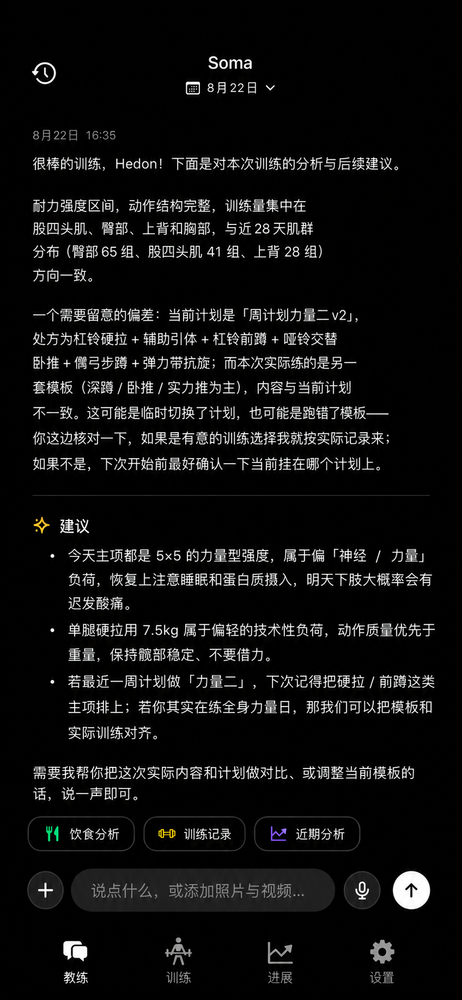
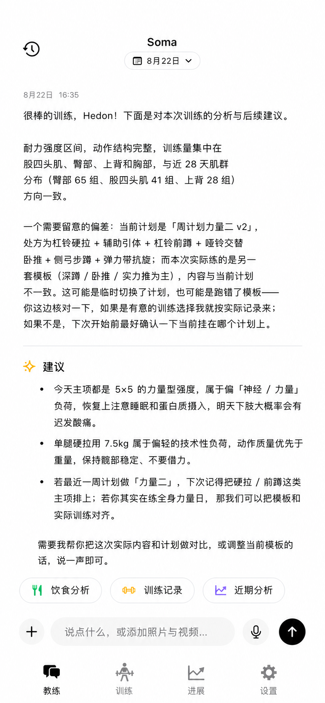
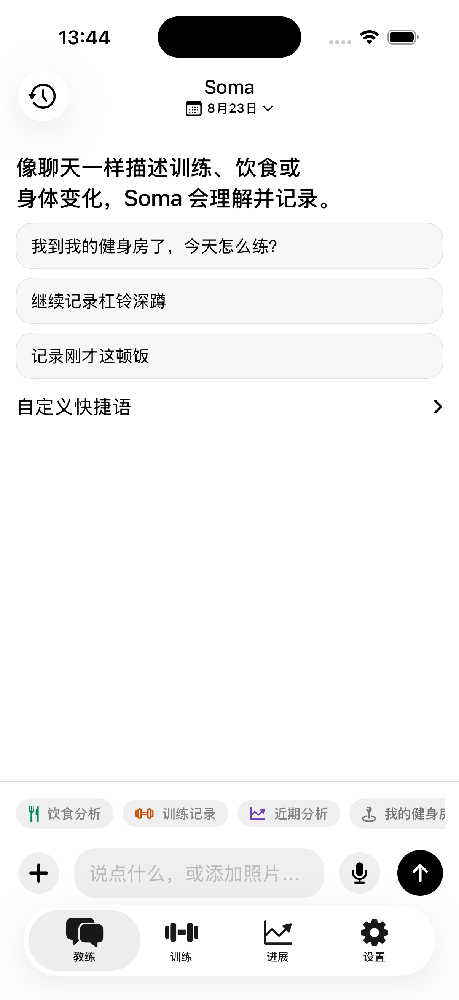
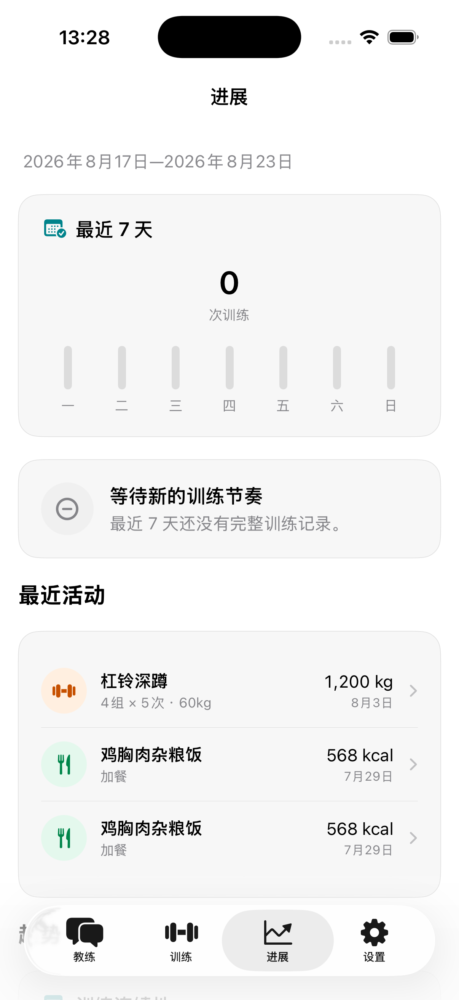
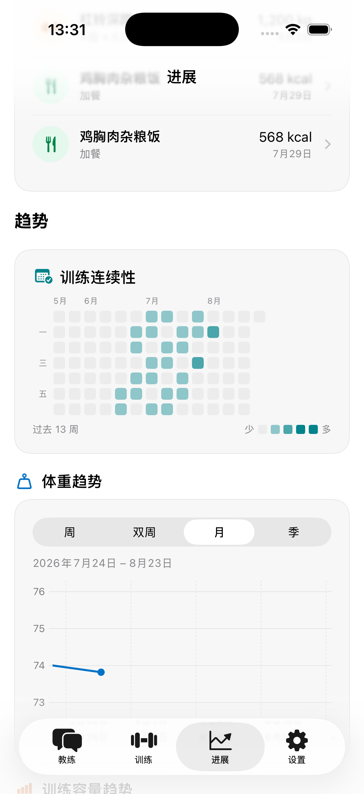
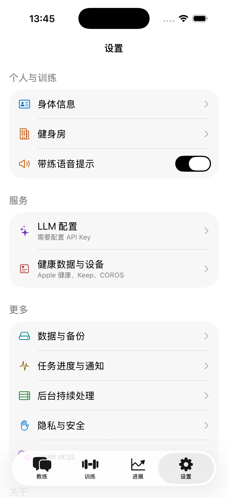
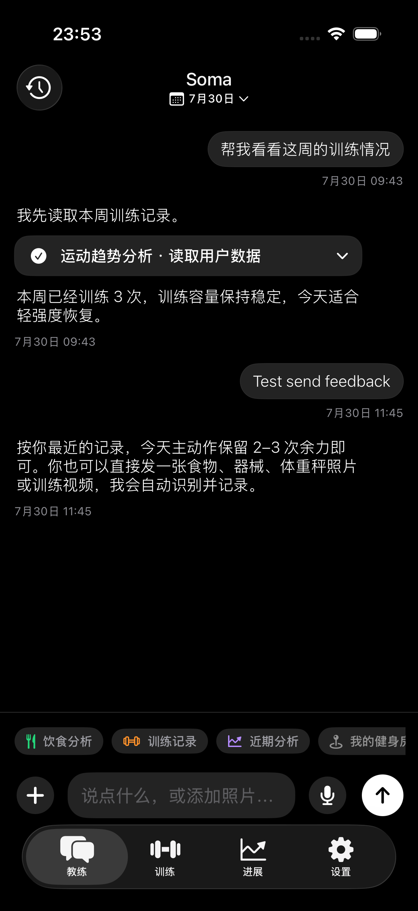
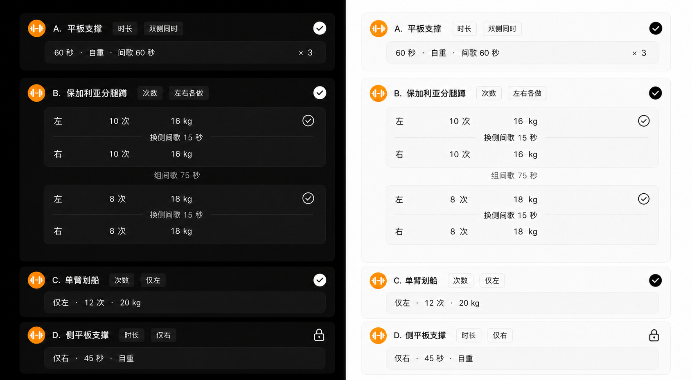
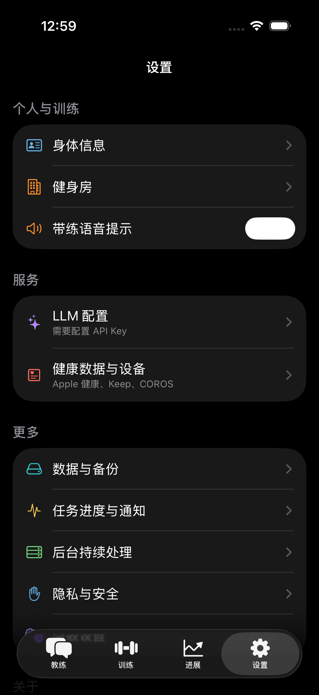

# ADR 0089：黑白双主题、受控 AI 排版与无损训练编辑投影

- 状态：已采纳
- 日期：2026-08-22
- 维护者：Soma maintainers
- 部分替代：无
- 后续替代：暂无
- 上游依据：[PRD 039](../prd/039-frequency-first-dual-theme-ui.md)
- 下游落地：[Soma UI 设计系统与优化工程报告](../engineering/soma-ui-design-system.md)

## 背景

页面自行选择颜色、字体和卡片会导致主题与模块持续漂移；模型直接输出自由布局会产生不可预测界面；
训练记录若从聚合字段重建则会损失异构逻辑组、左右 effort、间歇和录像证据。三类问题需要长期边界。

## 决策

### 1. 主题使用统一语义映射

1. `AppAppearancePreference` 只保存 `system/light/dark` 到 `UserDefaults`；根 `TabView` 统一应用
   `preferredColorScheme`，业务页面不维护主题分支。
2. `AppTheme` 提供 page/card/inset/separator、黑白主交互、语义彩色图标、反色前景、间距、圆角和
   最小触达。业务 View 不散落十六进制颜色。
3. 深色是纯黑页面与两级深灰；浅色是纯白页面与两级浅灰。主题不改变信息顺序。
4. 白色不作为暗色主题的重复大面积内容表面；用户消息使用 inset 灰色气泡。
5. 训练、饮食、身体、趋势、提醒、删除保持独立类别语义，只用于少量图标或状态点；业务类别图标不能无差别使用黑色。
   程序化肌群受力图是训练语义可视化：有效区域、标签与引导线统一使用训练橙深浅，未映射区域保持中性灰。
6. `AppSemanticRole` 管理类别色，`AppMetricRole` 管理指标色，`AppStatusRole` 管理有阈值的状态色；
   `SemanticIconBadge` 与 `MetricHeading` 分别固定业务入口和指标标题的图标边界。训练频率/连续性用
   青色，容量/负荷用橙色，恢复用绿色，表现用紫色，身体测量用蓝色，生命体征用珊瑚色。数据线、
   点、柱、面积与热力格不得使用黑白交互 `accent`；同一曲线仅在状态阈值有确定业务含义时分段多色，
   坐标轴、网格和分隔线保持中性。
7. 原生 Form、Navigation、Tab、Picker、Charts、Swipe Action 和媒体交互继续负责平台行为。
8. `MediaViewer` 的沉浸式深色是明确例外。

### 2. 字体、导航和页面顺序是产品契约

1. 根标题使用 inline 样式；四 Tab 各自保留导航栈。
2. 未选中 Tab 使用线框 SF Symbol，选中项可使用 fill 版本和中性选中底，不使用彩色品牌导航。
3. 聊天正文与用户消息为 Dynamic Type Subheadline Light；结构标题和显式强调只升到 Medium；元信息 Caption；AI 正文不保留重复头像或装饰列。
4. 训练、进展和设置的区块顺序由 PRD 039 固定。外观可下沉，反馈不得藏入二级页。
5. 浅色设置分组使用 card surface 与明确组间距，根分区标题对齐卡片外沿；反馈输入使用 inset 表面与 1 pt 边界，不能仅靠模糊阴影分层。

### 3. AI 只提供受控内容结构

1. 模型输出普通 Markdown，不输出 HTML、表格、emoji、代码围栏或自定义组件标记。
2. `CoachResponseDocument` 只解析 1–3 级标题、段落、分隔线、有序和无序列表。
3. `CoachResponseView` 将上述结构映射为原生 SwiftUI；未识别内容退化为普通段落。
4. 标题图标由本地语义规则决定，模型不能选择任意 SF Symbol 或插入交互控件。
5. Tool/Skill 过程、结构化记录卡和错误恢复仍由确定性本地组件呈现。

### 4. 训练编辑投影无损且共享

1. `WorkoutSetEvidence` 数组及其字段是事实来源；`WorkoutRecordDraft`、
   `LogicalWorkoutGroupDraft`、`WorkoutEffortDraft` 只是纯值编辑投影。
2. 有 `logicalSetIndex` 时稳定分组；没有时按原数组顺序形成 legacy 逻辑组，不猜测合并。
3. 左右 effort 可共享一个视觉逻辑组；单侧编辑只改变对应 effort。
4. 连续组的侧别、类型、目标、次数/时长和重量相同即可显示 `×N`；间歇不参与压缩判断，压缩不改变底层组身份、顺序、间歇或录像元数据。
5. 聊天与详情复用同一编辑器、侧别、缺失值、校验和保存规则。
6. 动作最后一个逻辑组不显示或编辑组间歇；左右动作最后一组仍显示换侧间歇。添加继承结构但不编造数值；复制复制值但不复制录像引用。
7. 只读历史摘要复用上述投影并忽略间歇进行连续压缩；最后逻辑组的组后间歇不显示，逐组事实不以“第 N 组”长句展开。

### 5. 计划总览与动作历史保持数据角色

1. 计划总览分别聚合主要与辅助肌群。目标组数可缩放各自强度，主要/辅助身份只能来自动作库定义，
   不能由归一化阈值重新分类；同一肌群只要在任一动作中是主要，就不在辅助结论中重复。
2. 从计划进入动作详情时携带只读处方快照并先显示“本计划目标”；从动作库或普通记录进入时不伪造计划上下文。
3. 动作详情的主要肌群、辅助肌群、动作提示、双面受力图与图例组成“标准动作”的单一列表行；
   受力图不另开章节，`Form` 不把 Divider、图或图例拆成空白行。
4. 动作历史按最近一次、容量趋势、全部记录分层。容量只使用完整次数与外部重量证据；图表横轴使用
   实际记录日期，图外显示最近容量与较上次变化，曲线使用负荷橙。

### 5. 视觉 QA 是交付门禁

1. 可见改动至少检查标准 iPhone 浅色/深色、长中文、键盘、滚动、安全区和辅助字号。
2. 产品级重构在 `design-qa.md` 中把来源设计与同视口实现放入同一比较输入。
3. P0/P1/P2 在交付前修复并重新截图；真机专属相机、HealthKit 与权限行为单列验收。

## 未采用方案

- 每页独立维护主题：会形成两套漂移实现，并在切换时丢状态。
- 彩色主导航或连续彩色卡片：会削弱信息层级，偏离已确认的黑白主视觉。
- 暗色用户消息使用白色气泡：面积过大、对比突兀，与对话阅读节奏冲突。
- 模型直接输出任意 UI：不可预测、不可测试，也不能保证本地与无障碍边界。
- 把设计稿当运行时背景：无法适配数据、主题、Dynamic Type 和 VoiceOver。
- 用聚合字段重建训练组：违反有序证据与 missing-is-nil。
- 为主题或编辑草稿新增 SwiftData：偏好和瞬时投影不需要业务数据库迁移。

## 结果

- 页面、导航、聊天和记录编辑共享稳定规则，后续迭代不再依赖单页审美判断。
- 黑白主视觉提高信息清晰度，彩色只承担可解释语义。
- 受控 Markdown 保留 AI 表达能力，同时阻止任意布局注入。
- 紧凑训练卡不以损失事实换取视觉整洁。

## 验证

- `AppAppearancePreferenceTests`：主题映射与回落。
- `AppThemePaletteTests`：表面层级、语义对比、业务颜色互异和黑白反色控件。
- `ChatMessageMetaLineTests`：日期、时间、跨年和位置。
- `CoachResponseDocumentTests`：受控 Markdown 结构与降级。
- `WorkoutRecordEditorProjectionTests`：顺序、legacy、侧别、目标、压缩、添加/复制和录像无损。
- `make format`、`make check`、`make verify`、`design-qa.md` 与真机安装启动。
