# Soma 0.0.38 界面截图

iPhone 17 Pro 模拟器实拍，普通字号，使用虚构的演示和测试数据。长页用首屏和向下滚动后的视口展示。点开图片可查看原尺寸。

## 教练

| 对话 · 浅色 | 对话 · 深色 | 历史对话 |
| --- | --- | --- |
| [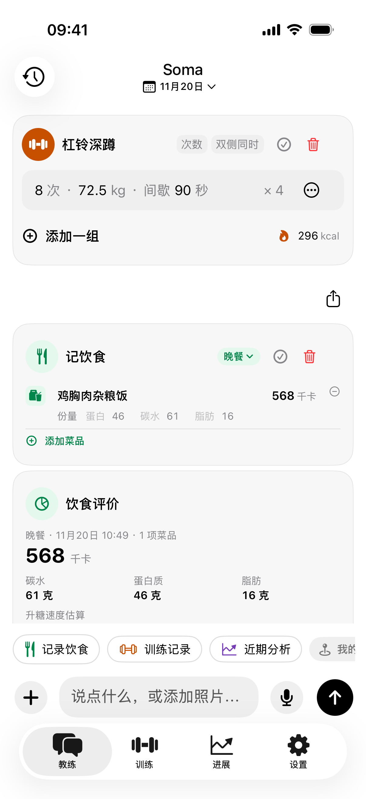](coach-light.webp) | [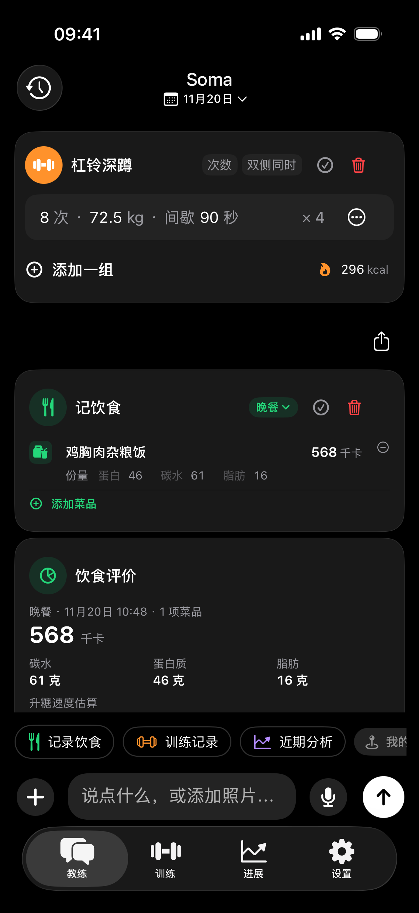](coach-dark.webp) | [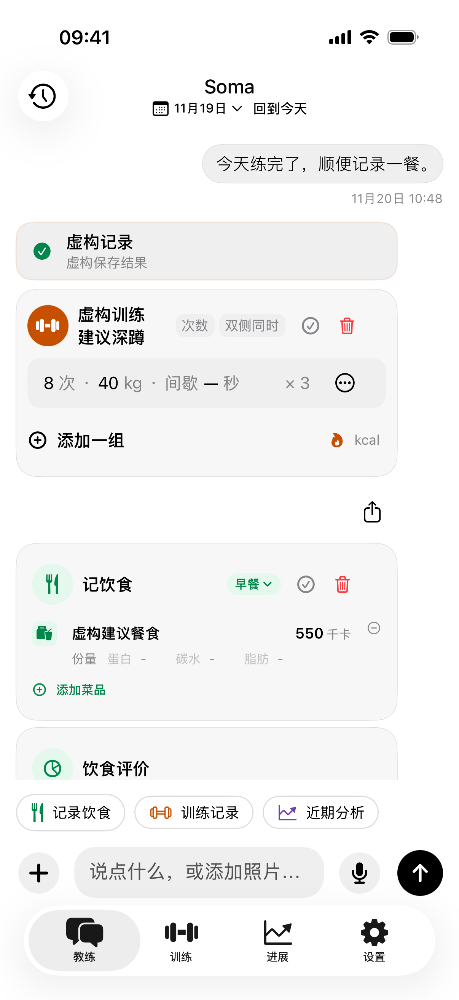](coach-return-light.webp) |

- 输入与审查：[选中快捷建议](coach-shortcuts-selected-light.webp)、[发送前预览多张照片](coach-media-composer.webp)、[待处理消息的附件](coach-photos-light.webp)、[教练选择题](coach-choices-light.webp)、[逐组训练卡](workout-card-light.webp)。
- 补餐：[待补餐次](meal-reminder-light.webp) → [按日期查看缺项](meal-history-light.webp) → [预填日期和餐次的草稿](meal-draft-light.webp)，也可以[撤销没吃标记](meal-undo.webp)。
- 回答：[回复下方的建议操作](coach-actions-light.webp)、[当日能量与剩余摄入](coach-energy-light.webp)。
- 单餐分享：[隐藏照片](meal-share-light.webp)、[显示照片](meal-share-photo-light.webp)。

## 训练

| 训练 · 浅色 | 训练 · 深色 | 逐组带练 |
| --- | --- | --- |
| [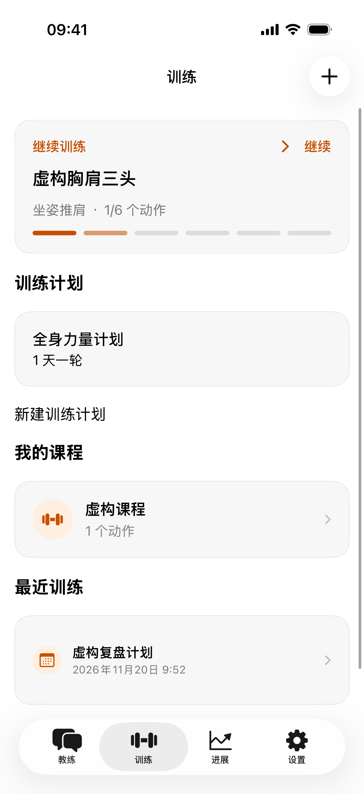](training-light.webp) | [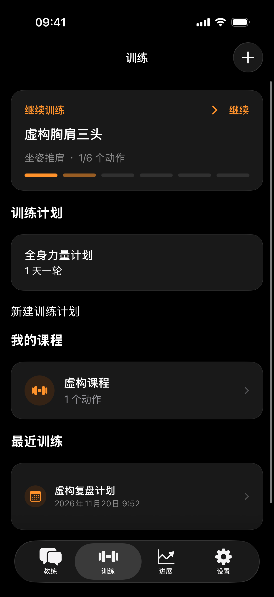](training-dark.webp) | [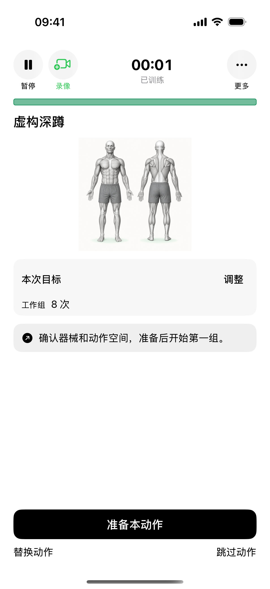](guided-prepare.webp) |

- [训练课程](course.webp)、[带练首组倒计时](guided-countdown.webp)、[编排计划](training-plan-editor-light.webp)、[从课程、动作或计划选择内容](training-content-picker-light.webp)。
- [实际训练记录与肌群图](workout-detail-dark.webp)、[动作库分类与筛选](exercise-library.webp)、[单动作历史趋势](exercise-trend-light.webp)。
- 训练分享：[浅色预览](workout-share-light.webp)、[深色预览](workout-share-dark.webp)、[向下滚动查看训练摘要](workout-share-lower-light.webp)。

## 进展

| 日 | 周 | 月 | 年 |
| --- | --- | --- | --- |
| [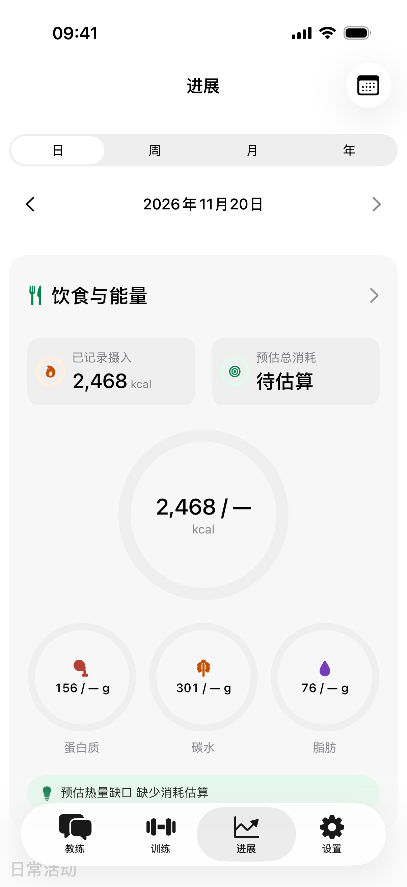](progress-day-light.webp) | [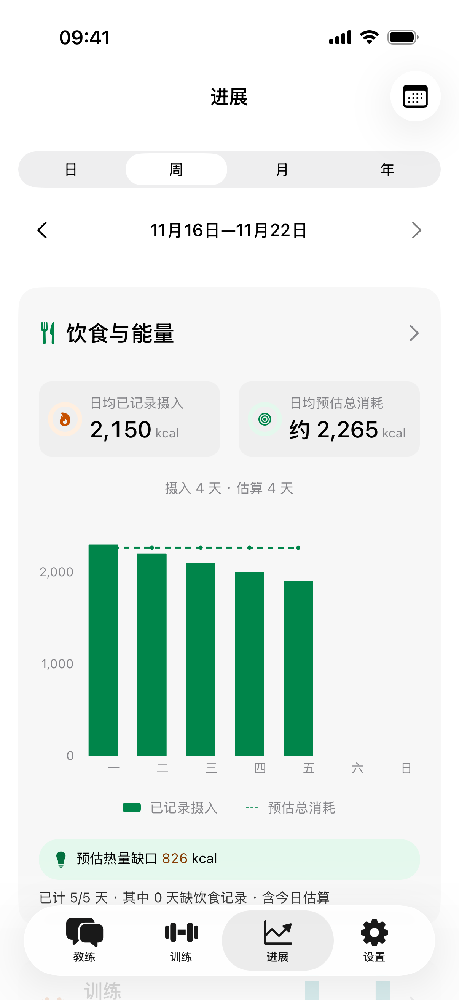](deficit-week-light.webp) | [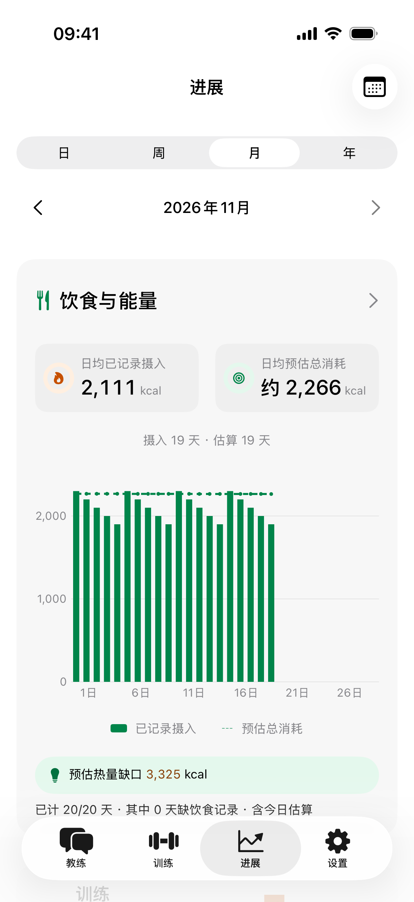](deficit-month-light.webp) | [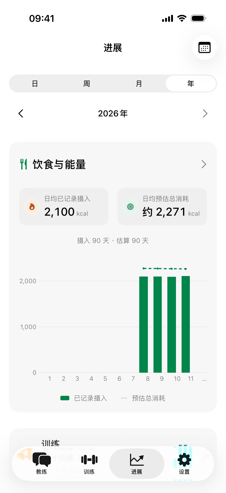](progress-year-light.webp) |

- 当日饮食与能量：[深色日页](progress-day-dark.webp)、[向下滚动到当日记录](progress-day-lower-light.webp)、[按餐次查看摄入明细](meal-detail.webp)、[消耗明细与逐条训练](energy-expenditure-light.webp)。
- 日常活动：[COROS 来源](activity-light.webp)、[Apple 健康来源](activity-apple-light.webp)、[步数、距离和活动消耗详情](activity-detail-light.webp)、[同步失败后的重试](activity-retry-light.webp)。
- 身体历史：[体重与体脂合并趋势及来源](body-history-light.webp)、[导入指标的来源和采样时间](body-detail.webp)。

## 设置

| 设置 · 浅色 | 设置 · 深色 | Apple 健康连接 |
| --- | --- | --- |
| [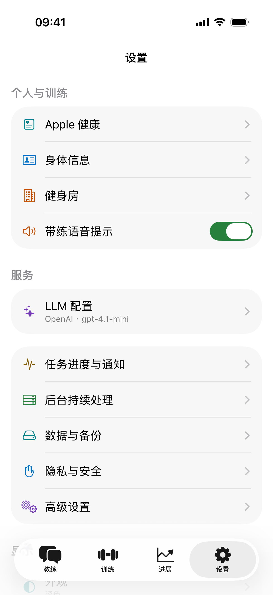](settings-light.webp) | [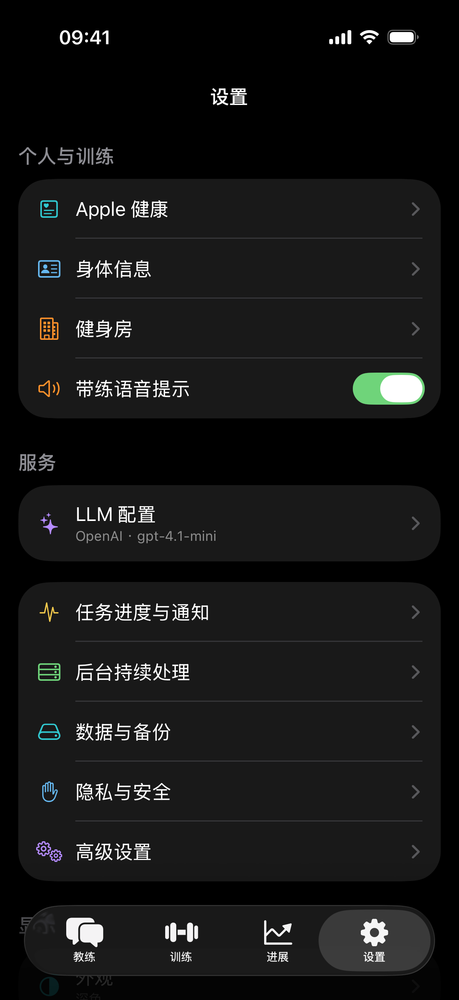](settings-dark.webp) | [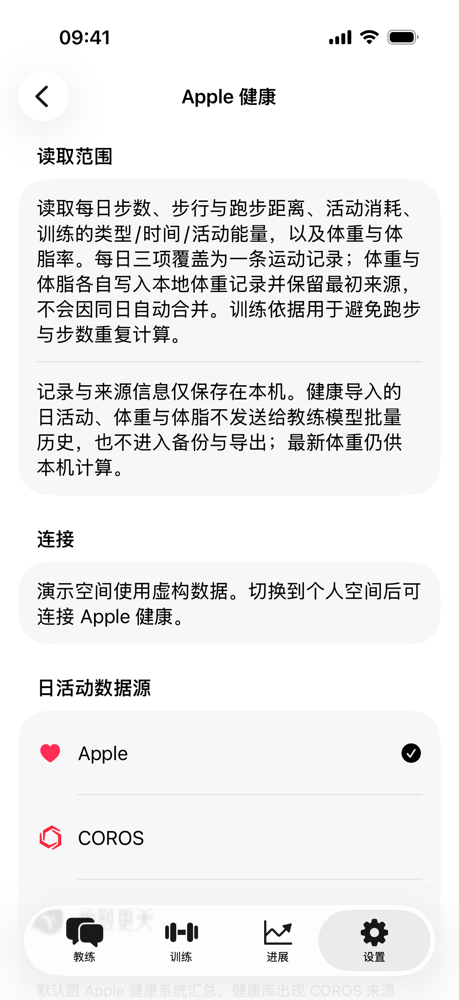](apple-health.webp) |

- [设置下半屏的外观、关于和反馈](settings-lower-light.webp)、[模型服务配置](model-settings.webp)、[后台持续处理的开关和数据边界](remote-settings.webp)、[健身房列表](gym.webp)、[器械详情](gym-equipment.webp)。
- [Apple 健康同步说明与历史入口](apple-health-lower.webp)、[数据与备份](backup.webp)、[崩溃诊断](crash-diagnostics.webp)。

本批截图的 App 构建号为 42。设置下半屏保留了 App「关于」分组当前显示的 `1.0.0 (1)` 文案。
