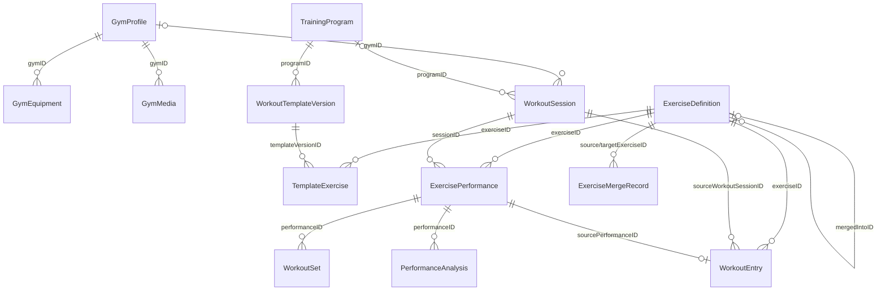
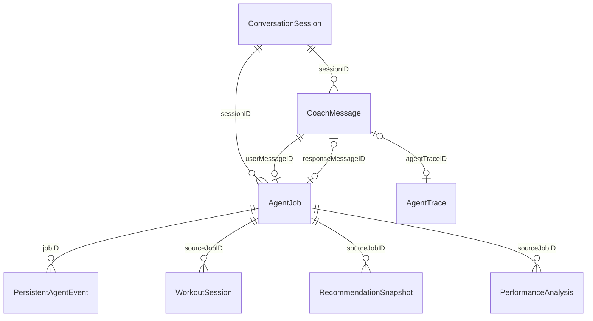
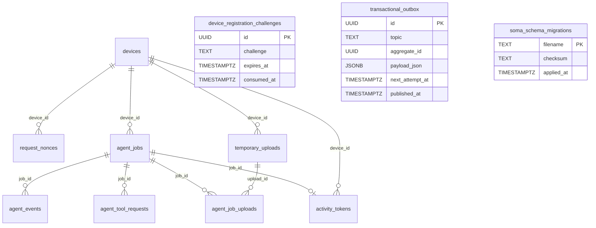

# 数据库结构与 ER 图

本文维护 Soma 当前持久化结构的可审查快照，覆盖设备端 SwiftData 与可选 Agent Server
的 PostgreSQL。修改模型或 migration 时，必须在同一个变更中同步本文。

- 状态：当前实现快照
- 最近同步：2026-08-14
- SwiftData 注册来源：[`Soma/App/SomaApp.swift`](../../Soma/App/SomaApp.swift)
- SwiftData 字段来源：[`Soma/Models/`](../../Soma/Models/)
- PostgreSQL 来源：[`Server/migrations/`](../../Server/migrations/)
- 迁移入口：`make db-migrate-create`、`make db-migrate-status`、`make db-migrate`
- 相关决策：ADR 0001、0031、0032，以及
  [`训练领域模型与运行时协议`](training-domain-model.md)

## 阅读约定

- SwiftData 部分记录的是应用可依赖的**逻辑结构**。Apple 管理的底层 SQLite 表名、列名和
  内部 metadata 不属于 Soma 契约，也不应被业务代码直接访问。
- SwiftData 模型当前不使用 `@Relationship`；关系由 UUID 软引用与 Store/删除规则维护。
  ER 图中的连线因此表达领域关系，不代表底层数据库外键。
- SwiftData 的 `id` 是领域身份；只有明确标注 `unique` 的字段由 SwiftData 唯一约束保护。
- PostgreSQL 部分记录 migration 实际建立的物理表、列、外键、唯一约束与索引。
- `Date` 与 `TIMESTAMPTZ` 都表示绝对时间戳。用户时区只在格式化展示时参与，不写入时间字段。
- `Data` 字段是 Codable 值的二进制封装；其载荷类型列在“编码字段”一节。
- `?` 表示可空；没有 `?` 的 Swift 字段由模型初始化器提供值，但不等价于公开 SQL `NOT NULL`。

## 设备端 SwiftData

个人空间与演示空间各自使用独立 `ModelContainer`，但注册完全相同的 24 个模型。两个空间
不能通过 UUID 软引用互相连接，也不启用 CloudKit。

### 用户、场馆与外部同步

<!-- schema-model: ExternalSyncCursor | id,source,stream,cursorData,updatedAt -->
| 模型 | 持久字段 | 关键约束或语义 |
| --- | --- | --- |
| `ExternalSyncCursor` | `id: UUID`、`source: String`、`stream: String`、`cursorData: Data?`、`updatedAt: Date` | 每个来源与数据流维护独立游标。 |
| <!-- schema-model: UserProfile | id,updatedAt,displayName,biologicalSexRaw,birthDate,age,height,referenceWeight,fitnessGoal,healthNotes --> `UserProfile` | `id: UUID`、`updatedAt: Date`、`displayName: String`、`biologicalSexRaw: String`、`birthDate: Date?`、`age: Int?`、`height: Double?`、`referenceWeight: Double?`、`fitnessGoal: String`、`healthNotes: String` | `age` 只用于旧数据兼容；可由生日推导时不应成为新事实来源。 |
| <!-- schema-model: GymProfile | id,name,createdAt,notes,coverImagePath,isCurrent,latitude,longitude,locationLabel,locationAccuracy,locationUpdatedAt,matchRadiusMeters --> `GymProfile` | `id: UUID`、`name: String`、`createdAt: Date`、`notes: String`、`coverImagePath: String?`、`isCurrent: Bool`、`latitude: Double?`、`longitude: Double?`、`locationLabel: String?`、`locationAccuracy: Double?`、`locationUpdatedAt: Date?`、`matchRadiusMeters: Double` | 每个数据空间只能有一个当前健身房，由共享规则维护。 |
| <!-- schema-model: GymEquipment | id,gymID,name,category,capabilities,confidence,imagePath,createdAt --> `GymEquipment` | `id: UUID`、`gymID: UUID`、`name: String`、`category: String`、`capabilities: String`、`confidence: Double`、`imagePath: String?`、`createdAt: Date` | `gymID → GymProfile.id`。 |
| <!-- schema-model: GymMedia | id,gymID,path,createdAt --> `GymMedia` | `id: UUID`、`gymID: UUID`、`path: String`、`createdAt: Date` | `gymID → GymProfile.id`；`path` 是 App 沙盒媒体引用。 |

### 用户记录

<!-- schema-model: MealEntry | id,date,mealTypeRaw,title,calories,protein,carbs,fat,itemsData,nutritionSourceRaw,notes,imagePath,mediaAttachmentsData,confidence,sourceTurnID,sourceSessionID -->
| 模型 | 持久字段 | 关键约束或语义 |
| --- | --- | --- |
| `MealEntry` | `id: UUID`、`date: Date`、`mealTypeRaw: String`、`title: String`、`calories: Int?`、`protein: Double?`、`carbs: Double?`、`fat: Double?`、`itemsData: Data`、`nutritionSourceRaw: String`、`notes: String`、`imagePath: String?`、`mediaAttachmentsData: Data`、`confidence: Double`、`sourceTurnID: UUID?`、`sourceSessionID: UUID?` | 未确认营养值保持为空；来源字段连接创建它的聊天 turn/session。 |
| <!-- schema-model: BodyEntry | id,date,weight,bodyFat,waist,notes,imagePath,mediaAttachmentsData,analysis,externalSource,externalID,sourceTurnID,sourceSessionID --> `BodyEntry` | `id: UUID`、`date: Date`、`weight: Double?`、`bodyFat: Double?`、`waist: Double?`、`notes: String`、`imagePath: String?`、`mediaAttachmentsData: Data`、`analysis: String`、`externalSource: String?`、`externalID: String?`、`sourceTurnID: UUID?`、`sourceSessionID: UUID?` | `externalSource + externalID` 用于外部导入去重，由 Store 维护。 |
| <!-- schema-model: WorkoutEntry | id,date,exercise,exerciseID,sets,reps,weight,setEntriesData,restSeconds,durationMinutes,notes,mediaKindRaw,mediaPath,mediaAttachmentsData,formScore,intensity,feedback,estimatedCalories,calorieMET,calorieDurationMinutes,calorieDurationEstimated,externalSource,externalID,sourceTurnID,sourceSessionID,sourceWorkoutSessionID,sourcePerformanceID --> `WorkoutEntry` | `id: UUID`、`date: Date`、`exercise: String`、`exerciseID: UUID?`、`sets: Int?`、`reps: Int?`、`weight: Double?`、`setEntriesData: Data`、`restSeconds: Int?`、`durationMinutes: Int?`、`notes: String`、`mediaKindRaw: String`、`mediaPath: String?`、`mediaAttachmentsData: Data`、`formScore: Int?`、`intensity: String?`、`feedback: String?`、`estimatedCalories: Int?`、`calorieMET: Double?`、`calorieDurationMinutes: Double?`、`calorieDurationEstimated: Bool`、`externalSource: String?`、`externalID: String?`、`sourceTurnID: UUID?`、`sourceSessionID: UUID?`、`sourceWorkoutSessionID: UUID?`、`sourcePerformanceID: UUID?` | `exerciseID → ExerciseDefinition.id`；session/performance 来源字段用于引导训练投影与幂等回查。 |

### 动作库与训练计划

<!-- schema-model: ExerciseDefinition | canonicalNameKey,id,canonicalName,createdAt,updatedAt,archivedAt,mergedIntoID,coachingNotes,primaryMusclesData,secondaryMusclesData,movementPatternsData,muscleDiagramAssetName,userDemoVideosData,guidanceVideosData,contentRevisionsData,imageReferencesData -->
| 模型 | 持久字段 | 关键约束或语义 |
| --- | --- | --- |
| `ExerciseDefinition` | `canonicalNameKey: String [unique]`、`id: UUID`、`canonicalName: String`、`createdAt: Date`、`updatedAt: Date`、`archivedAt: Date?`、`mergedIntoID: UUID?`、`coachingNotes: String`、`primaryMusclesData: Data`、`secondaryMusclesData: Data`、`movementPatternsData: Data`、`muscleDiagramAssetName: String?`、`userDemoVideosData: Data`、`guidanceVideosData: Data`、`contentRevisionsData: Data`、`imageReferencesData: Data` | `mergedIntoID` 是动作合并后的自引用；规范名键唯一。 |
| <!-- schema-model: ExerciseMergeRecord | id,sourceExerciseID,targetExerciseID,sourceName,affectedWorkoutIDsData,affectedTemplateExerciseIDsData,affectedPerformanceIDsData,affectedRecommendationIDsData,transferredContentRevisionIDsData,transferredUserDemoVideosData,transferredGuidanceVideosData,transferredImageReferencesData,createdAt,undoneAt --> `ExerciseMergeRecord` | `id: UUID`、`sourceExerciseID: UUID`、`targetExerciseID: UUID`、`sourceName: String`、`affectedWorkoutIDsData: Data`、`affectedTemplateExerciseIDsData: Data`、`affectedPerformanceIDsData: Data`、`affectedRecommendationIDsData: Data`、`transferredContentRevisionIDsData: Data`、`transferredUserDemoVideosData: Data`、`transferredGuidanceVideosData: Data`、`transferredImageReferencesData: Data`、`createdAt: Date`、`undoneAt: Date?` | 保存动作合并的受影响对象和可撤销信息。 |
| <!-- schema-model: TrainingProgram | id,name,goal,statusRaw,currentTemplateVersionID,createdAt,updatedAt --> `TrainingProgram` | `id: UUID`、`name: String`、`goal: String`、`statusRaw: String`、`currentTemplateVersionID: UUID?`、`createdAt: Date`、`updatedAt: Date` | 当前模板通过版本 ID 软引用；历史版本继续保留。 |
| <!-- schema-model: WorkoutTemplateVersion | id,programID,familyID,version,name,scheduleHint,source,createdAt,changeSummary,changeDetails --> `WorkoutTemplateVersion` | `id: UUID`、`programID: UUID`、`familyID: UUID`、`version: Int`、`name: String`、`scheduleHint: String`、`source: String`、`createdAt: Date`、`changeSummary: String?`、`changeDetails: String?` | `programID → TrainingProgram.id`；`familyID + version` 表达同一模板族的版本链。 |
| <!-- schema-model: TemplateExercise | id,templateVersionID,exerciseID,order,targetSets,targetReps,targetWeightKG,targetRestSeconds,firstSetIsWarmup,equipmentKind,notes --> `TemplateExercise` | `id: UUID`、`templateVersionID: UUID`、`exerciseID: UUID`、`order: Int`、`targetSets: Int?`、`targetReps: Int?`、`targetWeightKG: Double?`、`targetRestSeconds: Int?`、`firstSetIsWarmup: Bool`、`equipmentKind: String?`、`notes: String` | 计划内参数是版本快照，可独立于动作库调整。 |
| <!-- schema-model: WorkoutSession | id,startedAt,endedAt,gymID,programID,programNameSnapshot,sourceTemplateFamilyID,sourceTemplateVersion,prescriptionSnapshotData,statusRaw,guidedPhaseRaw,currentPerformanceID,currentSetID,phaseStartedAt,restStartedAt,restTargetEndAt,autoRecordingPolicyRaw,sourceTurnID,sourceJobID --> `WorkoutSession` | `id: UUID`、`startedAt: Date`、`endedAt: Date?`、`gymID: UUID?`、`programID: UUID?`、`programNameSnapshot: String?`、`sourceTemplateFamilyID: UUID?`、`sourceTemplateVersion: Int?`、`prescriptionSnapshotData: Data`、`statusRaw: String`、`guidedPhaseRaw: String`、`currentPerformanceID: UUID?`、`currentSetID: UUID?`、`phaseStartedAt: Date?`、`restStartedAt: Date?`、`restTargetEndAt: Date?`、`autoRecordingPolicyRaw: String`、`sourceTurnID: UUID?`、`sourceJobID: UUID?` | 保存计划处方快照，后续模板修改不会改写已开始训练。 |
| <!-- schema-model: ExercisePerformance | id,sessionID,exerciseID,exerciseName,order,prescriptionSnapshotData,statusRaw,notes,activeVideoPath,workoutProjectionSuppressed --> `ExercisePerformance` | `id: UUID`、`sessionID: UUID`、`exerciseID: UUID`、`exerciseName: String`、`order: Int`、`prescriptionSnapshotData: Data`、`statusRaw: String`、`notes: String`、`activeVideoPath: String?`、`workoutProjectionSuppressed: Bool` | 每次 session 中一次动作执行；终态完成数据可投影为 `WorkoutEntry`。 |
| <!-- schema-model: WorkoutSet | id,performanceID,order,kindRaw,laterality,plannedReps,plannedWeightKG,plannedRestSeconds,actualReps,actualWeightKG,actualRestSeconds,statusRaw,startedAt,completedAt,recordedVideoPath --> `WorkoutSet` | `id: UUID`、`performanceID: UUID`、`order: Int`、`kindRaw: String`、`laterality: String?`、`plannedReps: Int?`、`plannedWeightKG: Double?`、`plannedRestSeconds: Int?`、`actualReps: Int?`、`actualWeightKG: Double?`、`actualRestSeconds: Int?`、`statusRaw: String`、`startedAt: Date?`、`completedAt: Date?`、`recordedVideoPath: String?` | 计划值和实际值分离；跳过或未完成不伪造成完成事实。 |
| <!-- schema-model: RecommendationSnapshot | id,targetKind,targetID,inputFingerprint,advice,createdAt,sourceJobID --> `RecommendationSnapshot` | `id: UUID`、`targetKind: String`、`targetID: UUID`、`inputFingerprint: String`、`advice: String`、`createdAt: Date`、`sourceJobID: UUID?` | `targetKind + targetID` 是多态软引用；fingerprint 绑定分析输入。 |
| <!-- schema-model: PerformanceAnalysis | id,performanceID,sourceMediaPath,inputFingerprint,evidence,limitations,feedback,createdAt,sourceJobID --> `PerformanceAnalysis` | `id: UUID`、`performanceID: UUID`、`sourceMediaPath: String`、`inputFingerprint: String`、`evidence: String`、`limitations: String`、`feedback: String`、`createdAt: Date`、`sourceJobID: UUID?` | `performanceID → ExercisePerformance.id`；保留证据、局限与输入指纹。 |

### 对话与 Agent 运行时

<!-- schema-model: ConversationSession | id,startedAt,updatedAt,title -->
| 模型 | 持久字段 | 关键约束或语义 |
| --- | --- | --- |
| `ConversationSession` | `id: UUID`、`startedAt: Date`、`updatedAt: Date`、`title: String` | 聊天会话根对象。 |
| <!-- schema-model: CoachMessage | id,date,sessionID,isFromCoach,text,mediaKindRaw,mediaPath,mediaAttachmentsData,recordTypeRaw,agentTraceID,agentStatusRaw,agentEventsData,agentTurnItemsData,turnID,attemptNumber,locationData,effectiveGymID,manualCorrectionSummary --> `CoachMessage` | `id: UUID`、`date: Date`、`sessionID: UUID?`、`isFromCoach: Bool`、`text: String`、`mediaKindRaw: String`、`mediaPath: String?`、`mediaAttachmentsData: Data`、`recordTypeRaw: String?`、`agentTraceID: UUID?`、`agentStatusRaw: String?`、`agentEventsData: Data`、`agentTurnItemsData: Data`、`turnID: UUID?`、`attemptNumber: Int`、`locationData: Data`、`effectiveGymID: UUID?`、`manualCorrectionSummary: String?` | 同一响应气泡覆盖重试状态；结构化记录修正摘要进入消息上下文。 |
| <!-- schema-model: AgentTrace | id,startedAt,endedAt,statusRaw,provider,model,endpoint,dataSpaceRaw,userInput,contextSnapshot,mediaKindRaw,imageCount,imageAttachmentCount,videoAttachmentCount,finalAnswer,errorMessage,spansData,turnID,attemptNumber --> `AgentTrace` | `id: UUID`、`startedAt: Date`、`endedAt: Date?`、`statusRaw: String`、`provider: String`、`model: String`、`endpoint: String`、`dataSpaceRaw: String`、`userInput: String`、`contextSnapshot: String`、`mediaKindRaw: String`、`imageCount: Int`、`imageAttachmentCount: Int`、`videoAttachmentCount: Int`、`finalAnswer: String?`、`errorMessage: String?`、`spansData: Data`、`turnID: UUID?`、`attemptNumber: Int` | 每次远程 attempt 一条 trace；不保存 reasoning 内容。 |
| <!-- schema-model: AgentMutationReceipt | key,turnID,signature,resultData,createdAt,statusRaw --> `AgentMutationReceipt` | `key: String [unique]`、`turnID: UUID`、`signature: String`、`resultData: Data`、`createdAt: Date`、`statusRaw: String` | 本地业务 Tool 写入的幂等回执。 |
| <!-- schema-model: AgentJob | clientJobKey,id,turnID,sessionID,userMessageID,responseMessageID,dataSpaceRaw,backendRaw,stateRaw,userText,mediaAttachmentsData,contextSnapshotData,createdAt,updatedAt,completedAt,activeAttemptNumber,submissionAttemptCount,nextRetryAt,lastError,remoteJobID,remoteEventCursor,remoteRequestAttempt,leaseOwner,leaseExpiresAt,leaseEpoch,lastEventSequence,chatProjectionCursor,traceProjectionCursor,liveActivityProjectionCursor,notificationProjectionCursor,responseTextSnapshot,lastCompletedStep,loopCheckpointData,loopStartedAt,loopActiveDuration,loopActiveStartedAt,firstStepDeadlineConsumed,executionKindRaw,deterministicPayloadData --> `AgentJob` | `clientJobKey: String [unique]`、`id: UUID`、`turnID: UUID`、`sessionID: UUID`、`userMessageID: UUID`、`responseMessageID: UUID?`、`dataSpaceRaw: String`、`backendRaw: String`、`stateRaw: String`、`userText: String`、`mediaAttachmentsData: Data`、`contextSnapshotData: Data`、`createdAt: Date`、`updatedAt: Date`、`completedAt: Date?`、`activeAttemptNumber: Int`、`submissionAttemptCount: Int`、`nextRetryAt: Date?`、`lastError: String?`、`remoteJobID: String?`、`remoteEventCursor: Int`、`remoteRequestAttempt: Int`、`leaseOwner: String?`、`leaseExpiresAt: Date?`、`leaseEpoch: Int`、`lastEventSequence: Int`、`chatProjectionCursor: Int`、`traceProjectionCursor: Int`、`liveActivityProjectionCursor: Int`、`notificationProjectionCursor: Int`、`responseTextSnapshot: String`、`lastCompletedStep: Int`、`loopCheckpointData: Data`、`loopStartedAt: Date?`、`loopActiveDuration: Double`、`loopActiveStartedAt: Date?`、`firstStepDeadlineConsumed: Bool`、`executionKindRaw: String`、`deterministicPayloadData: Data` | durable ReAct Job；`loopStartedAt` 固定业务时间，活动时长字段只累计实际运行并在手动重试时刷新。新增字段有默认值，旧存储使用 SwiftData 轻量迁移。 |
| <!-- schema-model: PersistentAgentEvent | eventKey,id,jobID,turnID,sequence,attemptNumber,kindRaw,payloadData,createdAt --> `PersistentAgentEvent` | `eventKey: String [unique]`、`id: UUID`、`jobID: UUID`、`turnID: UUID`、`sequence: Int`、`attemptNumber: Int`、`kindRaw: String`、`payloadData: Data`、`createdAt: Date` | Job 的语义事件日志；`jobID + sequence` 形成消费顺序，`eventKey` 负责幂等。 |

### SwiftData 编码字段

| 字段 | Codable 载荷 |
| --- | --- |
| `ExternalSyncCursor.cursorData` | 外部 provider 自有 cursor 数据 |
| `MealEntry.itemsData` | `[MealItem]` |
| 各记录与消息的 `mediaAttachmentsData` | `[MediaAttachmentReference]` |
| `WorkoutEntry.setEntriesData` | `[WorkoutSetEvidence]` |
| `ExerciseDefinition.primaryMusclesData`、`secondaryMusclesData`、`movementPatternsData` | `[String]` |
| `ExerciseDefinition.userDemoVideosData` | `[MediaAttachmentReference]` |
| `ExerciseDefinition.guidanceVideosData` | `[ExerciseVideoSource]` |
| `ExerciseDefinition.contentRevisionsData` | `[ExerciseContentRevision]` |
| `ExerciseDefinition.imageReferencesData` | `[ExerciseImageReference]` |
| `ExerciseMergeRecord` 的 `affected…IDsData` | `[UUID]` |
| `ExerciseMergeRecord` 的 `transferred…Data` | 对应的 revision、media、video 或 image reference 数组 |
| `WorkoutSession.prescriptionSnapshotData` | `[TemplateExercisePrescription]` |
| `ExercisePerformance.prescriptionSnapshotData` | `TemplateExercisePrescription` |
| `CoachMessage.agentEventsData` | `[AgentTraceSpan]` |
| `CoachMessage.agentTurnItemsData` | `[AgentTurnItem]` |
| `CoachMessage.locationData` | `LocationSnapshot` |
| `AgentTrace.spansData` | `[AgentTraceSpan]` |
| `AgentMutationReceipt.resultData` | `AgentToolResult` |
| `AgentJob.contextSnapshotData` | `AgentJobContextSnapshot` |
| `AgentJob.loopCheckpointData` | `AgentLoopCheckpoint` |
| `AgentJob.deterministicPayloadData` | `ExerciseQuickRecordDraft` |
| `PersistentAgentEvent.payloadData` | `PersistentAgentEventPayload` |

### SwiftData ER 图

图中只画主要引用，`sourceTurnID`、`sourceSessionID`、`sourceJobID` 等审计来源字段不重复展开。

补充关系：`RecommendationSnapshot.targetKind + targetID` 是多态引用；
`AgentMutationReceipt.turnID`、记录的 `sourceTurnID` 与消息的 `turnID` 用于幂等和审计，
但它们不是指向单一实体行的外键。

## Agent Server PostgreSQL

Server 只保存远程执行所需的 Job、Event、设备认证与短期上传数据，不保存训练、饮食、体重、
健身房等身体业务事实。以下 11 张表是所有 migration 依次应用后的当前结果，其中
`soma_schema_migrations` 仅保存 migration 文件名、checksum 与执行时间。

### 表与列

<!-- schema-table: device_registration_challenges | id,challenge,expires_at,consumed_at -->
| 表 | 列 | 约束摘要 |
| --- | --- | --- |
| <!-- schema-table: soma_schema_migrations | filename,checksum,applied_at --> `soma_schema_migrations` | `filename TEXT`、`checksum TEXT`、`applied_at TIMESTAMPTZ` | PK `filename`；迁移器内部 registry，checksum 固定为 SHA-256。 |
| `device_registration_challenges` | `id UUID`、`challenge TEXT`、`expires_at TIMESTAMPTZ`、`consumed_at TIMESTAMPTZ?` | PK `id`；一次性设备注册 challenge。 |
| <!-- schema-table: devices | id,public_key_pem,attestation_key_id,created_at,revoked_at --> `devices` | `id UUID`、`public_key_pem TEXT`、`attestation_key_id TEXT?`、`created_at TIMESTAMPTZ`、`revoked_at TIMESTAMPTZ?` | PK `id`。 |
| <!-- schema-table: request_nonces | device_id,nonce,expires_at --> `request_nonces` | `device_id UUID`、`nonce TEXT`、`expires_at TIMESTAMPTZ` | 复合 PK `(device_id, nonce)`；`device_id → devices.id ON DELETE CASCADE`。 |
| <!-- schema-table: agent_jobs | id,device_id,client_job_id,turn_id,session_id,state,body_digest,input_json,last_sequence,acknowledged_sequence,lease_owner,lease_epoch,lease_expires_at,created_at,updated_at,terminal_at,content_deleted_at,error_code --> `agent_jobs` | `id UUID`、`device_id UUID`、`client_job_id UUID`、`turn_id UUID`、`session_id UUID`、`state agent_job_state`、`body_digest TEXT`、`input_json JSONB?`、`last_sequence INTEGER`、`acknowledged_sequence INTEGER`、`lease_owner TEXT?`、`lease_epoch INTEGER`、`lease_expires_at TIMESTAMPTZ?`、`created_at TIMESTAMPTZ`、`updated_at TIMESTAMPTZ`、`terminal_at TIMESTAMPTZ?`、`content_deleted_at TIMESTAMPTZ?`、`error_code TEXT?` | PK `id`；unique `(device_id, client_job_id)`；设备删除级联。 |
| <!-- schema-table: agent_events | id,job_id,sequence,kind,phase,payload_version,payload_json,created_at --> `agent_events` | `id UUID`、`job_id UUID`、`sequence INTEGER`、`kind TEXT`、`phase TEXT`、`payload_version INTEGER`、`payload_json JSONB`、`created_at TIMESTAMPTZ` | PK `id`；unique `(job_id, sequence)`；Job 删除级联。 |
| <!-- schema-table: agent_tool_requests | id,job_id,tool_call_id,tool_name,schema_version,arguments_json,mutation,expires_at,result_digest,result_json,completed_at --> `agent_tool_requests` | `id UUID`、`job_id UUID`、`tool_call_id UUID`、`tool_name TEXT`、`schema_version INTEGER`、`arguments_json JSONB`、`mutation BOOLEAN`、`expires_at TIMESTAMPTZ`、`result_digest TEXT?`、`result_json JSONB?`、`completed_at TIMESTAMPTZ?` | PK `id`；unique `(job_id, tool_call_id)`；Job 删除级联。 |
| <!-- schema-table: temporary_uploads | id,device_id,content_type,expected_bytes,expected_digest,object_key,completed_at,created_at,deleted_at --> `temporary_uploads` | `id UUID`、`device_id UUID`、`content_type TEXT`、`expected_bytes BIGINT`、`expected_digest TEXT`、`object_key TEXT`、`completed_at TIMESTAMPTZ?`、`created_at TIMESTAMPTZ`、`deleted_at TIMESTAMPTZ?` | PK `id`；`object_key` unique；设备删除级联。 |
| <!-- schema-table: agent_job_uploads | job_id,upload_id --> `agent_job_uploads` | `job_id UUID`、`upload_id UUID` | 复合 PK `(job_id, upload_id)`；两侧删除都级联。 |
| <!-- schema-table: activity_tokens | job_id,device_id,environment,encrypted_token,last_pushed_sequence,created_at --> `activity_tokens` | `job_id UUID`、`device_id UUID`、`environment TEXT`、`encrypted_token TEXT`、`last_pushed_sequence INTEGER`、`created_at TIMESTAMPTZ` | PK/FK `job_id`；`environment ∈ {development, production}`；设备与 Job 删除级联。 |
| <!-- schema-table: transactional_outbox | id,topic,aggregate_id,payload_json,created_at,next_attempt_at,published_at,attempt_count --> `transactional_outbox` | `id UUID`、`topic TEXT`、`aggregate_id UUID`、`payload_json JSONB`、`created_at TIMESTAMPTZ`、`next_attempt_at TIMESTAMPTZ`、`published_at TIMESTAMPTZ?`、`attempt_count INTEGER` | PK `id`；`topic ∈ {job, apns, cleanup}`；`aggregate_id` 不设外键以支持多聚合类型。 |

`agent_job_state` 枚举值：`accepted`、`queued`、`running`、`waitingForDevice`、
`completed`、`failed`、`cancelled`、`expired`。

### PostgreSQL 索引

| 索引 | 定义 | 用途 |
| --- | --- | --- |
| `agent_jobs_worker_idx` | `agent_jobs(state, lease_expires_at, created_at)` | Worker 领取可执行 Job。 |
| `agent_jobs_retention_idx` | `agent_jobs(created_at, terminal_at, content_deleted_at)` | 内容保留与清理扫描。 |
| `agent_events_cursor_idx` | `agent_events(job_id, sequence)` | 按 Job cursor 拉取事件。 |
| `temporary_uploads_retention_idx` | `temporary_uploads(created_at, deleted_at)` | 临时上传清理。 |
| `transactional_outbox_pending_idx` | `transactional_outbox(next_attempt_at, created_at) WHERE published_at IS NULL` | 发布未完成的 outbox 事件。 |

### PostgreSQL ER 图

`device_registration_challenges` 在完成注册前不绑定设备行；
`transactional_outbox.aggregate_id` 是应用层多态聚合引用，因此两者在 ER 图中保持独立。

## 维护流程

1. SwiftData 变更以 `@Model` 源码和 `SomaApp` 的 `Schema` 注册为事实来源；不兼容变更通过
   `VersionedSchema` / `SchemaMigrationPlan` 迁移，不能只依赖启动时修复数据。
2. PostgreSQL 结构变更先运行 `make db-migrate-create name=<snake_case_name>`，只编辑生成的
   新 migration。禁止直接改目标数据库，也禁止修改或删除已经执行并登记 checksum 的文件。
3. 在同一个提交中更新本文对应字段、约束、编码载荷和 ER 关系。删除或重命名字段时说明
   旧数据兼容、迁移或明确的数据重建策略。
4. 模型字段涉及时间时只持久化时间戳；涉及用户事实时保持 `nil` 语义；涉及媒体时只记录
   沙盒路径或受控对象引用，不嵌入真实媒体或密钥样例。
5. 运行 `ruby scripts/check-database-schema-doc.rb`。脚本会核对所有 `@Model`、
   `ModelContainer` 注册、SwiftData 持久字段，以及全部 migration 的表和列。
6. PostgreSQL 部署前用 `DATABASE_URL=… make db-migrate-status` 审查 pending 集合，再运行
   `DATABASE_URL=… make db-migrate`。现有旧数据库只允许在人工核对后显式 baseline。
7. 完成前运行 `make check`；代码或 migration 变更继续运行 `make verify`，并按变更风险验证
   个人/演示空间隔离、旧数据兼容、级联删除与幂等行为。

隐藏的 `schema-model` / `schema-table` 注释是自动门禁使用的结构化清单，不要手动删除；
正文仍需解释类型、关系和语义，不能只为通过脚本更新注释。
