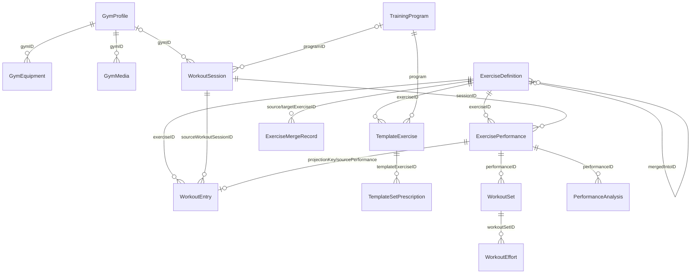
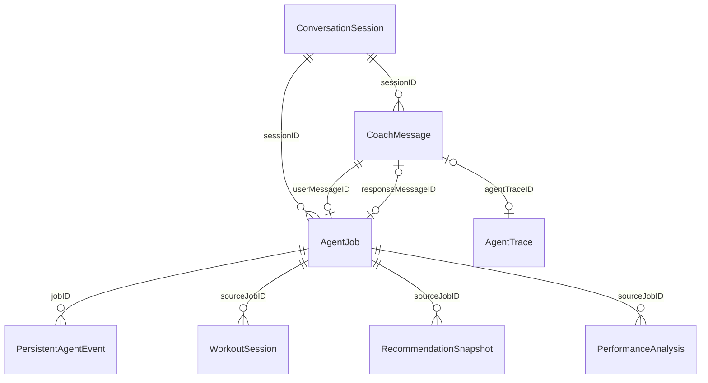
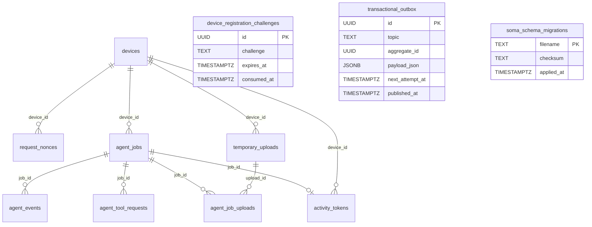

# 数据库结构与 ER 图

本文维护 Soma 当前持久化结构的可审查快照，覆盖设备端 SwiftData 与可选 Agent Server
的 PostgreSQL。修改模型或 migration 时，必须在同一个变更中同步本文。

- 状态：当前 schema 快照；实现收口后仍需以数据库结构门禁复核
- 最近同步：2026-08-25
- SwiftData 注册来源：[`Soma/App/SomaApp.swift`](../../Soma/App/SomaApp.swift)
- SwiftData 版本与启动迁移来源：[`Soma/Models/SomaDataMigration.swift`](../../Soma/Models/SomaDataMigration.swift)
- SwiftData 字段来源：[`Soma/Models/`](../../Soma/Models)
- PostgreSQL 来源：[`Server/migrations/`](../../Server/migrations)
- 迁移入口：`make db-migrate-create`、`make db-migrate-status`、`make db-migrate`
- 上游依据：
  - [ADR 0073](../archive/0.0.7/adr/0073-independent-set-prescriptions-efforts-and-guided-finalization.md)
  - [ADR 0075](../archive/0.0.7/adr/0075-current-swiftdata-schema-without-historical-versions.md)
  - [ADR 0076](../archive/0.0.7/adr/0076-exercise-owned-laterality-and-target-kind.md)
  - [ADR 0090](../archive/0.0.9/adr/0090-current-state-business-models-and-session-facts.md)
  - [ADR 0000](../adr/0000-origin-through-0.0.11.md) 的动作级计划间歇收口
  - [ADR 0097](../adr/0097-current-baseline-performance-budget-and-cache-invalidation.md)
  - [ADR 0100](../adr/0100-bounded-snapshots-continuous-stream-rendering-and-query-first-data-access.md)
- 相关决策：ADR 0001、0031、0032，以及
  [`训练领域模型与运行时协议`](training-domain-model.md)

## 阅读约定

- SwiftData 部分记录的是应用可依赖的**逻辑结构**。Apple 管理的底层 SQLite 表名、列名和
  内部 metadata 不属于 Soma 契约，也不应被业务代码直接访问。
- 训练关系使用 `@Relationship(deleteRule: .nullify)` 配合稳定 UUID 锚点，避免 SwiftData 迁移期
  反向阻断；Store 负责显式级联、媒体回收、动作 deny/归档和一对一投影校验。模型关系可空是
  框架迁移兼容，不代表新业务写入允许缺少关系。
- 身体业务模型对 Agent 和 UI 暴露 `businessID: Int64` 作为领域身份；既有 UUID 仅作为设备内
  迁移锚点、媒体/来源引用和旧备份映射，不再进入模型 Tool 协议。Session、Turn、Job、Trace、
  Event、媒体与外部来源身份继续使用 UUID/String。
- PostgreSQL 部分记录 migration 实际建立的物理表、列、外键、唯一约束与索引。
- `Date` 与 `TIMESTAMPTZ` 都表示绝对时间戳。用户时区只在格式化展示时参与，不写入时间字段。
- `Data` 字段是 Codable 值的二进制封装；其载荷类型列在“编码字段”一节。
- `?` 表示可空；没有 `?` 的 Swift 字段由模型初始化器提供值，但不等价于公开 SQL `NOT NULL`。

## 设备端 SwiftData

个人空间与演示空间各自使用独立 `ModelContainer`，当前注册完全相同的 28 个模型。两个空间
不能互相连接，也不启用 CloudKit。App 启动时先迁移个人空间、再迁移演示空间；两者均写入并
复核当前 `DataMigrationMarker` 前，根界面与 Agent 队列都不会挂载。

磁盘库由 `SomaStoreOpening` 以 `Schema(SomaDataSchema.models)` 打开，不传入
`migrationPlan`。缺少的可选列由系统轻量推断补齐。打开后启动门禁再展开旧聚合处方、建立
Effort、修复关系/投影键、收敛当前计划、分配业务 ID 并写入 schema version 6 marker。打开路径见
[ADR 0075](../archive/0.0.7/adr/0075-current-swiftdata-schema-without-historical-versions.md)；任一数据空间
失败时不开放业务 Root。

schema version 6 marker 是当前唯一安装基线。启动先用 `key + schemaVersion` 谓词和
`fetchLimit = 1` 检查 marker；命中后立即返回，不再扫描业务表。marker 尚未完成时才执行当前
收口步骤并在完整校验通过后写入。缓存与性能边界见
[ADR 0097](../adr/0097-current-baseline-performance-budget-and-cache-invalidation.md)。

### 用户、场馆与外部同步

<!-- schema-model: ExternalSyncCursor | id,source,stream,cursorData,updatedAt -->
| 模型 | 持久字段 | 关键约束或语义 |
| --- | --- | --- |
| `ExternalSyncCursor` | `id: UUID`、`source: String`、`stream: String`、`cursorData: Data?`、`updatedAt: Date` | 每个来源与数据流维护独立游标。 |
| <!-- schema-model: UserProfile | id,businessID,updatedAt,displayName,biologicalSexRaw,birthDate,age,height,referenceWeight,fitnessGoal,healthNotes --> `UserProfile` | `businessID: Int64?`、`id: UUID`（迁移锚点）及身体资料字段 | `age` 只用于旧数据兼容；可由生日推导时不应成为新事实来源。 |
| <!-- schema-model: GymProfile | id,businessID,name,createdAt,notes,coverImagePath,isCurrent,latitude,longitude,locationLabel,locationAccuracy,locationUpdatedAt,matchRadiusMeters --> `GymProfile` | `businessID: Int64?`、`id: UUID`（迁移锚点）及场馆字段 | 每个数据空间只能有一个当前健身房，由共享规则维护。 |
| <!-- schema-model: GymEquipment | id,businessID,gymID,name,category,capabilities,confidence,imagePath,createdAt --> `GymEquipment` | `businessID: Int64?`、`id: UUID`（迁移锚点）、`gymID: UUID` 及设备字段 | `gymID → GymProfile.id`；后续关系迁移前保留旧锚点。 |
| <!-- schema-model: GymMedia | id,gymID,path,createdAt --> `GymMedia` | `id: UUID`、`gymID: UUID`、`path: String`、`createdAt: Date` | `gymID → GymProfile.id`；`path` 是独立逻辑媒体引用。相同内容允许由不同路径通过硬链接复用物理文件，单条记录删除不会破坏其他引用。 |

### 用户记录

<!-- schema-model: MealEntry | id,businessID,date,mealTypeRaw,title,calories,protein,carbs,fat,totalSugar,glycemicSpeedRaw,glycemicAssessment,itemsData,nutritionSourceRaw,notes,imagePath,mediaAttachmentsData,confidence,sourceTurnID,sourceSessionID -->
| 模型 | 持久字段 | 关键约束或语义 |
| --- | --- | --- |
| `MealEntry` | `id: UUID`、`date: Date`、`mealTypeRaw: String`、`title: String`、`calories: Int?`、`protein: Double?`、`carbs: Double?`、`fat: Double?`、`totalSugar: Double?`、`glycemicSpeedRaw: String?`、`glycemicAssessment: String`、`itemsData: Data`、`nutritionSourceRaw: String`、`notes: String`、`imagePath: String?`、`mediaAttachmentsData: Data`、`confidence: Double`、`sourceTurnID: UUID?`、`sourceSessionID: UUID?` | 未确认营养值保持为空；总糖包含天然糖与添加糖；升糖速度只表示成对保存的餐食组成定性估算，修改菜品时清空旧评估。来源字段连接创建它的聊天 turn/session。 |
| <!-- schema-model: BodyEntry | id,businessID,date,weight,bodyFat,waist,notes,imagePath,mediaAttachmentsData,analysis,externalSource,externalID,sourceTurnID,sourceSessionID --> `BodyEntry` | `businessID: Int64?`、`id: UUID`（迁移锚点）及身体记录字段 | `externalSource + externalID` 用于外部导入去重，由 Store 维护。 |
| <!-- schema-model: WorkoutEntry | id,businessID,date,exercise,exerciseID,exerciseDefinition,sets,reps,weight,setEntriesData,restSeconds,durationMinutes,notes,mediaKindRaw,mediaPath,mediaAttachmentsData,formScore,intensity,feedback,estimatedCalories,calorieMET,calorieDurationMinutes,calorieDurationEstimated,externalSource,externalID,sourceTurnID,sourceSessionID,sourceWorkoutSessionID,sourcePerformanceID,projectionKey,sourcePerformance --> `WorkoutEntry` | `businessID: Int64?`、`id: UUID`（迁移锚点）、训练字段、动作关系、来源关系及唯一 `projectionKey` | 带练投影使用 `guided-performance:<uuid>`；其余记录使用 `entry:<uuid>`。unique 索引保留，启动迁移必须先补齐空 key，不能把多个 `nil` 留给 SwiftData 校验。热量投影保留 MET、计算时长、估算标记和结果，不维护算法版本；UUID 来源继续用于旧备份映射与审计。 |

### 动作库与训练计划

<!-- schema-model: ExerciseDefinition | canonicalNameKey,id,businessID,canonicalName,createdAt,updatedAt,archivedAt,mergedIntoID,coachingNotes,primaryMusclesData,secondaryMusclesData,movementPatternsData,muscleDiagramAssetName,userDemoVideosData,guidanceVideosData,imageReferencesData,lateralityRaw,targetKindRaw -->
| 模型 | 持久字段 | 关键约束或语义 |
| --- | --- | --- |
| `ExerciseDefinition` | `canonicalNameKey: String [unique]`、`id: UUID`、`canonicalName: String`、`createdAt: Date`、`updatedAt: Date`、`archivedAt: Date?`、`mergedIntoID: UUID?`、`coachingNotes: String`、`primaryMusclesData: Data`、`secondaryMusclesData: Data`、`movementPatternsData: Data`、`muscleDiagramAssetName: String?`、`userDemoVideosData: Data`、`guidanceVideosData: Data`、`imageReferencesData: Data`、`lateralityRaw: String`、`targetKindRaw: String` | `mergedIntoID` 是动作合并后的自引用；规范名键唯一。内容字段只保存当前状态。空的 `lateralityRaw`/`targetKindRaw` 表示尚未配置，展示时按全身和按次数解释。 |
| <!-- schema-model: ExerciseMergeRecord | id,businessID,sourceExerciseID,targetExerciseID,sourceName,affectedWorkoutIDsData,affectedTemplateExerciseIDsData,affectedPerformanceIDsData,affectedRecommendationIDsData,transferredUserDemoVideosData,transferredGuidanceVideosData,transferredImageReferencesData,createdAt,undoneAt --> `ExerciseMergeRecord` | `businessID: Int64?`、迁移锚点与可撤销合并快照 | 保存动作合并的受影响对象和可撤销媒体信息。 |
| <!-- schema-model: TrainingProgram | id,businessID,name,overview,statusRaw,prescriptionGroupID,scheduleHint,createdAt,updatedAt,templateExercises --> `TrainingProgram` | `businessID: Int64?`、迁移锚点、当前计划字段与 cascade 动作关系 | 当前计划直接拥有处方，不维护版本号或版本链。 |
| <!-- schema-model: TemplateExercise | id,businessID,prescriptionGroupID,exerciseID,program,exerciseDefinition,order,targetSets,targetReps,targetWeightKG,targetRestSeconds,restBetweenSidesSeconds,firstSetIsWarmup,equipmentKind,notes,lateralityRaw,setPrescriptions --> `TemplateExercise` | `businessID: Int64?`、当前计划关系、动作级两类计划间歇、从动作定义复制的 `lateralityRaw` 及独立组集合 | `targetRestSeconds` 是组间歇，`restBetweenSidesSeconds` 只对左右分开有效；`prescriptionGroupID` 是旧列无损迁移锚点，新业务通过 `program` 关系读取。 |
| <!-- schema-model: TemplateSetPrescription | id,businessID,templateExerciseID,templateExercise,order,kindRaw,targetKindRaw,targetReps,targetDurationSeconds,targetWeightKG,leftWeightKG,rightWeightKG,restBetweenSidesSeconds,restAfterSetSeconds,notes --> `TemplateSetPrescription` | 独立逻辑组的类型、次数/时长、逐侧重量与备注；两类旧间歇列仅兼容读取 | `templateExerciseID` 是迁移锚点，`templateExercise` 是业务关系；当前计划间歇写入 `TemplateExercise`，新组处方不写旧间歇列。 |
| <!-- schema-model: WorkoutSession | id,businessID,startedAt,endedAt,gymID,programID,programNameSnapshot,prescriptionSnapshotData,statusRaw,guidedPhaseRaw,currentPerformanceID,currentSetID,currentEffortID,phaseStartedAt,phaseDeadlineAt,transitionRevision,restStartedAt,restTargetEndAt,autoRecordingPolicyRaw,queuedRecordingEffortID,automaticRecordingPaused,automaticRecordingPauseCodeRaw,automaticRecordingPauseReason,sourceTurnID,sourceJobID,performances --> `WorkoutSession` | `businessID: Int64?`、不可变处方快照、当前 Performance/Set/Effort、录像恢复状态及动作集合 | `transitionRevision` 是状态机并发令牌，不是业务版本；录像预约及带 code/reason 的暂停原因可跨 View 重建恢复；Performance 为 cascade 子项。 |
| <!-- schema-model: ExercisePerformance | id,businessID,sessionID,session,exerciseID,exerciseDefinition,exerciseName,order,prescriptionSnapshotData,statusRaw,notes,activeVideoPath,activeVideoKindRaw,workoutProjectionSuppressed,projectedWorkout,workoutSets --> `ExercisePerformance` | `businessID: Int64?`、Session/动作关系、执行字段、逻辑组集合和可空投影 | 业务上每个终态 Performance 最多一条投影；兼容视频路径同步保存 complete/partial kind；用户删除后 suppression 阻止复活。 |
| <!-- schema-model: WorkoutSet | id,businessID,performanceID,performance,order,kindRaw,laterality,plannedReps,plannedTargetKindRaw,plannedDurationSeconds,plannedWeightKG,plannedRestSeconds,restBetweenSidesSeconds,actualReps,actualDurationSeconds,actualWeightKG,actualRestSeconds,statusRaw,startedAt,completedAt,recordedVideoPath,recordedVideoKindRaw,efforts --> `WorkoutSet` | 逻辑组、Performance 关系、目标类型、兼容聚合值、组级状态与 Effort 集合 | V5 实际证据读取 cascade Effort；兼容聚合路径同步保存 complete/partial kind，旧数据缺 kind 按 complete 解释。 |
| <!-- schema-model: WorkoutEffort | id,businessID,workoutSetID,workoutSet,order,sideRaw,targetKindRaw,plannedReps,plannedDurationSeconds,plannedWeightKG,actualReps,actualDurationSeconds,actualWeightKG,actualRestSeconds,statusRaw,startedAt,completedAt,recordedVideoPath,recordedVideoKindRaw --> `WorkoutEffort` | `none/left/right` 原子执行的目标、实际值、状态、时间、视频路径与证据种类 | `.both` 由同一 Set 下 left/right 两条表达；`recordedVideoKindRaw` 区分 complete/partial，旧路径缺 kind 按 complete；缺失实际字段保持 `nil`。 |
| <!-- schema-model: RecommendationSnapshot | id,businessID,targetKind,targetID,inputFingerprint,advice,createdAt,sourceJobID --> `RecommendationSnapshot` | `businessID: Int64?`、分析输入指纹与建议 | 目标锚点留作本地迁移/审计；模型侧使用解析后的业务 ID。 |
| <!-- schema-model: PerformanceAnalysis | id,businessID,performanceID,sourceMediaPath,inputFingerprint,evidence,limitations,feedback,createdAt,sourceJobID --> `PerformanceAnalysis` | `businessID: Int64?`、证据、局限与反馈字段 | 目标锚点留作本地迁移/审计；模型侧使用解析后的业务 ID。 |

### 对话与 Agent 运行时

<!-- schema-model: ConversationSession | id,startedAt,updatedAt,title,titleSourceRaw,businessDate,businessTimeZoneIdentifier -->
| 模型 | 持久字段 | 关键约束或语义 |
| --- | --- | --- |
| `ConversationSession` | `id: UUID`、`startedAt: Date`、`updatedAt: Date`、`title: String`、`titleSourceRaw: String?`、`businessDate: Date?`、`businessTimeZoneIdentifier: String?` | 聊天会话根对象；标题来源区分本地兜底、模型生成和用户手动，旧库空值按兜底解释。标题编辑不改变最近活动时间。 |
| <!-- schema-model: CoachMessage | id,date,sessionID,isFromCoach,text,mediaKindRaw,mediaPath,mediaAttachmentsData,recordTypeRaw,agentTraceID,agentStatusRaw,agentEventsData,agentTurnItemsData,turnID,attemptNumber,locationData,effectiveGymID,manualCorrectionSummary --> `CoachMessage` | `id: UUID`、`date: Date`、`sessionID: UUID?`、`isFromCoach: Bool`、`text: String`、`mediaKindRaw: String`、`mediaPath: String?`、`mediaAttachmentsData: Data`、`recordTypeRaw: String?`、`agentTraceID: UUID?`、`agentStatusRaw: String?`、`agentEventsData: Data`、`agentTurnItemsData: Data`、`turnID: UUID?`、`attemptNumber: Int`、`locationData: Data`、`effectiveGymID: UUID?`、`manualCorrectionSummary: String?` | 同一响应气泡覆盖重试状态；结构化记录修正摘要进入消息上下文。 |
| <!-- schema-model: AgentTrace | id,startedAt,endedAt,statusRaw,provider,model,endpoint,dataSpaceRaw,userInput,contextSnapshot,mediaKindRaw,imageCount,imageAttachmentCount,videoAttachmentCount,finalAnswer,errorMessage,spansData,turnID,attemptNumber --> `AgentTrace` | `id: UUID`、`startedAt: Date`、`endedAt: Date?`、`statusRaw: String`、`provider: String`、`model: String`、`endpoint: String`、`dataSpaceRaw: String`、`userInput: String`、`contextSnapshot: String`、`mediaKindRaw: String`、`imageCount: Int`、`imageAttachmentCount: Int`、`videoAttachmentCount: Int`、`finalAnswer: String?`、`errorMessage: String?`、`spansData: Data`、`turnID: UUID?`、`attemptNumber: Int` | 每次远程 attempt 一条 trace；不保存 reasoning 内容。 |
| <!-- schema-model: AgentMutationReceipt | key,turnID,signature,resultData,createdAt,statusRaw --> `AgentMutationReceipt` | `key: String [unique]`、`turnID: UUID`、`signature: String`、`resultData: Data`、`createdAt: Date`、`statusRaw: String` | 本地业务 Tool 写入的幂等回执。 |
| <!-- schema-model: AgentJob | clientJobKey,id,turnID,sessionID,userMessageID,responseMessageID,dataSpaceRaw,backendRaw,stateRaw,userText,mediaAttachmentsData,contextSnapshotData,createdAt,updatedAt,completedAt,activeAttemptNumber,submissionAttemptCount,nextRetryAt,lastError,remoteJobID,remoteEventCursor,remoteRequestAttempt,leaseOwner,leaseExpiresAt,leaseEpoch,lastEventSequence,chatProjectionCursor,traceProjectionCursor,liveActivityProjectionCursor,notificationProjectionCursor,responseTextSnapshot,lastCompletedStep,loopCheckpointData,loopStartedAt,loopActiveDuration,loopActiveStartedAt,firstStepDeadlineConsumed,executionKindRaw,deterministicPayloadData,turnSentAt,effectiveBusinessDate,businessTimeZoneIdentifier,defaultOccurredAt,selectedSkillID,selectedShortcutID --> `AgentJob` | durable ReAct Job 字段，以及冻结的 `turnSentAt`、`effectiveBusinessDate`、时区、`defaultOccurredAt`、`selectedSkillID` 与 `selectedShortcutID` | 排队、恢复和跨午夜重试复用原始 Turn 默认发生时间；自然语言日期覆盖只属于当前 Turn；快捷按钮决定本 Turn 的工具曝光。 |
| <!-- schema-model: PersistentAgentEvent | eventKey,id,jobID,turnID,sequence,attemptNumber,kindRaw,payloadData,createdAt --> `PersistentAgentEvent` | `eventKey: String [unique]`、`id: UUID`、`jobID: UUID`、`turnID: UUID`、`sequence: Int`、`attemptNumber: Int`、`kindRaw: String`、`payloadData: Data`、`createdAt: Date` | Job 的语义事件日志；`jobID + sequence` 形成消费顺序，`eventKey` 负责幂等。 |
| <!-- schema-model: ConversationCompactionSummary | sessionKey,id,sessionID,summary,coveredTurnIDsData,strategyRaw,updatedAt --> `ConversationCompactionSummary` | `sessionKey: String [unique]`、摘要、覆盖 Turn 和策略 | Loop 前滚动替代更早对话；最近 10 对保持原生消息。 |
| <!-- schema-model: DataMigrationMarker | key,schemaVersion,completedAt --> `DataMigrationMarker` | `key: String [unique]`、`schemaVersion: Int`、`completedAt: Date` | 每个数据空间独立的启动迁移完成证明。 |
| <!-- schema-model: BusinessIDSequence | namespace,nextValue,updatedAt --> `BusinessIDSequence` | `namespace: String [unique]`、`nextValue: Int64`、`updatedAt: Date` | 每实体、每数据空间独立分配 Int64 业务 ID。 |

### SwiftData 编码字段

| 字段 | Codable 载荷 |
| --- | --- |
| `ExternalSyncCursor.cursorData` | 外部 provider 自有 cursor 数据 |
| `MealEntry.itemsData` | `[MealItem]`，每项包含稳定 ID、名称、可选份量、热量、三大宏量与 `totalSugar: Double?` |
| 各记录与消息的 `mediaAttachmentsData` | `[MediaAttachmentReference]` |
| `WorkoutEntry.setEntriesData` | `[WorkoutSetEvidence]`；V5 可含 logical set index、side、kind、target kind、reps/duration、重量、休息与录像 |
| `ExerciseDefinition.primaryMusclesData`、`secondaryMusclesData`、`movementPatternsData` | `[String]` |
| `ExerciseDefinition.userDemoVideosData` | `[MediaAttachmentReference]` |
| `ExerciseDefinition.guidanceVideosData` | `[ExerciseVideoSource]` |
| `ExerciseDefinition.imageReferencesData` | `[ExerciseImageReference]` |
| `ExerciseMergeRecord` 的 `affected…IDsData` | `[UUID]` |
| `ExerciseMergeRecord` 的 `transferred…Data` | 对应的 media、video 或 image reference 数组 |
| `WorkoutSession.prescriptionSnapshotData` | `[TemplateExercisePrescription]`；动作级保存两类计划间歇，`plannedSets` 保存独立组目标 |
| `ExercisePerformance.prescriptionSnapshotData` | `TemplateExercisePrescription`，旧聚合字段继续可解码 |
| `CoachMessage.agentEventsData` | `[AgentTraceSpan]` |
| `CoachMessage.agentTurnItemsData` | `[AgentTurnItem]` |
| `CoachMessage.locationData` | `LocationSnapshot` |
| `AgentTrace.spansData` | `[AgentTraceSpan]` |
| `AgentMutationReceipt.resultData` | `AgentToolResult` |
| `AgentJob.contextSnapshotData` | `AgentJobContextSnapshot` |
| `AgentJob.loopCheckpointData` | `AgentLoopCheckpoint` |
| `AgentJob.deterministicPayloadData` | `ExerciseQuickRecordDraft` |
| `PersistentAgentEvent.payloadData` | `PersistentAgentEventPayload` |

### SwiftData ER 图

图中只画主要引用，`sourceTurnID`、`sourceSessionID`、`sourceJobID` 等审计来源字段不重复展开。

补充关系：`RecommendationSnapshot.targetKind + targetID` 是多态引用；
`AgentMutationReceipt.turnID`、记录的 `sourceTurnID` 与消息的 `turnID` 用于幂等和审计，
但它们不是指向单一实体行的外键。

## Agent Server PostgreSQL

Server 只保存远程执行所需的 Job、Event、设备认证与短期上传数据，不保存训练、饮食、体重、
健身房等身体业务事实。以下 11 张表是所有 migration 依次应用后的当前结果，其中
`soma_schema_migrations` 仅保存 migration 文件名、checksum 与执行时间。

### 表与列

<!-- schema-table: device_registration_challenges | id,challenge,expires_at,consumed_at -->
| 表 | 列 | 约束摘要 |
| --- | --- | --- |
| <!-- schema-table: soma_schema_migrations | filename,checksum,applied_at --> `soma_schema_migrations` | `filename TEXT`、`checksum TEXT`、`applied_at TIMESTAMPTZ` | PK `filename`；迁移器内部 registry，checksum 固定为 SHA-256。 |
| `device_registration_challenges` | `id UUID`、`challenge TEXT`、`expires_at TIMESTAMPTZ`、`consumed_at TIMESTAMPTZ?` | PK `id`；一次性设备注册 challenge。 |
| <!-- schema-table: devices | id,public_key_pem,attestation_key_id,created_at,revoked_at --> `devices` | `id UUID`、`public_key_pem TEXT`、`attestation_key_id TEXT?`、`created_at TIMESTAMPTZ`、`revoked_at TIMESTAMPTZ?` | PK `id`。 |
| <!-- schema-table: request_nonces | device_id,nonce,expires_at --> `request_nonces` | `device_id UUID`、`nonce TEXT`、`expires_at TIMESTAMPTZ` | 复合 PK `(device_id, nonce)`；`device_id → devices.id ON DELETE CASCADE`。 |
| <!-- schema-table: agent_jobs | id,device_id,client_job_id,turn_id,session_id,state,body_digest,input_json,last_sequence,acknowledged_sequence,lease_owner,lease_epoch,lease_expires_at,created_at,updated_at,terminal_at,content_deleted_at,error_code --> `agent_jobs` | `id UUID`、`device_id UUID`、`client_job_id UUID`、`turn_id UUID`、`session_id UUID`、`state agent_job_state`、`body_digest TEXT`、`input_json JSONB?`、`last_sequence INTEGER`、`acknowledged_sequence INTEGER`、`lease_owner TEXT?`、`lease_epoch INTEGER`、`lease_expires_at TIMESTAMPTZ?`、`created_at TIMESTAMPTZ`、`updated_at TIMESTAMPTZ`、`terminal_at TIMESTAMPTZ?`、`content_deleted_at TIMESTAMPTZ?`、`error_code TEXT?` | PK `id`；unique `(device_id, client_job_id)`；设备删除级联。 |
| <!-- schema-table: agent_events | id,job_id,sequence,kind,phase,payload_version,payload_json,created_at --> `agent_events` | `id UUID`、`job_id UUID`、`sequence INTEGER`、`kind TEXT`、`phase TEXT`、`payload_version INTEGER`、`payload_json JSONB`、`created_at TIMESTAMPTZ` | PK `id`；unique `(job_id, sequence)`；Job 删除级联。 |
| <!-- schema-table: agent_tool_requests | id,job_id,tool_call_id,tool_name,schema_version,arguments_json,mutation,expires_at,result_digest,result_json,completed_at --> `agent_tool_requests` | `id UUID`、`job_id UUID`、`tool_call_id UUID`、`tool_name TEXT`、`schema_version INTEGER`、`arguments_json JSONB`、`mutation BOOLEAN`、`expires_at TIMESTAMPTZ`、`result_digest TEXT?`、`result_json JSONB?`、`completed_at TIMESTAMPTZ?` | PK `id`；unique `(job_id, tool_call_id)`；Job 删除级联。 |
| <!-- schema-table: temporary_uploads | id,device_id,content_type,expected_bytes,expected_digest,object_key,completed_at,created_at,deleted_at --> `temporary_uploads` | `id UUID`、`device_id UUID`、`content_type TEXT`、`expected_bytes BIGINT`、`expected_digest TEXT`、`object_key TEXT`、`completed_at TIMESTAMPTZ?`、`created_at TIMESTAMPTZ`、`deleted_at TIMESTAMPTZ?` | PK `id`；`object_key` unique；设备删除级联。 |
| <!-- schema-table: agent_job_uploads | job_id,upload_id --> `agent_job_uploads` | `job_id UUID`、`upload_id UUID` | 复合 PK `(job_id, upload_id)`；两侧删除都级联。 |
| <!-- schema-table: activity_tokens | job_id,device_id,environment,encrypted_token,last_pushed_sequence,created_at --> `activity_tokens` | `job_id UUID`、`device_id UUID`、`environment TEXT`、`encrypted_token TEXT`、`last_pushed_sequence INTEGER`、`created_at TIMESTAMPTZ` | PK/FK `job_id`；`environment ∈ {development, production}`；设备与 Job 删除级联。 |
| <!-- schema-table: transactional_outbox | id,topic,aggregate_id,payload_json,created_at,next_attempt_at,published_at,attempt_count --> `transactional_outbox` | `id UUID`、`topic TEXT`、`aggregate_id UUID`、`payload_json JSONB`、`created_at TIMESTAMPTZ`、`next_attempt_at TIMESTAMPTZ`、`published_at TIMESTAMPTZ?`、`attempt_count INTEGER` | PK `id`；`topic ∈ {job, apns, cleanup}`；`aggregate_id` 不设外键以支持多聚合类型。 |

`agent_job_state` 枚举值：`accepted`、`queued`、`running`、`waitingForDevice`、
`completed`、`failed`、`cancelled`、`expired`。

### PostgreSQL 索引

| 索引 | 定义 | 用途 |
| --- | --- | --- |
| `agent_jobs_worker_idx` | `agent_jobs(state, lease_expires_at, created_at)` | Worker 领取可执行 Job。 |
| `agent_jobs_retention_idx` | `agent_jobs(created_at, terminal_at, content_deleted_at)` | 内容保留与清理扫描。 |
| `agent_events_job_id_sequence_key` | unique `agent_events(job_id, sequence)` | 唯一约束自带的 btree 同时服务按 Job cursor 的等值加范围查询；`002` 删除了重复普通索引。 |
| `temporary_uploads_retention_idx` | `temporary_uploads(created_at, deleted_at)` | 临时上传清理。 |
| `transactional_outbox_pending_idx` | `transactional_outbox(next_attempt_at, created_at) WHERE published_at IS NULL` | 发布未完成的 outbox 事件。 |
| `request_nonces_expiry_idx` | `request_nonces(expires_at)` | 清理过期请求 nonce。 |
| `device_registration_challenges_expiry_idx` | `device_registration_challenges(expires_at)` | 清理过期注册 challenge。 |
| `devices_revoked_idx` | `devices(revoked_at) WHERE revoked_at IS NOT NULL` | 清理达到保留期限的已撤销设备。 |
| `activity_tokens_device_idx` | `activity_tokens(device_id)` | 按设备撤销 Live Activity token。 |
| `transactional_outbox_aggregate_idx` | `transactional_outbox(aggregate_id)` | 按 Job 聚合清理 outbox。 |

### PostgreSQL ER 图

`device_registration_challenges` 在完成注册前不绑定设备行；
`transactional_outbox.aggregate_id` 是应用层多态聚合引用，因此两者在 ER 图中保持独立。

## 维护流程

1. SwiftData 变更以 `@Model` 源码和 `SomaApp` 的 `Schema` 注册为事实来源。当前只打开
   `SomaDataSchema`，不维护历史 VersionedSchema 链。追加可选列依赖无 plan 的轻量推断；
   不兼容变更必须新增 ADR，并明确启动门禁回填或数据重建，不能只靠打开时静默改写业务事实。
2. PostgreSQL 结构变更先运行 `make db-migrate-create name=<snake_case_name>`，只编辑生成的
   新 migration。禁止直接改目标数据库，也禁止修改或删除已经执行并登记 checksum 的文件。
3. 在同一个提交中更新本文对应字段、约束、编码载荷和 ER 关系。删除或重命名字段时说明
   旧数据兼容、迁移或明确的数据重建策略。
4. 模型字段涉及时间时只持久化时间戳；涉及用户事实时保持 `nil` 语义；涉及媒体时只记录
   沙盒路径或受控对象引用，不嵌入真实媒体或密钥样例。
5. 运行 `ruby scripts/check-database-schema-doc.rb`。脚本会核对所有 `@Model`、
   `ModelContainer` 注册、SwiftData 持久字段，以及全部 migration 的表和列。
6. PostgreSQL 部署前用 `DATABASE_URL=… make db-migrate-status` 审查 pending 集合，再运行
   `DATABASE_URL=… make db-migrate`。现有旧数据库只允许在人工核对后显式 baseline。
7. 完成前运行 `make check`；代码或 migration 变更继续运行 `make verify`，并按变更风险验证
   个人/演示空间隔离、旧数据兼容、级联删除与幂等行为。

隐藏的 `schema-model` / `schema-table` 注释是自动门禁使用的结构化清单，不要手动删除；
正文仍需解释类型、关系和语义，不能只为通过脚本更新注释。
