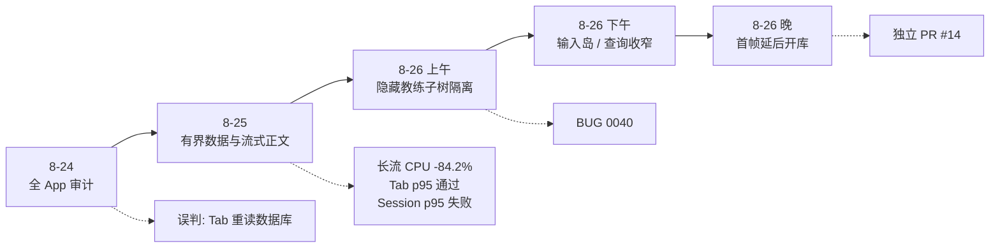
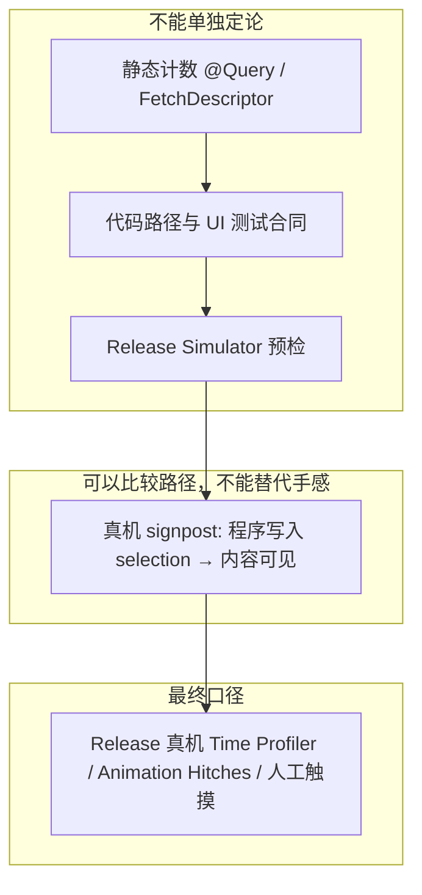
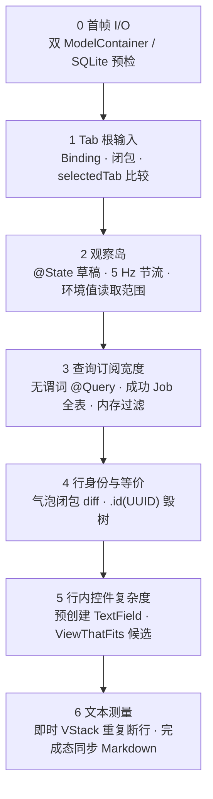
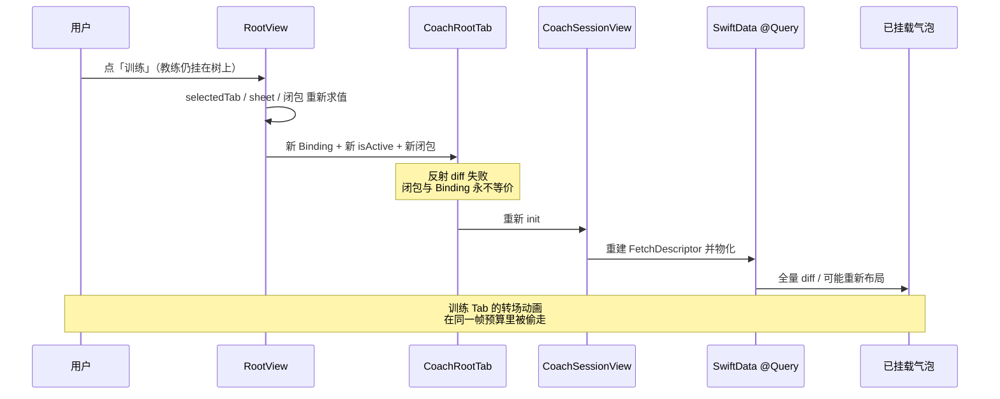
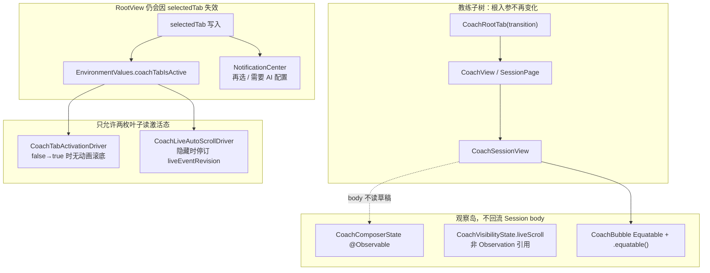
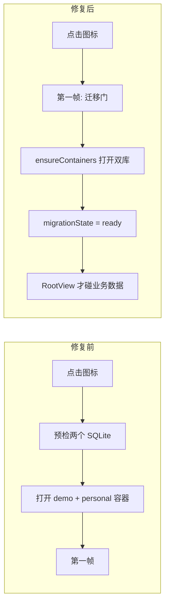
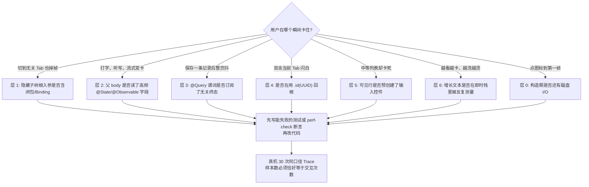

# Soma 性能优化经验教训：有界数据、渲染隔离与首帧诚实（2026-08-26）

- 状态：综合复盘；8-24/8-25 有 Release 真机预算数据，8-26 渲染隔离、冷启动与当前真实 Session 回归已落地
- 日期：2026-08-26
- 目标设备口径：iPhone 17 Pro Max，iOS 26.3.1，Release，120 Hz 严格档
- 数据边界：自动夹具只使用内存数据库和虚构内容；真实 Session 复验只记录匿名区间，不记录 ID、标题、正文或截图
- 修订自：
  - [全 App 性能审计报告（2026-08-24）](performance-audit-2026-08-24.md)
  - [本轮性能优化收尾与踩坑报告（2026-08-25）](performance-optimization-retrospective-2026-08-25.md)
- 上游依据：
  - [ADR 0000](../adr/0000-origin-through-0.0.11.md) 收口的真机预算与有界数据访问规则
  - [ADR 0100](../adr/0100-bounded-snapshots-continuous-stream-rendering-and-query-first-data-access.md)
  - [BUG 0040](../bugs/0040-hidden-coach-subtree-tab-invalidation.md)
- 下游落地：[真机性能录制：一次安装，多次复用](device-performance-profiling.md)

本文把 2026 年 8 月下旬 Soma 的性能工作收成一份可复用的工程判断：哪些假设被数据推翻，哪些修复真正降低了主线程工作，哪些「看起来更快」其实是测量污染，以及下一轮应该从哪条失败预算开始，而不是再做一轮无边界扫描。

---

## 1. 这篇文档要回答什么

Soma 是聊天优先、本地优先的 iOS 私人身体智能。教练页是默认入口，四个 Tab（教练、训练、进展、设置）必须同时流畅。用户能感知的失败很具体：长流式后发热、切 Tab 掉帧、切回教练看不到最新消息、双击「教练」整页闪一下、冷启动首帧被磁盘拖住。

三轮工作之后，真正稳定下来的结论只有三条：

1. **卡顿的主因很少是「又读了一遍数据库」。** 更常见的是隐藏子树仍在做 AttributeGraph 更新、布局和文本测量。
2. **保留 View 身份不等于缓存已经排版完成的像素。** Tab 栈还在，并不表示切回来是零成本。
3. **只有把失效范围收成「可见叶子」之后，有界查询和懒布局才会兑现。** 否则查询已经变窄，整页仍会按 5 Hz 重算。

预算本身没有改。[ADR 0000](../adr/0000-origin-through-0.0.11.md) 仍然要求：warm 常用交互 p95 小于 100 ms，冷页首个有效内容 p95 小于 200 ms，滚动 hitch 小于 1%；缺少真机 Trace 时不得宣称量化达标。

---

## 2. 时间线：四次纠偏，而不是一次「全盘优化」

| 批次 | 用户可见问题 | 当时的第一判断 | 被证据修正后的机制 | 产出 |
| --- | --- | --- | --- | --- |
| 8-24 审计 | 切 Tab / 进 Session 卡 | 切换时重新打开或全表读取 SwiftData | 切换不重开库；成本在查询宽度、`body` 派生、同步解码、文本测量 | [审计报告](performance-audit-2026-08-24.md) |
| 8-25 收口 | 长流发热、饮食卡卡死、进展空白 | 「消息太多」或「Markdown 太重」 | 即时 `VStack` 重复断行；单卡预创建几十个 `TextField`；快照 revision 错乱 | [BUG 0034](../bugs/0034-large-session-inline-editor-render-hang.md)–[0037](../bugs/0037-insights-snapshot-stale-and-overfetch.md)、[ADR 0100](../adr/0100-bounded-snapshots-continuous-stream-rendering-and-query-first-data-access.md) |
| 8-26 渲染隔离 | 教练内容稍多，*所有* Tab 动画掉帧 | 教练页自己卡，或仍是查询问题 | 隐藏教练根带着 Binding/闭包，Root 任意 state 变化都会整树求值 | [BUG 0040](../bugs/0040-hidden-coach-subtree-tab-invalidation.md)、PR [#13](https://github.com/hedon954/soma/pull/13) |
| 8-26 首帧 | 点击图标到第一帧偏慢 | 迁移回填太重（8-25 已部分处理） | 构造期同步打开演示+个人两个 `ModelContainer` | PR [#14](https://github.com/hedon954/soma/pull/14) |

合并顺序是先 #13、再 #14：渲染隔离改变的是运行时失效图，冷启动改变的是首帧 I/O 位置，不要混成一次提交。

---

## 3. 证据口径：什么算数，什么不算

性能讨论如果混用 Simulator、signpost、手指触摸和「看起来没卡」，下一轮一定会把已经证伪的假设再做一遍。Soma 最终采用五层证据，越往上越能对用户负责：

| 证据 | 能证明 | 不能证明 |
| --- | --- | --- |
| `make perf-check` 与单元测试 | 已知反模式没有回来；身份、谓词、等价策略仍在 | 120 Hz、hitch、发热 |
| `CoachTabBehaviorUITests` | 切回教练仍 `nearBottom=true`；再选教练后分页窗口仍在（树没有被 `.id(UUID)` 毁掉） | 切换动画是否掉帧 |
| Simulator 10 轮 Tab 预检 p95 61 ms | 路径可跑通 | 真机 120 Hz 预算 |
| 真机 30 轮 / 120 次 Tab signpost | App 渲染路径的 p50/p95 | 真实手指识别耗时；像素是否已经排版完毕 |
| 35 秒长流 Time Profiler | 主线程 CPU、单核负载、热状态 | 完成态 Markdown 悬崖（必须走真实完成夹具，见 BUG 0036） |

8-26 当前分支补充了 Release 真机证据：10 轮共 40/40 个 Tab 样本 p95 `76.677 ms`；用户最近
两个真实 Session 往返 3 轮共 6/6 次切换 p95/最大值 `160.873 ms`，跨两个 Session 的 12 次
长内容滚动为 0 actual hitch、0 个 `>=33 ms` 潜在延迟。该证据满足当前回归验收。

---

## 4. 被推翻的心智模型

### 4.1 「切 Tab 会重新读数据库」

四个 Tab 一直保留各自的 `NavigationStack`。8-25 真机采样没有把 SwiftData 打开或全库读取指到切换热点。Time Profiler 上的主线程成本集中在 AttributeGraph 更新/布局、Lazy stack 测量、TextKit 与 CoreText。

这个误判昂贵：它会把人推向「切换时禁止查询」或「全局关掉动画」，而真正吃掉帧预算的是**已经挂在树上、只是暂时看不见的教练子树**。

### 4.2 「View 还在，所以切回来是免费的」

SwiftUI 可以保留 `@State` 和导航栈，但子树重新可见时仍会执行属性更新、diff、布局和文本测量。正确目标不是零工作，而是：

- 工作有界，只与**当前可见内容**相关；
- 隐藏子树的输入保持稳定，使 SwiftUI 可以跳过 `body`；
- 重新可见时的工作低于 100 ms p95，而不是「看起来像瞬时切换」。

Airbnb 把同一件事说得更形式化：SwiftUI 默认用反射比较存储属性来决定要不要重算 `body`；一旦视图携带闭包、非 `Equatable` 引用或每次重建的 `Binding`，比较必然失败，整棵子树成为不可 diff 的热点。[1](#ref-airbnb)

### 4.3 「消息数量 = 会话成本」

[BUG 0034](../bugs/0034-large-session-inline-editor-render-hang.md) 的故障 Session 只有 12 条消息，正文不足 1 KB。真正热点是最新饮食卡为十道菜同时创建菜名、热量、份量和多项营养值的原生 `TextField`，再被 `ViewThatFits` 做成多套候选布局。一次切换就能在主线程上集中产生几十个 TextKit 输入控件。

性能排查必须同时记录**行数**和**每行的控件/布局复杂度**。

---

## 5. 一张图看清成本落在哪一层

把 Soma 的主线程成本从外到内分成七层。每一轮有效修复都只打穿其中一层；打错层会得到「代码改了很多、Trace 几乎不动」的结果。

| 层 | 典型症状 | 8 月对应修复 | 若只修下一层会怎样 |
| --- | --- | --- | --- |
| 0 首帧 | 点图标后白屏/门面卡住 | #14：磁盘容器移到首帧之后 | 运行时流畅，冷启动仍慢 |
| 1 Tab 根 | *所有* Tab 动画被教练拖死 | #13：`CoachRootTab` 只收稳定引用 | 教练隐藏时仍整树求值，查询再窄也救不了切换 |
| 2 观察岛 | 打字、听写、流式 tick 重建会话页 | `CoachComposerState`；节流迁出 `@State` | 气泡 Equatable 会被父层高频失效抵消 |
| 3 查询宽度 | 保存一次 Job/训练就带动无关页 | 谓词化、`fetchLimit`、`fetchCount`、排除 `succeeded` Job | 订阅集合仍在变，行 diff 永远有活干 |
| 4 行身份 | 双击教练闪白、滚动位置丢失 | `.restoreCoachRoot`；`CoachBubble: Equatable` | 根已稳定，父层 state 仍重排全部历史气泡 |
| 5 控件复杂度 | 中等 Session 却卡死退出 | 按需单字段编辑器 | 行 Equatable 比的是「整张卡」，卡本身仍然极重 |
| 6 文本测量 | 越流越卡、完成后整 App 顿一下 | 256 字符尾块、`LazyVStack`、单一 TextKit 文本面 | 分块只省了字符串构造，测量仍是 O(全文) |

经验法则：**先证明失效从哪一层漏下来，再改那一层。** 不要从「感觉慢的控件」开始改。

---

## 6. 第一波：把数据访问和文本测量变成有界工作

这一波的产品决策已经写入 [ADR 0100](../adr/0100-bounded-snapshots-continuous-stream-rendering-and-query-first-data-access.md)：快照必须带 revision，流式正文必须是连续文本面，数据库访问必须查询优先，而不是先全表再过滤。

### 6.1 查询形状，而不是查询条数

静态 `@Query` 从 77 降到 42；`RootView` 常驻查询降为 0。`FetchDescriptor` 文本引用从 262 **增加到** 332——这是把「取全表后内存过滤」拆成更多按 ID、状态、日期、Session 的定向谓词，不代表读取量上升。

计数类指标改走 `fetchCount`。进展页再也不为「足迹数量」物化上千条消息。[BUG 0037](../bugs/0037-insights-snapshot-stale-and-overfetch.md) 同时修了另一类静默失败：后台 `ModelContext` 保存被旧的 context 实例过滤漏掉，页面永远空白，直到用户切走再回来。

### 6.2 长流：分块只完成了一半

第一轮把增长正文收成「稳定冻结块 + 可变尾块」，消除了全文字符串反复构造。同一 35 秒虚构长流里，内层即时 `VStack` 仍在尾块变化时测量全部冻结正文，CoreText / `NSOptimalLineBreaker` 持续重复断行。主线程 CPU 几乎没掉。

真正下降发生在第二刀：正文块改 `LazyVStack`、每块固定纵向理想尺寸、尾块从 768 收到 256 字符。Apple 在 WWDC26 的懒栈专题里把原因说死了——`LazyVStack` 只布局可见区加预取，离屏尺寸靠估计；即时栈会保留整棵内容树。[2](#ref-wwdc-lazy)

[BUG 0036](../bugs/0036-long-stream-continuous-text-and-completion-cliff.md) 又补了第三刀：无换行长段落会让「按换行冻结」失效；完成态若在主线程同步解析整棵 Markdown，会制造一次性能悬崖。产品层仍是一条 `CoachMessage`；内部改成单一 TextKit 文本面，增量只追加后缀，Markdown 在后台准备。

### 6.3 8-25 Release 真机数据

目标设备：iPhone 17 Pro Max，120 Hz，Release。长流夹具为虚构 35 秒增长正文。

| 场景 | 改造前 | 改造后 | 结论 |
| --- | ---: | ---: | --- |
| 长流 35 秒总 CPU | 6.047 s | 0.998 s | −83.5% |
| 长流 35 秒主线程 CPU | 6.004 s | 0.950 s | **−84.2%** |
| 流式 5 秒后主线程单核 | 16.785% | 2.643% | 15 秒后仍为 2.649%，不再随正文反弹 |
| 长流 Animation Hitches | 文本/布局热点 | actual hitch 0；>33 ms 潜在延迟 0 | 36.28 秒热状态全程 Nominal |
| 四 Tab 30 轮 / 120 次 | 旧口径潜在延迟 p95 164.636 ms | p50 63.480 ms，**p95 82.731 ms**，max 100.921 ms | 当前 &lt;100 ms 门禁通过 |
| 返回教练 | 方向性样本曾到 578–592 ms | 30 次 p50 74.509 ms，**p95 98.877 ms** | p95 通过，单次 max 略高于 100 ms |
| Session 30 轮 / 60 次 | 无同口径基线 | p50 92.454 ms，**p95 354.505 ms** | **&lt;200 ms 失败，明确延期** |
| 8-26 当前真实 Session | 8-25 批次 p95 354.505 ms | 6/6 次 p50 142.172 ms，**p95/max 160.873 ms**；12 次滚动 0 hitch | 当前回归通过 |

四 Tab 分方向：

```mermaid
xychart-beta
  title "四 Tab 切换 p50 / p95 / max（ms）"
  x-axis ["训练", "进展", "设置", "教练"]
  y-axis "毫秒" 0 --> 120
  bar [72.114, 51.241, 60.082, 74.509]
  bar [83.661, 54.704, 65.094, 98.877]
  bar [89.260, 57.844, 66.721, 100.921]
```

冷启动当时只拿到 27 个完整生命周期，与旧版 30 次不完全同间隔，只能当方向性证据：初始化→首帧 p95 180.079 → 162.684 ms（−9.7%）；初始化→foreground-active p95 608.506 → 486.797 ms（−20.0%）。#14 要回答的，是这条曲线上仍然同步发生的双库打开。

---

## 7. 测量本身也会制造卡顿

8-25 复盘把自动化踩坑写得很细，这里只保留会改变设计决策的几条。

### 7.1 关掉动画不是优化

全局 `UIView.setAnimationsEnabled(false)` 让 Simulator 看起来像「单帧替换」。真机上选中反馈延迟、样式异常，教练的布局成本一个字节都没少。该路径已删除，并由 `make perf-check` 禁止恢复。

这不是 Soma 的独特教训。任何把「用户看不见过渡」当成「工作量为零」的手法，测的都是视觉抑制，不是 workload reduction。

### 7.2 signpost 区间 ≠ 像素已经稳定

Tab 自动化测量的是「程序写入 `selectedTab` 到内容可见」。它稳定、可重复，适合回归比较 App 渲染路径；它不包含手指识别，也不证明隐藏子树在不可见期间没有干活。8-26 的掉帧发生在**其他 Tab 的切换动画期间**，signpost 仍可能显示「教练方向 p95 &lt; 100 ms」——因为被吃掉的是训练/进展自己的动画帧。

### 7.3 驱动器会污染被测路径

XCUITest 若查询长聊天的完整 Accessibility 子树，主线程会构造大量语义文本。旧脚本一度把「测试自己的遍历」写进了 App 的卡顿里。最终 harness 改为 App 内环境变量驱动 selection，并用内存虚构数据隔离个人库。

代价必须写在报告里：最终数字比较的是渲染区间，不能替代人工触摸验收。

### 7.4 空 Trace、Runner 崩溃、锁屏等待都不是性能样本

`SomaUITests-Runner` 在 `XCTRunnerDaemonSession` 初始化失败（code 74）时，得到的是测试基础设施故障。锁屏状态下启动编译或 xctrace，得到的是空等。按进程名 attach 存在发现竞态。现行协议见 [真机性能录制](device-performance-profiling.md)：安装一次、按 PID 附着、校验 TOC/`<run>`/`<data>`、样本数必须恰好等于交互次数。

---

## 8. 第二波：隐藏子树如何吃掉别人的动画预算

8-25 已经把返回教练的方向性长尾从约 580 ms 压到 p95 98.877 ms，但维护者在真实使用里仍能感到：教练内容稍多之后，**训练 ↔ 进展 ↔ 设置** 的切换动画也会掉帧。这不是「教练页自己卡」，而是隐藏教练子树仍在参与每一次 Root 失效。

### 8.1 修复前：一次 Tab 点击如何穿过整棵教练树

三个独立机制叠在一起，记录在 [BUG 0040](../bugs/0040-hidden-coach-subtree-tab-invalidation.md)：

1. **根输入不稳定。** `CoachRootTab` 携带 `Binding<RootSheet?>`、`isActive: selectedTab == .coach` 和每次 `body` 新造的闭包。SwiftUI 对非 `Equatable` 视图按字段反射比较；闭包与 Binding 必然失败，于是 Root 的任意 state 变化都会沿着 `CoachRootTab → CoachView → CoachSessionPage → CoachSessionView` 重新求值。
2. **再选教练用身份炸弹实现回根。** `tabStackIDs[.coach] = UUID()` 更换 `.id()`，销毁整棵导航树：`@State` 全丢、`@Query` 重建、全部气泡重排。教练子树里唯一的推入页只有健身房，完全不需要毁树。
3. **5 Hz 节流写在 `@State` 上。** `lastLiveScrollAt` / `liveScrollTask` 每个流式 tick 都写，把「只更新实时回复叶子」重新放大成整页失效；隐藏 Tab 仍订阅 `liveEventRevision`。

Swift Forums 上有过几乎同一形状的报告：自定义 `TabView` `Binding` 会让子视图的 `init` 在每次切 Tab 时重跑，而 `$selection` 直接绑定不会。[3](#ref-forums-tab) Soma 的差异是：子树**没有被销毁**，只是每次都重新求值——对长聊天来说，这比销毁更阴险，因为成本随已挂载气泡线性增长，且发生在别人的动画帧里。

### 8.2 修复后：根稳定，叶子读环境值

对应实现选择：

| 旧做法 | 新做法 | 为什么这是最小充分修复 |
| --- | --- | --- |
| `CoachRootTab` 吃 Binding、`isActive`、闭包 | 只保留稳定的 `AppTabTransitionCoordinator` | 根 diff 可以成功，隐藏子树不再随 Root state 重算 |
| 激活态沿参数一路传到 Session | `\.coachTabIsActive` 环境键，仅两枚叶子读取 | 中间层不因 `true/false` 翻转而失效 |
| 需要 AI 配置走闭包上抛 | `.coachRequiresAIConfiguration` 通知 | 与既有 `.prefillCoachDraft` 同一模式，避免再引入闭包字段 |
| 双击教练 `tabStackIDs[.coach] = UUID()` | `.restoreCoachRoot`：关抽屉、收起健身房、滚到底 | 回根语义保留，树身份保留 |
| 切到教练不滚最新 | 激活驱动写既有 `scrollRequest` | 不新造滚动通道 |
| 节流在 `@State` | 非 Observation 的 `liveScroll` 引用 | 写时间戳不再触发 Session `body` |

`.equatable()` 仍然显式加上，而不是只声明 `Equatable`。Fatbobman 指出：自定义 `==` 要成为 SwiftUI 的比较路径，通常需要 `.equatable()` / `EquatableView` 把视图包进这条路径；否则运行时仍可能走反射。[4](#ref-fatbobman) Soma 的 `==` 比较消息对象身份和渲染 flags，**闭包不参与**——这与 Airbnb 把 action handler 标成跳过项是同一条规则。[1](#ref-airbnb)

聊天列表的身份策略与 Stream 的 SwiftUI 消息列表一致：用稳定业务 ID，而不是「每次父层更新都换行身份」；Stream 甚至用周期性 `.id` 来**主动释放**过长列表的历史状态，那是内存策略，不是回根策略。[5](#ref-stream) Soma 把 `.id(UUID)` 用在再选 Tab 上，等于每次点「教练」都执行一次 Stream 说的内存释放——用户看到的就是整页重建。

切回教练要看到最新消息，依赖程序化滚动而不是「希望列表还停在底部」。iOS 18 的 `defaultScrollAnchor(_:for:)` 把初始偏移、尺寸变化和对齐拆成不同 role；短会话顶部对齐、长会话贴底，是 `.initialOffset` 与 `.alignment` 的组合，而不是在 `onAppear` 里抢一次 `ScrollViewProxy`。[6](#ref-scroll-anchor)

### 8.3 这一层如何验证（在还没有新的真机 p95 之前）

- 静态：`scripts/check-performance-hotpaths.rb` 锁定「教练根不得携带 per-render 入参」「不得写 `tabStackIDs[.coach]`」「必须存在环境键与 Equatable 气泡」。
- 单测：`AppTabReselectTests` 四种效果各自唯一；`CoachBubbleEquatableTests` 证明闭包不参与 `==`。
- UI：`CoachTabBehaviorUITests` 走完长流夹具后切走再切回，断言 `nearBottom=true` 且可见条数仍为分页窗口（20）。再选教练后窗口仍在，证明树没有被重建。该测试挂在 `SomaPerformance` scheme，不进入默认 `make test`。

真机 Animation Hitches 仍待复测。在那之前，不得把 8-25 的 Tab p95 自动延长为「8-26 隔离后仍然通过」。

---

## 9. 第三波：输入岛、廉价全局赢、查询再收一刀

根隔离之后，Session `body` 仍可能被**自己的**高频输入打穿。这一波不再动 Tab 架构，只把仍然回流到会话页的观察源拆走。

### 9.1 打字是最高频的用户路径

草稿原先是 `CoachSessionView` 的 `@State`。每一次按键、每一次听写 partial，都会让会话页 `body` 重算，再 diff 全部气泡——即便气泡已经 `Equatable`。

修复是标准的观察岛：`@Observable CoachComposerState` 作为引用放在父层，**会话页 `body` 不读取它的任何字段**；只有 `CoachComposer` 以 `@Bindable` 消费。动作建议在输入区内局部计算。语音识别对相同 transcript 做等值守卫，避免 partial 以相同字符串反复写。

这与 Airbnb「把大 `body` 拆成可 diff 的小视图」是同一件事，只是拆分轴是**状态所有权**，不是视觉区块。[1](#ref-airbnb) Observation 的粒度规则也一致：谁读了字段，谁才失效；父视图为了把 `Binding` 传下去而去读 `draft`，等于把隔离作废。

### 9.2 廉价、局部、可证明的赢

这些改动单独看都不像「架构」，但它们都在渲染路径上按键级或滚动级触发：

| 热点 | 原成本 | 修复 |
| --- | --- | --- |
| 训练历史日期头 | 每次 `body` 构造 `DateFormatter` | 静态 formatter |
| 肌群受力图 | 每次绘制解析 SVG path | `SVGPath.cachedCGPath`，按固定资产缓存 |
| 动作库「最近训练」`.task` | 以整表 UUID 数组当 task key，打字就哈希约 2000 个 ID | key 改为 `(definitionCount, revision)` |
| 教练 `AgentJob` `@Query` | limit 100 的数据空间级订阅；每次 Job 保存（含成功历史）都重新物化 | 谓词排除 `succeeded`；保留 failed/cancelled（重试语义依赖它们） |
| 带练努力判定 | 相机/协调器 tick 时按 ID 回查 SwiftData | `shouldCaptureEffort` / `remainingEffortSeconds` 复用视图 `@Query` 里已有的对象 |

### 9.3 明确没有改的东西

性能审计很容易变成「能改的都改」。下面这些被代码审过并保持现状，因为正确性风险或收益不成比例：

| 保留 | 原因 |
| --- | --- |
| Agent 逐事件 `save()` | 崩溃恢复的至少一次检查点，是运行时契约，不是漏掉的批量优化 |
| `beginCurrentSet` 连续两次 save | 录像时序雷区（BUG 0019–0026），省一次 save 换回方向/掐断 bug 不值得 |
| 相机旋转几何「相等则跳过」 | 旋转低频；跳过要处理连接替换与首次应用，方向 bug 密度高于收益 |
| 把 `liveEventRevision` 收成纯文本 | Span 卡出现也需要滚底跟随 |
| 历史分组快照、动作详情投影快照 | 交互频度级且有界；快照会引入「编辑日期后列表过期」 |
| 训练计划详情的 workouts 实时查询 | 从本页开始训练返回后指纹必须刷新 |
| 身体信息 `onAppear` 的 limit-1 读取 | 改 `.task` 会让表单首帧空白闪一下 |

**没有改，也要写进报告。** 否则下一轮 Agent 会把同一份列表再扫一遍，并在录像路径上「顺便」合并两次 save。

---

## 10. 第四波：首帧只画门面，开库放到第一帧之后

Apple 对启动时间的公开建议始终是同一句：把文件 I/O、存储初始化和非首帧所需的工作移出「点击图标 → 第一帧」。[7](#ref-launch) Soma 在 8-25 已经把 schema marker 命中后的整表回填、演示填充和媒体去重移出了根交互之前；但 `DataSpaceController.init` 仍在 `SomaApp` 的 `@State` 构造期同步做两件事：

1. 对 `default.store` 与 `PersonalData.store` 做 SQLite 投影键预检；
2. 打开两个 `ModelContainer`（schema 校验 + 文件 I/O）。

库越大、预检越可能写修复，这段串行 I/O 越长。极端情况下它靠近系统 watchdog 窗口，而用户看见的只是图标已经点下去、屏幕还没有第一帧。

#14 的修复故意很小：

- 磁盘容器改为首帧之后、既有 `runLaunchMigration()` 里的 `ensureContainers()` 打开；
- 第一帧立刻呈现本来每次冷启动都会出现的迁移门，spinner 在开库期间保持可绘制；
- 打开失败的恢复语义不变：仍是「无法打开本地数据」+ 清空全部库重试，或迁移失败时只清空个人库；
- 测试内存容器保持同步打开，夹具语义不变。

这不是「启动再快 50%」的承诺。8-25 的冷启动数字是方向性的，且 #14 尚未做 30 次 terminate-existing 对比。它只纠正一个明确的反模式：**首帧之前不要打开两份业务数据库。**

所有容器消费方本来就挂在 `migrationState == .ready` 之后；`activeContainer` 在 ready 前访问仍是 `preconditionFailure`。外显产品行为不变，变的是第一帧是否还在等磁盘。

---

## 11. 可复用的最佳实践（带来源）

下面这些不是「SwiftUI 技巧清单」，而是 Soma 已经付过学费、并且用门禁或测试锁住的判断。来源标注的是规则出处；Soma 的数据只为证明这条规则在本仓库成立。

| # | 实践 | Soma 中的落点 | 来源 |
| ---: | --- | --- | --- |
| P1 | 视图要可 diff：闭包、临时 Binding、每次重建的 action 不得进入默认比较 | `CoachRootTab` 稳定入参；`CoachBubble ==` 忽略闭包 | Airbnb Engineering, *Understanding and Improving SwiftUI Performance*[1](#ref-airbnb) |
| P2 | 声明了 `Equatable` 仍应显式 `.equatable()`，确保走自定义 `==` | 气泡挂载 | Fatbobman, *Using equatable() to Avoid the NavigationLink Pre-Build Pitfall*[4](#ref-fatbobman) |
| P3 | Tab 选择使用稳定 `$selection`；不要用自定义 `Binding` 拦截再选 | 再选改通知，不改 Binding 身份 | Swift Forums #84575[3](#ref-forums-tab) |
| P4 | 不要用 `.id(UUID)` 表达「回到根」。身份变化等于毁树 | `.restoreCoachRoot` | Stream, *How Our iOS Team Built the SwiftUI SDK Message List*（稳定 ID；周期性 `.id` 只用于内存释放）[5](#ref-stream) |
| P5 | 懒栈只布局可见区；增长文本不要放进即时 `VStack` | 长流 `LazyVStack` + 固定理想高度 | WWDC26 session 321[2](#ref-wwdc-lazy) |
| P6 | 程序化滚动用系统锚点 role，不要在 `onAppear` 里与用户手势抢同一个 proxy | 短内容顶部对齐、长内容贴底；激活时 `scrollRequest` | Use Your Loaf / Nil Coalescing / Apple `defaultScrollAnchor(_:for:)`[6](#ref-scroll-anchor) |
| P7 | 高频输入状态不得被列表父视图读取 | `CoachComposerState` 观察岛 | Airbnb 拆分 `body`[1](#ref-airbnb)；Observation 按访问失效 |
| P8 | `@Query` 的谓词就是订阅范围。排除与 UI 无关的终态 | 教练 Job 排除 `succeeded` | [ADR 0100](../adr/0100-bounded-snapshots-continuous-stream-rendering-and-query-first-data-access.md) 查询优先 |
| P9 | 计数走 `fetchCount`，明细走有界窗口，快照走后台 actor + revision | 进展页、训练历史 10+1 哨兵 | 同上；[BUG 0037](../bugs/0037-insights-snapshot-stale-and-overfetch.md) |
| P10 | 控件按需创建。默认态禁止为「以后可能编辑」预热 TextKit | 饮食卡单字段编辑器 | [BUG 0034](../bugs/0034-large-session-inline-editor-render-hang.md) |
| P11 | 首帧之前禁止业务存储 I/O | #14 异步 `ensureContainers()` | Apple, *Reducing your app's launch time*[7](#ref-launch) |
| P12 | 禁止用关闭动画、空 Trace、Runner 崩溃或锁屏等待当性能证据 | `perf-check` 禁 `setAnimationsEnabled`；录制协议按 PID 附着 | 8-25 复盘 §5–§6；[真机录制协议](device-performance-profiling.md) |
| P13 | `Task.yield()` 只能让路，不能取消工作 | 次要刷新让出 selection 帧，同时必须减查询/减控件 | 8-25 复盘 §5.6 |
| P14 | 缓存只保存访问后的不可变纯值，不缓存 SwiftData 模型，不预热未打开 Session | 64 项消息渲染缓存、48 MB 图片、4 MB Markdown | [ADR 0000](../adr/0000-origin-through-0.0.11.md) §24；8-25 复盘 §3 |

---

## 12. 下次再遇到卡顿，按这个顺序查

这是把上面七层成本翻成可执行的排查单。新的性能任务应从这里开始，而不是重新 `grep @Query`。

配套纪律：

1. **先复盘上一份失败产物。** manifest、xcresult、crash log 里已经有 Runner 故障时，不要再开一次三分钟空录制。
2. **先写回归门禁，再写修复。** BUG 0040 的价值一半在 `check-performance-hotpaths.rb`：没有它，下一次「方便地把 `isActive` 传回 CoachRootTab」会静默回来。
3. **正确性雷区标成明确不改。** 录像、Agent 检查点、相机几何不接受顺手重构。
4. **Simulator 只做路径预检。** 120 Hz、hitch、热状态以 Release 真机为准。
5. **报告必须区分：** 代码已落地、UI 合同已通过、真机预算已通过。三者不能互相替代。

---

## 13. 当前收口与后续专项

8-25 收口时按维护者要求停止。8-26 收口了当时点名的教练掉帧、切回滚底、双击不重建、真实
Session 切换与滚动，以及启动路径上的双库同步打开。后续专项不阻塞本次回归结论。

| 优先级 | 项 | 当前证据 | 下一步 |
| --- | --- | --- | --- |
| 已完成 | Session 切换与滚动回归 | 当前真实 Session 6/6、p95/max **160.873 ms**；12 次滚动 0 hitch | 本次验收通过，不追加重复采样 |
| 已完成 | 8-26 隔离后的 Tab 回归 | 40/40 个样本，p95 **76.677 ms** | 本次验收通过，不追加重复采样 |
| P1 | 冷启动严格 before/after | 8-25 只有 27 个完整样本；#14 尚未对比 | 30 次 terminate-existing，只比「初始化→首帧」，不与旧批次混算 |
| P1 | SwiftUI Instrument / Allocations | Simulator RSS 无单调增长 ≠ 真机 | 同一路径 30 轮 |
| P1 | 全路径滚动 hitch | 只完成长流 0 hitch | 训练/进展/设置分别录 Animation Hitches |
| P1 | 真实触摸手感 | 自动化不含手指识别 | 个人 Session 往返、长按重命名、单字段编辑、长流后滚动 |
| P2 | Session 分析器按方向拆分 | 当前总体分布已通过 | 仅在再次出现方向性长尾时补匿名标签 |

8-25 的 Session 失败 Trace 仍保留为历史证据；8-26 当前真实 Session 回归已经通过。只有再次出现
方向性长尾时，才从同一匿名 signpost 路径继续定位，不再无边界扫描。

---

## 14. 一句话收口

Soma 这三周的性能工作，不是把 App「优化快了」，而是反复把同一个错误从不同层赶出去：

> 把不可见的工作当成免费的，把身份变化当成导航，把测量污染当成加速。

当隐藏教练子树不再参与别人的动画帧、输入不再重建消息列表、查询不再订阅已经成功的历史、第一帧不再打开两份数据库时，当前真实 Session 与 Tab 回归也回到了预算内。后续优化只由新的可复现证据触发。

---

## 参考资料

1. Airbnb Engineering, *Understanding and Improving SwiftUI Performance*. 反射 diff、闭包导致不可比较、自定义 `Equatable` 与拆分 `body`。https://medium.com/airbnb-engineering/understanding-and-improving-swiftui-performance-37b77ac61896
2. Apple, WWDC26 session 321, *Dive into lazy stacks and scrolling with SwiftUI*. 懒栈只布局可见区与预取；即时栈保留整棵内容树；程序化滚动依赖稳定单子视图身份。https://developer.apple.com/videos/play/wwdc2026/321/
3. Swift Forums, *Why does a custom Binding in TabView trigger re-initialization of child View models, while a direct Binding does not?* https://forums.swift.org/t/why-does-a-custom-binding-in-tabview-trigger-re-initialization-of-child-view-models-while-a-direct-binding-does-not/84575
4. Fatbobman, *Using equatable() to Avoid the NavigationLink Pre-Build Pitfall*. 自定义 `==` 需要 `.equatable()` 才能成为比较路径。https://fatbobman.com/en/posts/using-equatable-to-avoid-the-navigationlink-pre-build-pitfall/
5. Stream, *How Our iOS Team Built the SwiftUI SDK Message List*. 稳定消息身份、`LazyVStack`、周期性 `.id` 仅用于释放内存而不是导航。https://getstream.io/blog/build-message-list-swiftui/
6. Keith Harrison (Use Your Loaf), *SwiftUI Default Scroll Anchor*；Natalia Panferova (Nil Coalescing), *Modern SwiftUI APIs for programmatic scrolling*；Apple, `defaultScrollAnchor(_:for:)`。https://useyourloaf.com/blog/swiftui-default-scroll-anchor/ · https://nilcoalescing.com/blog/ModernSwiftUIAPIsForProgrammaticScrolling · https://developer.apple.com/documentation/swiftui/view/defaultscrollanchor(_:for:)
7. Apple, *Reducing your app's launch time*. 将存储初始化与非首帧工作移出启动关键路径。https://developer.apple.com/documentation/xcode/reducing-your-app-s-launch-time

仓库内前驱：

- [全 App 性能审计报告（2026-08-24）](performance-audit-2026-08-24.md)
- [本轮性能优化收尾与踩坑报告（2026-08-25）](performance-optimization-retrospective-2026-08-25.md)
- [真机性能录制：一次安装，多次复用](device-performance-profiling.md)
- [BUG 0034](../bugs/0034-large-session-inline-editor-render-hang.md) · [0035](../bugs/0035-long-stream-text-relayout-thermal-jank.md) · [0036](../bugs/0036-long-stream-continuous-text-and-completion-cliff.md) · [0037](../bugs/0037-insights-snapshot-stale-and-overfetch.md) · [0040](../bugs/0040-hidden-coach-subtree-tab-invalidation.md)
- [ADR 0100](../adr/0100-bounded-snapshots-continuous-stream-rendering-and-query-first-data-access.md)
- PR [#13](https://github.com/hedon954/soma/pull/13) 教练渲染隔离 · PR [#14](https://github.com/hedon954/soma/pull/14) 首帧延后开库
