# Soma UI 设计系统与优化工程报告

- 日期：2026-08-27（训练记录卡片规则更新）
- 产品依据：[PRD 039](../archive/0.0.9/prd/039-frequency-first-dual-theme-ui.md)
- 上游依据：[ADR 0089](../archive/0.0.9/adr/0089-semantic-dual-theme-and-lossless-workout-editor.md)
- 开发规则：`.claude/skills/soma-ui-development/`
- 验证记录：`design-qa.md`

## 1. 最终结论

Soma 的主视觉是黑白，而不是某一种彩色品牌色。深色使用纯黑页面与两级深灰；浅色使用纯白页面
与两级浅灰。彩色只出现在少量类别图标、指标轨迹或状态点，并且由含义决定，不由页面决定。这个
结论同时适用于根导航、聊天、训练、进展、设置、记录编辑和带练。

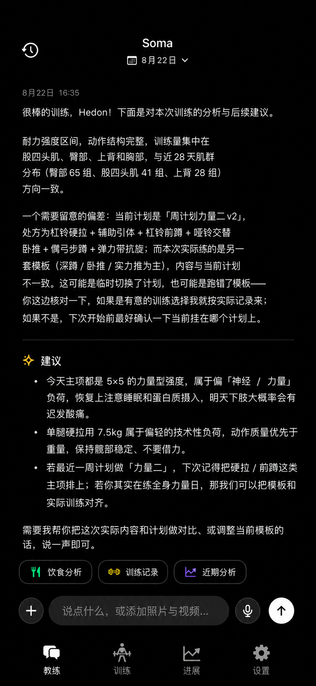
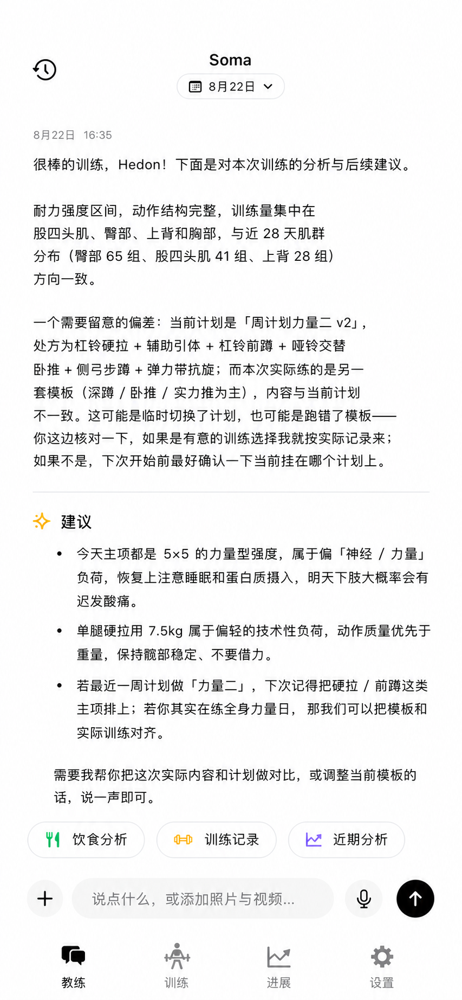

## 2. 设计依据

清晰度由颜色、字重、表面层级、间距和信息顺序共同决定。标题和正文保持克制字重；页面、卡片与
内嵌块形成稳定色阶；相邻区块使用一致节奏；彩色只承担业务语义；设置分组在纯白背景上仍可辨认；
用户气泡不切断阅读；高频功能占据最短路径。

COROS 参考最有价值的不是某个色值，而是纯黑底、清晰卡片色阶、具体指标图标、稳定的指标色、必要
时由阈值驱动的曲线分段、克制留白以及高频任务优先。Soma 保留自己的聊天优先、可审查记录和本地
优先结构，只采用这些可抽象原则。

## 3. 设计系统

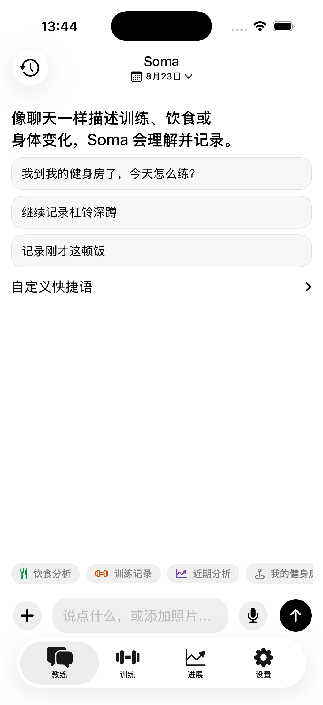
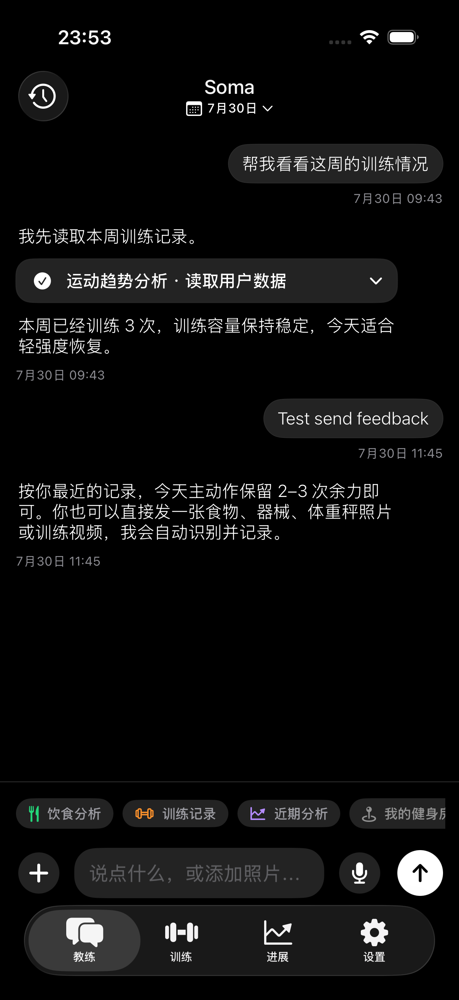

### 3.1 表面

| 角色 | 深色 | 浅色 | 用途 |
| --- | --- | --- | --- |
| page | `#000000` | `#FFFFFF` | 页面、安全区、导航和 TabBar |
| card | `#191919` | `#F7F7F7` | 分组卡和主要信息卡 |
| inset | `#232323` | `#EFEFEF` | 卡内逻辑组、输入、用户消息 |
| separator | `#303030` | `#DCDCDC` | 0.5 pt 边界与细分隔线 |
| primary action | `#FFFFFF` | `#000000` | 黑白主交互 |
| on primary | `#000000` | `#FFFFFF` | 主控件反色前景 |

浅色不是把内容全部放在白色上。纯白只承担页面；浅灰卡形成分组，卡内再用更深一级浅灰。深色同理，
纯黑只承担页面，大块内容落在 `#191919`，编辑或过程块落在 `#232323`。

### 3.2 语义彩色

- 训练类别、容量与负荷：橙色。
- 饮食或明确成功：绿色。
- 身体数据：蓝色。
- 趋势：紫色。
- 训练频率与连续性：青色。
- 恢复：绿色。
- 生命体征与明确异常：珊瑚色。
- 提醒：琥珀色。
- 删除或失败：系统红。

浅色主题在纯白背景上适度提高语义色的明度与饱和度，避免小图标和细数据标记发灰；所有前景继续满足
至少 4.5:1 对比度。语义图标保持清晰实色，不使用阴影、柔光或模糊。暗色主题依靠纯黑背景获得
视觉亮度，保持既定色值。

一张普通卡默认只出现一个非中性色，而且优先只出现在小图标、进度或状态点。业务类别图标必须使用
对应语义色，不能无差别染成黑色；导航、标题、普通按钮和大面积卡片不使用上述颜色建立品牌感。
肌群受力图属于训练语义数据可视化：有效区域、标签和引导线统一使用训练橙，主要/高强度接近实色，
辅助/低强度使用浅橙；骨架与未映射肌群保持中性灰。

颜色由三层角色决定，而不是由控件或页面决定：`AppSemanticRole` 表示记录类别，`AppMetricRole`
表示实际测量指标，`AppStatusRole` 只在确定阈值存在时表示结果状态。训练日与连续性使用频率青，
训练容量和动作容量使用负荷橙，恢复使用恢复绿，表现使用趋势紫，体重使用身体蓝，生命体征使用
珊瑚色。折线、点、柱、面积和热力格继承指标角色；只有阈值、区间或异常点有确定意义时，同一曲线
才使用状态色分段，不能为了丰富而彩虹化。坐标轴、网格与分隔线保持中性。业务入口经
`AppSemanticRole` 和 `SemanticIconBadge` 映射；指标标题经 `AppMetricRole` 和 `MetricHeading`
映射具体图标与颜色，均不能回退为黑白交互 `accent`。

### 3.3 字体与尺寸

- 根标题：Inline/Headline，居中。
- 聊天正文与用户消息：Dynamic Type Subheadline Light。
- 普通列表正文：Subheadline Regular。
- 章节标题与显式强调：Headline 或 Title3 Medium；不使用大面积 Bold/Semibold。
- 时间、位置与辅助文案：Caption/secondary。
- 数值：Monospaced digits。
- 页面左右 16 pt；区块 20 pt；同组 12 pt；卡内 20 pt；编辑卡可用 14 pt。
- 卡片圆角 18 pt；内嵌控件 12 pt；点击目标至少 44×44 pt。

## 4. 根导航与页面信息架构

### 4.1 四个 Tab

顶层固定为教练、训练、进展、设置，每个 Tab 保留自己的导航栈。未选中图标使用线框 SF Symbol，
选中项可以使用 fill 版本和中性选中底。Tab 图标和文字尺寸遵循系统，不用彩色品牌导航或自绘底栏。

### 4.2 教练

AI 回复采用开放阅读版式，避免每段都装进厚重气泡，也不设置重复头像或装饰列。用户消息仍右对齐，
但使用主题 inset 灰；暗色不使用大白块。每条消息下方固定显示日期和时间。输入区只保留加号、文本、麦克风和发送；照片、
视频统一从加号进入。三个快捷 Skill 使用紧凑胶囊，视觉尺寸小但保持 44 pt 触达。

AI 文本不是自由 UI。Prompt 只允许普通 Markdown，本地 `CoachResponseDocument` 解析标题、段落、
分隔线和列表，`CoachResponseView` 再映射成原生布局。建议、分析、训练和提醒标题可以由本地附加
单个语义图标；模型无法插入任意按钮、卡片或 SF Symbol。

### 4.3 训练

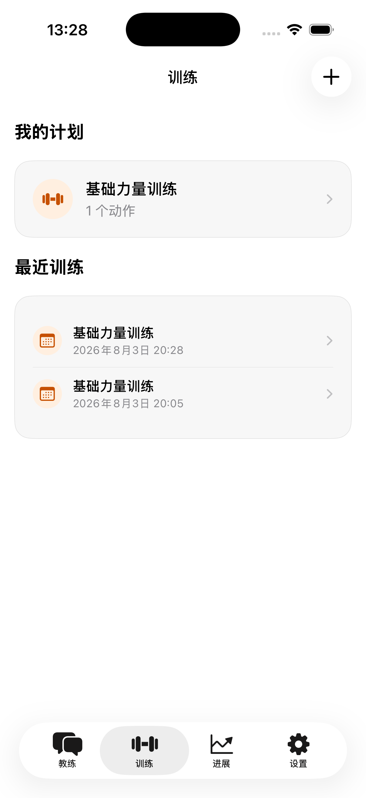
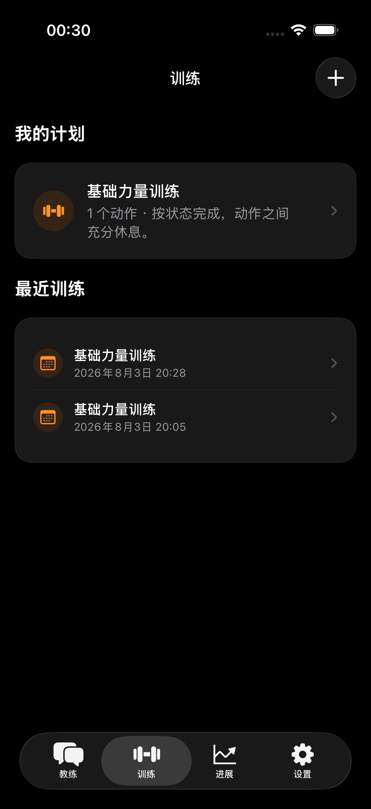

训练页按进行中训练、我的计划、最近训练排列。没有进行中 Session 时不造空卡；新建计划保留右上角
加号，继续或开始训练是一跳操作。计划与最近训练图标使用训练橙和柔和语义底；橙色不扩张为全页主色。

计划详情直接展示并编辑当前名称、安排与动作参数，保存后覆盖当前计划。界面不显示版本号、版本入口、
版本历史、恢复版本或带版本后缀的名称。已开始和已完成训练读取各自不可变的处方快照，因此修改计划只影响
之后开始的训练，不改写历史执行事实。

### 4.4 进展

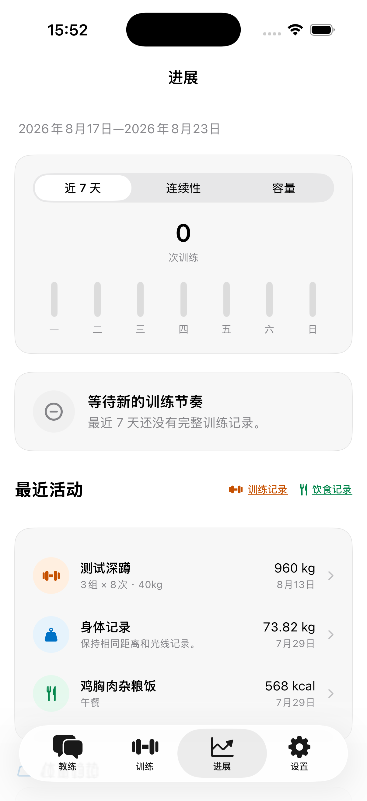
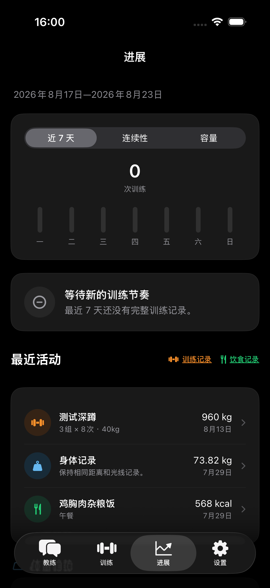

进展用单张训练概览卡分段切换近 7 天、连续性和训练容量，再阅读一条变化结论、最近三项混合活动、
体重趋势和完整数据入口。最近活动标题旁用语义图标与短下划线明确训练记录、饮食记录入口。无可靠证据的指标不补零。
活动按时间混排训练、饮食和身体记录。训练日与连续性使用频率青、训练容量使用负荷橙、
体重曲线使用身体蓝；每个指标显示对应 SF Symbol。数据入口的训练、饮食、身体、足迹和动作库图标
使用各自类别色，颜色不扩张到卡片或导航。

### 4.5 设置

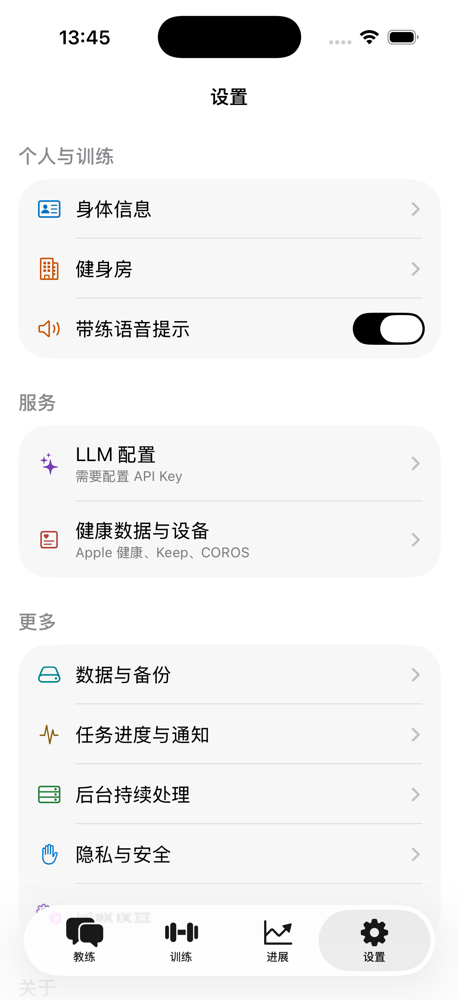
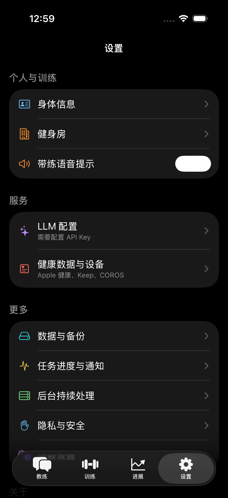

设置按个人与训练、服务、平铺低频入口、显示、关于、反馈排列。任务、后台、数据、隐私和高级入口
直接成组，不再使用没有独立含义的“更多”标题。浅色每组使用 `#F7F7F7` 卡和清晰组间距，分区标题
对齐卡片外沿；反馈输入落在 inset 表面并使用 1 pt separator 边界。因此纯白页面不会与行内容融为
一体。反馈直接位于最后，用户无需深入二级页。

设置项不改文字、SF Symbol 形状、行高或卡片布局，只给现有图标增加功能语义色：身体信息与隐私用
身体蓝，健身房与带练语音用训练橙，LLM 与高级设置用趋势紫，健康设备用生命体征珊瑚，数据备份与
外观用连续性青，任务通知用提醒琥珀，后台持续处理用恢复绿。文字、箭头和 Tab 继续保持中性；Switch
关闭时保持系统中性，开启轨道统一使用正向状态色。图标不增加彩色底块。

## 5. 训练记录与带练

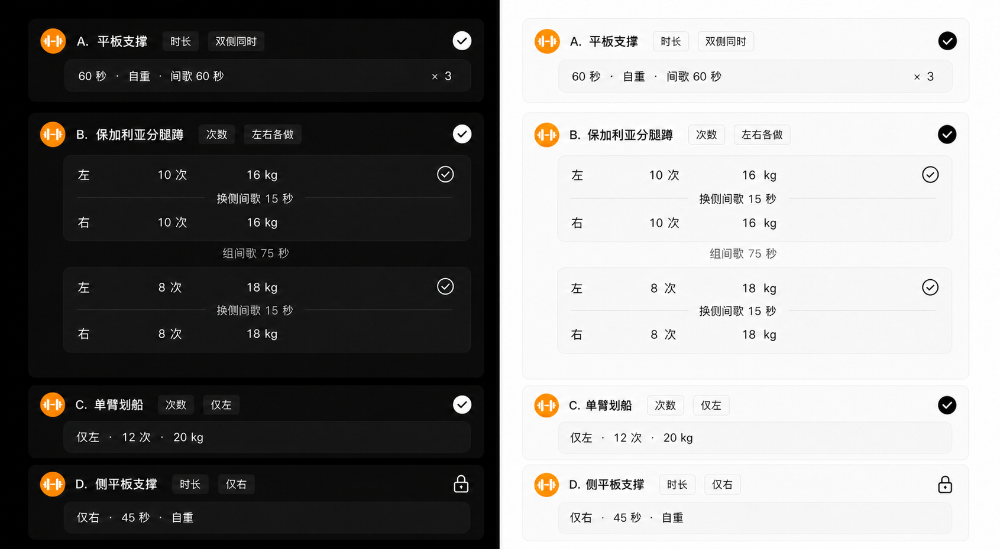

界面把底层 effort 投影为逻辑组，但不把事实聚合丢失。次数/时长和侧别由动作定义统一决定，记录只
保存当次完成证据。双侧同时为一行；左右各做在同一逻辑组内
显示左、右两行；仅左、仅右为紧凑单行。次数、时长、重量、自重、缺失值、换侧间歇和组间间歇
都有确定语义。连续组的侧别、类型、目标、次数/时长和重量相同即可显示 `×N`；间歇不参与压缩，
底层间歇仍原样保留。动作最后一个逻辑组不显示或编辑组间歇，左右动作仍保留换侧间歇，不显示组号。

聊天里的每个动作只使用一张动作卡。标题行依次放置训练语义图标、动作名称、目标类型标签、侧别标签
和保存或锁定状态；动作名称前不加 `A.`、`B.`、`C.` 等顺序前缀。目标类型使用“次数”或“时长”，
侧别使用“双侧同时”“左右各做”“仅左”或“仅右”，每种标签在一张动作卡中只出现一次。内嵌数据块
直接呈现次数或时长、重量与连续组数 `×N`，不再添加一层重复的逻辑组标题或大卡。已保存的
普通、仅左或仅右动作使用单行摘要：左侧为 `60 秒 · 自重`，右侧对齐 `× 3`。一条记录里各组都相同时，组间歇写在完成行里；组与组有差别时，组间歇放在相邻组块中间。
左右各做时，换侧间歇放在同一组卡片里左右记录中间。间歇仍可编辑，不要做成胶囊表单。标题的训练图标使用实心训练橙底与白色图形，
右侧用勾选表达记录已保存；只有真正不可编辑的锁定状态才显示锁。

只有“左右各做”需要在内嵌数据块中显示“左”“右”两条 effort，因为这两行代表不同完成证据；
“仅左”和“仅右”的方向已经由标题标签完整表达，单行数据块不得再次显示“左”“右”或重复
“仅左”“仅右”。上方设计稿只作为布局和层级参考，其中的字母顺序前缀及单侧数据块内重复方向不属于
最终产品规则。

实现分三层：`WorkoutEffortDraft` 保存单条 evidence；`LogicalWorkoutGroupDraft` 组织左右 effort；
`WorkoutRecordDraft` 保持顺序并生成显示 run。保存直接回写 evidence，不从总组数、统一重量或总时长
重建。聊天卡和详情共同使用这套投影；聊天卡去掉重复的逻辑组外层大卡，详情保留标准密度。带练
进度也按动作与逻辑组推进，相机错误只影响录像状态。

### 5.1 计划总览与动作详情

计划动作把组间歇与换侧间歇放在“动作设定”，与左右方式处于同一层；换侧间歇只在左右分开时出现。
独立组只编辑类型、次数或时长、重量与备注，不重复两类计划间歇。连续组压缩不比较间歇；开始训练时
组间歇只编译到非最终逻辑组，换侧间歇编译到左右分开的每个逻辑组。

计划总览先分别累加动作库中的主要和辅助肌群，再按目标组数缩放两类强度；归一化只用于受力图深浅，
不能改变肌群角色。若一个肌群在任一动作中是主要肌群，它只进入主要结论，不在辅助列表重复。

计划动作行使用 56 pt 缩略图、Subheadline Medium 名称和最多两行处方；次数与时长混合时直接提示。
从计划进入动作详情先显示“本计划目标”，因此用户不会把当前处方和最近实际训练误认为同一组数据。
主要肌群、辅助肌群、动作提示、双面受力图和图例说明共同组成“标准动作”里的单一列表行；受力图
是肌群语义的视觉解释，不得另设重复章节，也不得把 Divider、图和图例交给 Form 拆成独立行。
历史区拆为“最近一次 + 容量趋势”和“训练记录”：异构组压缩为 `4×5次 29kg · 1×3次 29kg`，
最近容量与较上次变化位于图外，图表使用训练橙与真实记录日期。容量仍只计算同时具有有效次数与外部重量的完成证据。

## 6. 未采用方案

- 复制 COROS 页面：会引入品牌依赖，也不匹配 Soma 的聊天审查主路径。
- 使用彩色全局主色：会让导航和内容争夺注意力。
- 暗色用户消息使用白色气泡：对比面积过大，阅读被切断。
- 浅色所有表面纯白：设置和列表会融成一片。
- 只换颜色：无法解决字体、间距、顺序和数据真值问题。
- AI 输出任意 UI：不可预测、不可测试，且无法保证无障碍。
- 训练卡只保存聚合值：会覆盖异构组、另一侧与录像证据。
- 为业务记录维护版本链：增加理解和维护成本；当前态直接编辑，历史事实由训练 Session 快照承担。

## 7. 可访问性、隐私与恢复

Dynamic Type 负责字号缩放，Light 字重不通过固定字号实现。图标按钮提供 VoiceOver label，点击目标
至少 44 pt。键盘、主题切换、前后台、相机错误和重试不能清空草稿、媒体或成功训练进度。截图、
设计稿和测试只使用虚构数据，不存放真实身体照片、健康事实、位置、密钥或 Agent Trace。

## 8. 验证与迭代规则

自动化覆盖主题映射、表面对比、日期时间、受控 Markdown、记录顺序、四种侧别、标题标签唯一性、
单侧数据块不重复方向、次数/时长、压缩、缺失值、录像无损和暗色语义色稳定性。视觉 QA 必须把来源
设计与同视口实现放入同一个比较输入，检查字体、气泡、Composer、Tab、卡片和语义色。工程门禁为
`make format`、`make check` 和 `make verify`；相机、VoiceOver 手势等硬件交互按验收矩阵
单列。

Coding Agent 同时使用 `soma-development` 和 `soma-ui-development`。新的视觉决定先复用 Token、
页面契约和共享组件；若改变页面顺序、数据模型、Agent 协议或隐私边界，先修订 PRD/ADR。
