# PRD 039：频率优先的双主题全产品界面

- 状态：已实现
- 日期：2026-08-22
- 修订自：
  - [PRD 004](004-soma-current-product.md) 的顶层页面、进展与记录审查基线
  - [PRD 020](020-gui-simplification-and-progressive-disclosure.md) 的渐进披露与设置顺序
  - [PRD 031](031-guided-workout-v5-independent-sets-and-automatic-completion.md) 的独立逻辑组与左右执行
  - [PRD 034](034-history-media-tabs-and-guided-capture-polish.md) 的 Tab、历史和媒体基线
- 后续修订：暂无
- 上游依据：维护者确认的 Soma 最终 UI 设计稿
- 下游落地：[ADR 0089](../adr/0089-semantic-dual-theme-and-lossless-workout-editor.md)

## 背景

Soma 已有聊天、计划、训练、记录和趋势闭环，但部分页面存在标题过重、表面层级不清、间距漂移、
低频功能占用短路径以及训练记录聚合后损失逐组事实的问题。设计参考 COROS 的纯黑页面、克制卡片、
紧凑节奏与稀疏彩色图标，不复制其品牌资产、专有图标、文案或页面。

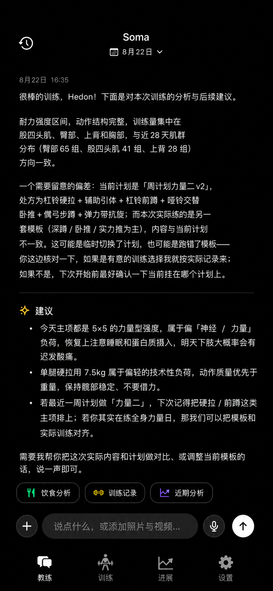
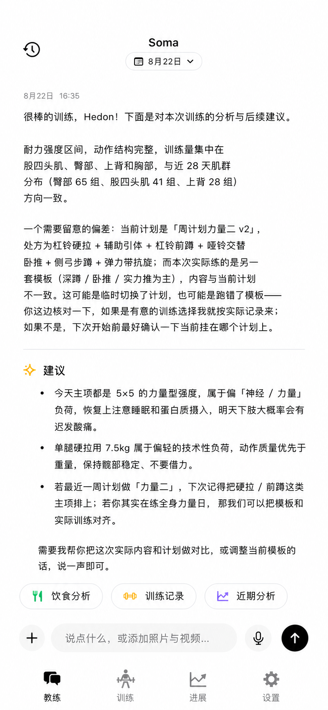

## 用户结果

1. 用户可以选择跟随系统、浅色或深色；深色纯黑，浅色纯白，信息层级一致。
2. 四个根页面使用紧凑居中标题与线框未选中 Tab，高频任务路径最短。
3. 聊天消息更小、更细；用户消息与主题自然融合，不出现暗色大白块。
4. 输入区只保留加号、文本、语音和发送；三个快捷 Skill 紧凑但仍易点按。
5. 每条消息显示日期与时间；AI 回复使用可预测的章节、段落和列表布局。
6. 进展按最近事实阅读；设置外观倒数第二、反馈直接在最后发送。
7. 训练记录支持次数、时长和四种侧别，紧凑呈现不损失逐组、逐侧或录像事实。

## 产品规则

### 视觉系统

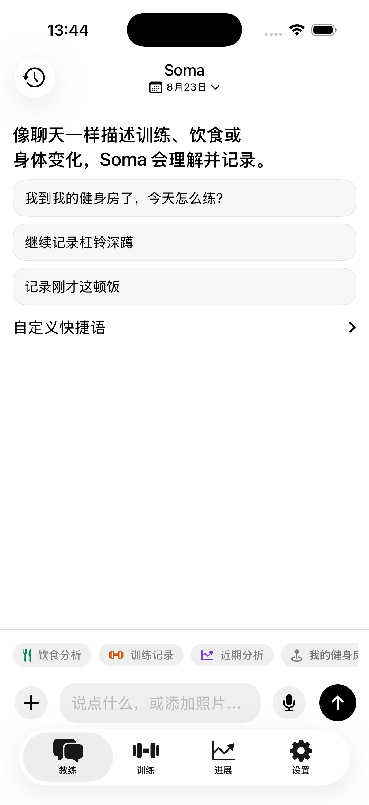
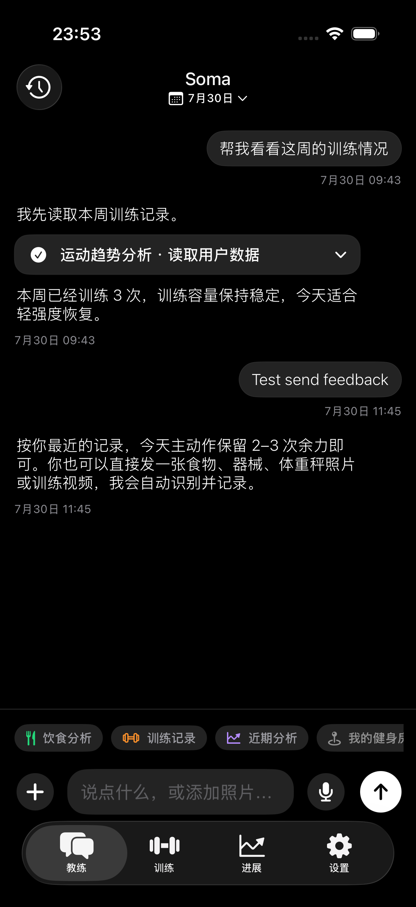

- 深色：page `#000000`、card `#191919`、inset `#232323`、separator `#303030`。
- 浅色：page `#FFFFFF`、card `#F7F7F7`、inset `#EFEFEF`、separator `#DCDCDC`。
- 主交互是黑白反色；类别、指标和状态各自使用确定性语义色，业务图标不无差别染黑，也不把训练页面
  的所有内容无差别染橙。
- 浅色语义色适度提高明度与饱和度，抵消纯白背景的灰雾感，并保持至少 4.5:1 对比度；暗色语义色在纯黑底上
  保持既定色值。
- 语义图标保持清晰实色，不使用阴影、柔光或模糊；暗色语义色不随浅色校准改变。
- 数据线、点、柱、面积与热力格跟随指标语义：训练频率/连续性使用青色，容量/负荷使用训练橙，
  恢复使用绿色，表现使用紫色，身体测量使用蓝色，生命体征使用珊瑚色；坐标轴、网格与分隔线保持
  中性。只有存在确定阈值或区间时，同一曲线才按状态分段多色。
- 每个指标使用与含义直接对应的本地 SF Symbol；泛化训练图标不代替频率、容量、恢复、表现、身体
  与生命体征图标。
- 大面积内容表面不使用彩色填充；暗色用户消息使用 inset 灰，不使用白色气泡。
- 页面左右 16 pt、区块 20 pt、同组 12 pt、主卡内 20 pt；主卡圆角 18 pt、控件圆角 12 pt。
- 点击区域至少 44×44 pt；图标只使用 SF Symbols 或仓库真实素材。
- 根标题使用 inline 样式；未选中 Tab 使用线框图标，选中项可使用 fill 图标和中性底。
- 聊天正文与用户消息使用 Subheadline Light；标题和显式强调只升到 Medium；时间与位置 Caption；数值等宽。
- 支持 Dynamic Type，不能用固定高度截断中文、记录字段或错误恢复文案。

### 教练

- 顶部只保留历史、Soma 与业务日期；普通 AI 回复为开放阅读版式，不保留重复头像或装饰列。
- 用户消息使用紧凑灰色气泡；消息元信息始终显示日期与时间，跨年额外显示年份。
- AI 只输出普通 Markdown。本地仅映射 1–3 级标题、段落、分隔线、有序和无序列表；不能注入任意组件。
- “建议/下一步、分析/趋势、训练/结论、注意/风险”可显示单个语义 SF Symbol。
- Composer 只保留加号、文本、麦克风和发送；加号统一承载照片与视频选择。
- 三个快捷 Skill 小胶囊横向排列；视觉高度紧凑，触达区域至少 44 pt。
- 最新记录卡可编辑、保存、删除；旧消息只显示锁图标，不显示冗余解释。
- Tool/Skill 过程、媒体、暂存、欠费、失败和重试保持可审查与可恢复。

### 训练

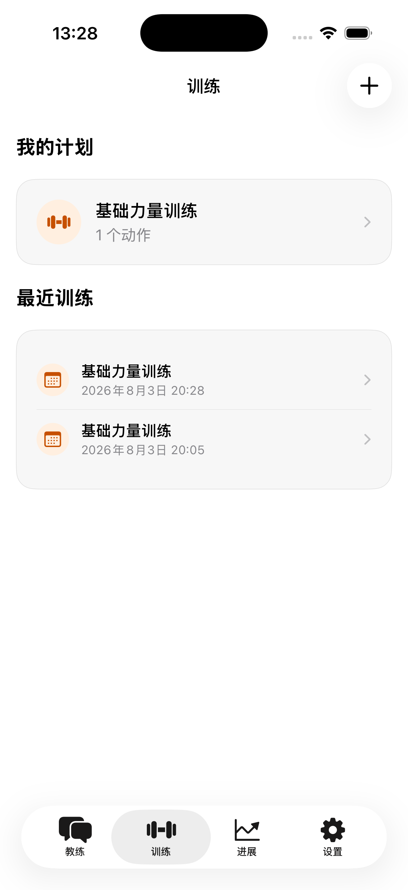
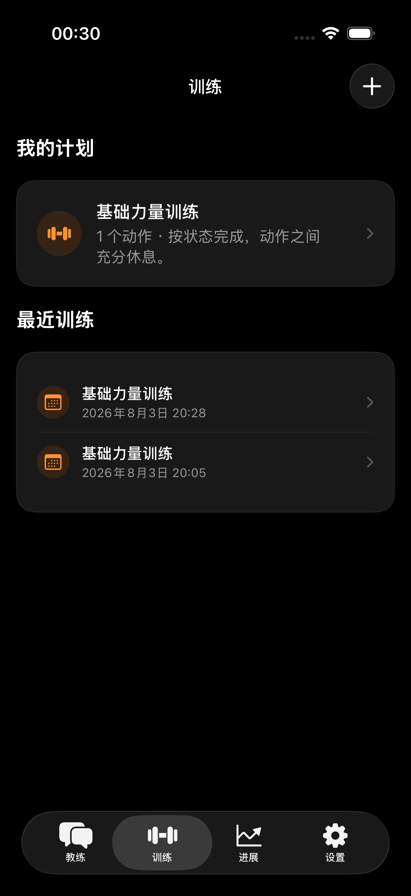

- 顺序为进行中的训练、我的计划、最近训练；没有进行中 Session 时不显示占位卡。
- 新建计划保留右上角加号；继续/开始训练是一跳操作。
- 归档、删除和完整复盘进入列表、详情或上下文菜单。
- 计划与最近训练的类别图标使用训练橙和柔和语义底，导航、加号和文字继续保持黑白。
- 连续逻辑组的侧别、类型、目标、次数/时长和重量相同即可显示 `×N`；间歇不参与压缩判断。
- 计划总览保留动作库的主要/辅助肌群身份；目标组数只缩放图上强度，不能通过全局阈值把辅助肌群
  升为主要肌群。所有受力图使用训练橙深浅，不以黑色表达有效受力区域。
- 计划动作行使用紧凑层级；混合次数/时长时直接提示。进入动作详情后先显示本计划目标，再显示
  动作内容；训练历史拆为最近一次、容量趋势和全部记录，图表使用真实日期与训练橙。
- 动作详情把主要肌群、辅助肌群、动作提示、双面受力图与图例合并为“标准动作”的单一列表行；
  不设置独立受力图章节，也不产生只有 Divider 或图例的空白 Form 行。
- 历史异构组压缩成 `4×5次 29kg · 1×3次 29kg`，不罗列组号；容量只统计完整次数与外部重量，
  最近容量和较上次变化必须在图外可直接读到。

### 进展

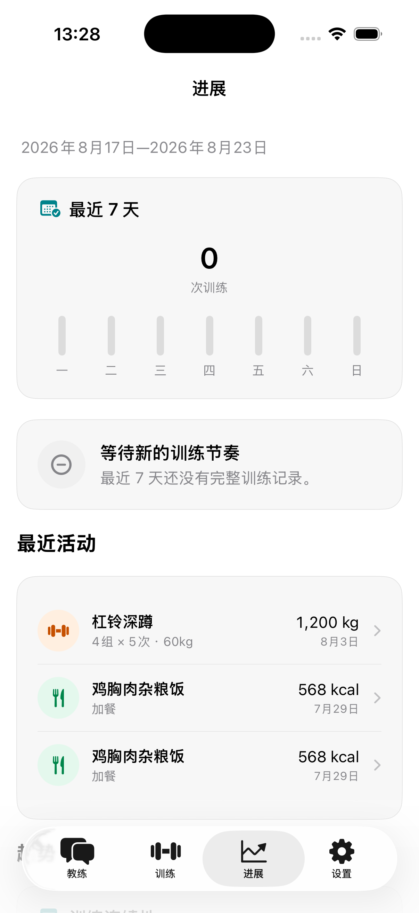
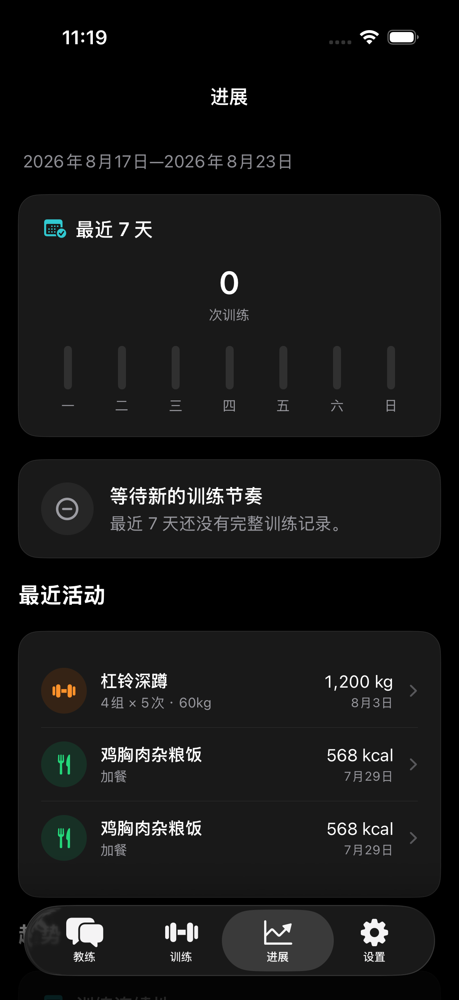
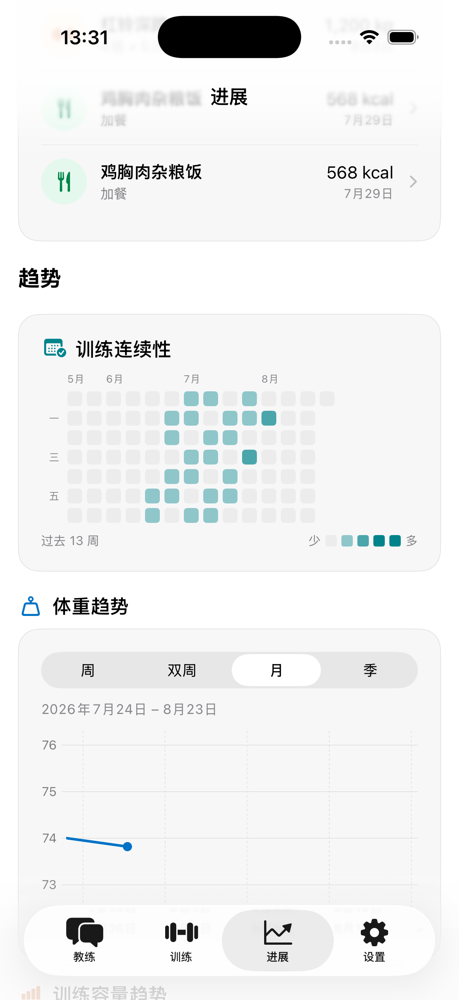
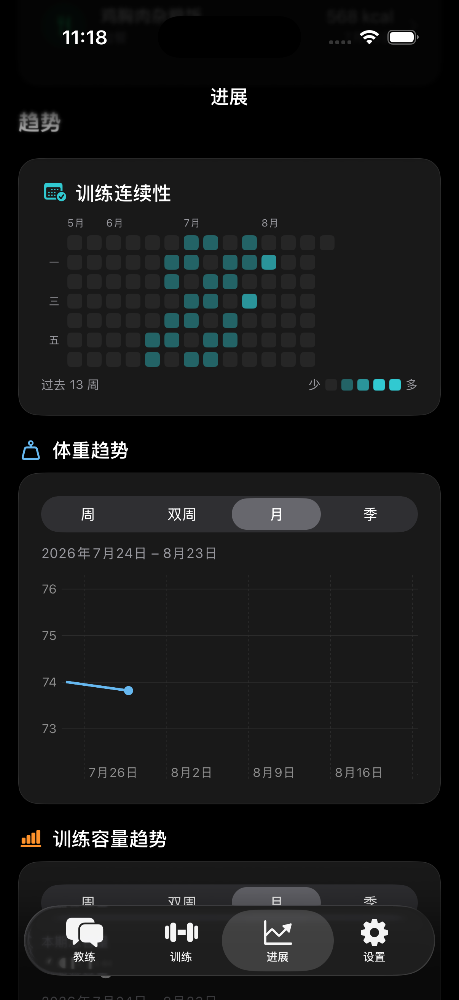

- 顺序为最近 7 天摘要、一条结论、最近三项混合活动、趋势、全部数据入口。
- 摘要只显示可靠指标；未知项不补零、不占位。
- 结论采用“结论 + 一句依据”，不展示内部置信度或医疗诊断。
- 最近活动按时间混排训练、饮食和身体记录，彩色只点缀类别图标。
- 最近 7 天训练柱与连续性热力格使用频率青，训练容量曲线使用负荷橙，体重曲线使用身体蓝；标题
  图标与数据轨迹共享同一指标角色。训练、饮食、身体、足迹和动作库入口继续使用类别色与柔和底，
  不显示一排黑色类别图标。

### 设置

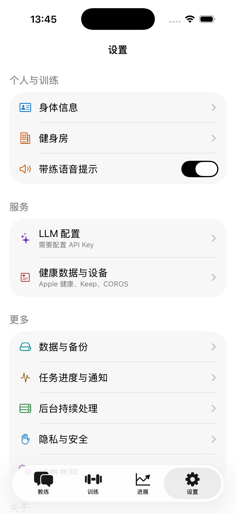
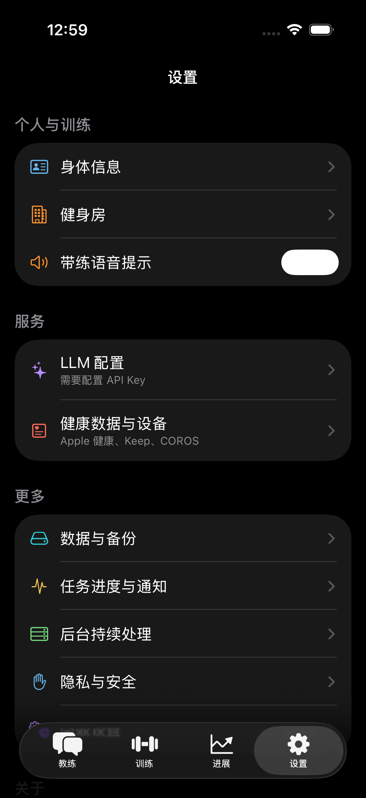

- 分组顺序为个人与训练、服务、更多、关于、显示、反馈。
- 设置项文字、图标形状和行布局保持不变；图标按功能使用身体蓝、训练橙、智能紫、健康珊瑚、
  数据青、通知琥珀与后台绿。颜色只落在图标本身，不增加彩色底块或彩色文字。
- 纯白页面上的每个分组使用可辨识浅灰卡与明确组间距，不能让行、卡和背景融成一片。
- 分区标题与卡片外沿对齐；反馈输入使用 inset 表面和 1 pt separator 边界，浅色下不能依赖模糊阴影辨认。
- 外观位于倒数第二组，提供跟随系统、浅色、深色即时切换。
- 反馈位于最后一组，直接支持文字、照片/视频和发送；失败保留草稿与媒体。
- 反馈只发送用户明确填写或选择的内容，不自动附带健康数据、聊天、日志或密钥。

### 训练记录编辑与带练

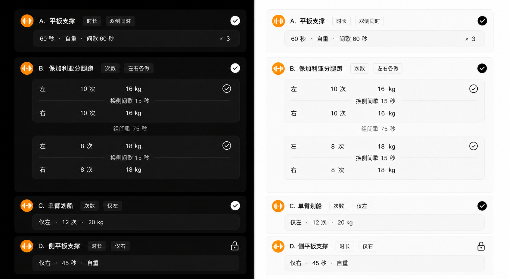

- 卡头只显示动作、次数/时长和侧别；术语为双侧同时、左右各做、仅左、仅右。
- 双侧同时一行；左右各做在同一逻辑组显示左、右两行；单侧为紧凑一行。
- 换侧间歇位于左右行之间，组间间歇位于逻辑组之后；动作最后一个逻辑组没有组间歇，但左右动作仍保留必要的换侧间歇。
- 缺失值显示 `—` 并保存为 `nil`；0 kg 只在既有模型语义下显示自重。
- 间歇不参与逻辑组压缩；压缩只是显示投影，保存仍保留顺序、逻辑组、另一侧、未显示间歇和录像元数据。
- 带练进度按动作和逻辑组分段；相机失败不能回滚完成 effort 或清空草稿。

## 数据与隐私

- 外观偏好只存 `UserDefaults`，不新增 SwiftData、服务器表或远程数据流。
- 训练编辑通过纯值投影修改既有 `WorkoutSetEvidence`，不改变 Tool Schema。
- 测试、截图和设计稿只使用虚构数据与 DemoMedia，不包含真实健康事实、位置、密钥或 Trace。

## 不在范围

- 不重构 Widget、Live Activity、分享海报或系统媒体查看器；MediaViewer 继续沉浸式深色。
- 不新增账户、同步、COROS 私有 API、姿态诊断或服务器身体事实源。
- 不为未来能力新增持久字段、入口或默认值。

## 验收

- 四根页浅深主题均为紧凑居中标题；Tab 未选中线框、选中中性强调，导航栈行为不变。
- 聊天正文细而清晰；用户消息为主题灰色；Composer 和三个 Skill 紧凑且触达不小于 44 pt。
- 每条消息显示日期时间；受控 Markdown 结构稳定，未知 Markdown 可读降级。
- 训练、进展、设置顺序符合本 PRD；设置分组层级清晰，外观倒数第二，反馈最后直达。
- 进展的业务图标、指标标题与图表数据标记均按类别/指标/状态三层语义着色；频率青、容量橙、身体蓝
  可在同一页面稳定区分，导航、主操作、坐标轴和分隔线仍保持黑白中性。
- 浅色语义图标与数据标记清晰鲜明且正文对比度不低于 4.5:1，不使用阴影、柔光或模糊；暗色
  语义色不受浅色校准影响。
- 训练编辑覆盖次数/时长、四种侧别与异构组，无可见组号，证据往返无损。
- 计划总览主/辅助身份不被累计强度重分类；动作详情可区分本计划目标与真实历史，容量趋势日期、
  数值与明细一致；所有受力图在浅深主题中均使用训练橙深浅，动作详情肌群文字与受力图位于
  同一列表行且没有幽灵分隔行。
- 标准/小屏 iPhone、浅/深、键盘、滚动、安全区、长中文、辅助字号与 VoiceOver 有证据。
- `make check`、`make verify`、设计 QA 和 Skill 校验通过；真机与硬件专属交互按验收矩阵单列。
