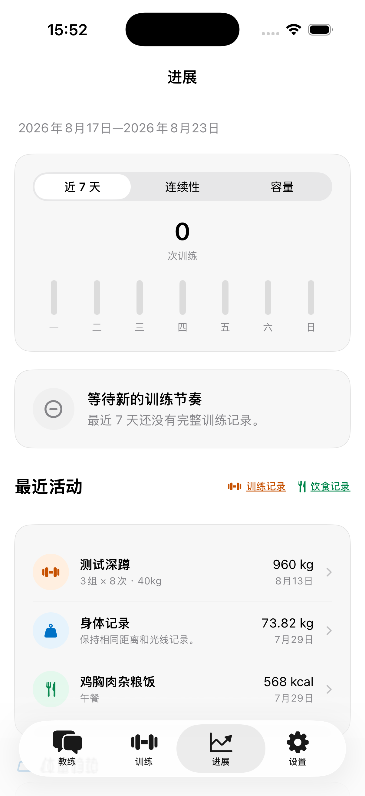
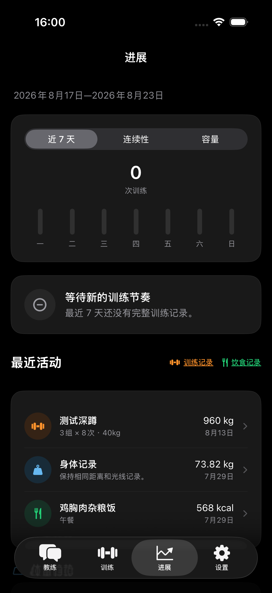

# PRD 041：动作级间歇与紧凑进展总览

- 状态：已实现
- 日期：2026-08-23
- 修订自：[PRD 000](000-origin-through-0.0.9.md) 的计划参数编辑、逐组间歇配置与进展区块收口
- 后续修订：[PRD 042](042-user-controlled-recovery-message-feedback-and-action-art.md) 进一步压缩聊天内训练逻辑组，但保留详情页标准密度
- 下游落地：
  - [ADR 0091](../adr/0091-action-level-planned-rest.md)
  - [训练领域模型与运行时协议](../engineering/training-domain-model.md)

## 用户结果

1. 编辑计划动作时，组间歇和换侧间歇与左右方式位于同一个“动作设定”区，不再逐组重复填写。
2. 动作各组只编辑类型、次数或时长、重量与备注；相同组可以稳定压缩，不受间歇差异影响。
3. 进展页用一个分段卡切换“近 7 天、连续性、容量”，减少重复标题和纵向滚动。
4. “最近活动”标题旁可直接进入训练记录与饮食记录。
5. 最近活动默认显示最多 6 条；更多记录在卡片内部纵向滚动，不需要跳转页面。
6. 设置中的带练语音及其他 Switch 使用一致的开启强调色，浅深主题都能看清当前状态。

## 产品规则

### 计划与带练

- `组间歇时间` 属于计划动作；有值时应用到除最后一组外的所有逻辑组。
- `左右侧切换间歇时间` 只对“左右分开”动作出现并生效，每个逻辑组的左右执行之间使用同一值。
- 用户切换为全身、仅左或仅右时，清除不再适用的换侧间歇。
- 连续组的压缩只比较类型、目标、次数或时长、重量与备注，不比较间歇。
- 历史训练仍逐组保存实际休息证据；本规则只统一计划参数，不改写既有 Session 或训练记录。

### 进展

- “训练概览”是单张卡，顶部使用“近 7 天、连续性、容量”分段选择器，切换时不改变页面位置。
- 三个视图继续使用各自的可靠数据与语义色；未知数据不补零。
- 最近活动仍按时间混排；卡片默认高度最多容纳 6 条，超过 6 条时只在卡片内部滚动。标题右侧继续
  提供带语义图标和短下划线的紧凑“训练记录”“饮食记录”入口，触达区域不少于 44 pt。

### 开关

- 全产品 Switch 统一使用系统开关外形；开启轨道使用确定性的正向状态色，关闭状态保持系统中性。
- 文案、可访问性标签与原有设置行为不变，不能只靠颜色表达开关状态。

## 兼容与真值

- 旧计划只有在所有适用逻辑组的同类间歇均存在且完全相同时，才提升为动作级值；缺失或冲突保持
  `nil`。
- 当前计划、Agent Tool、备份与 Session 快照均以动作级计划间歇为准；新写入不再把计划间歇复制
  到独立组处方。
- 开始训练时才把动作级配置编译为 `WorkoutSet` 的计划休息；最后一组的组间歇保持 `nil`。

## 验收

- 计划编辑器不再显示逐组间歇输入，动作设定可直接编辑两类适用间歇。
- 左右方式切换、旧快照解码、摘要压缩、Agent Tool、备份及开始训练的结果都有确定性测试。
- 进展页只有一张训练概览卡，三个分段均可切换；训练与饮食记录一跳可达。
- 全仓 Switch 均采用共享样式；带练语音开关在浅深主题的开、关状态可辨。
- `make check`、Server 测试、`make verify`、浅深主题视觉检查和真机安装通过。
