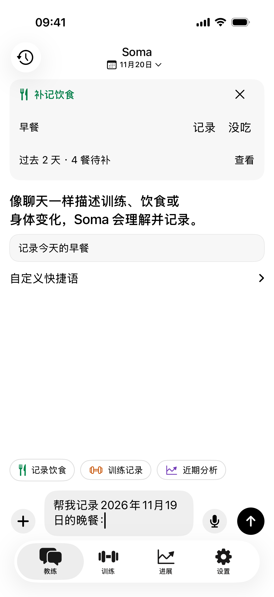
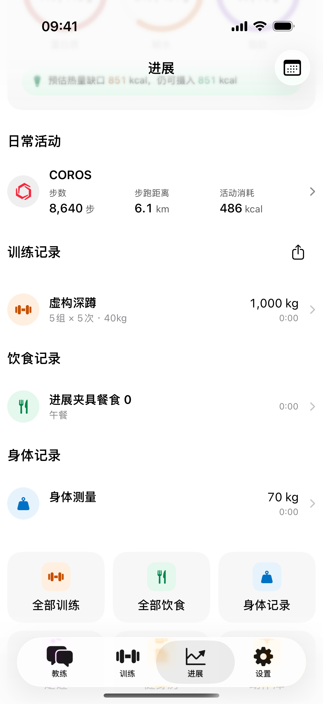
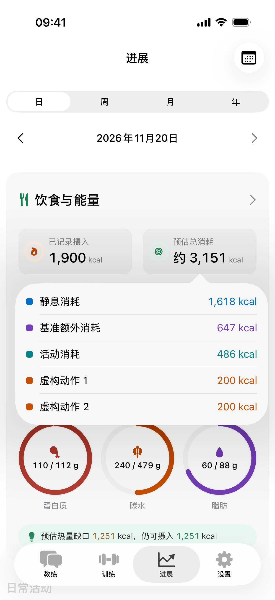
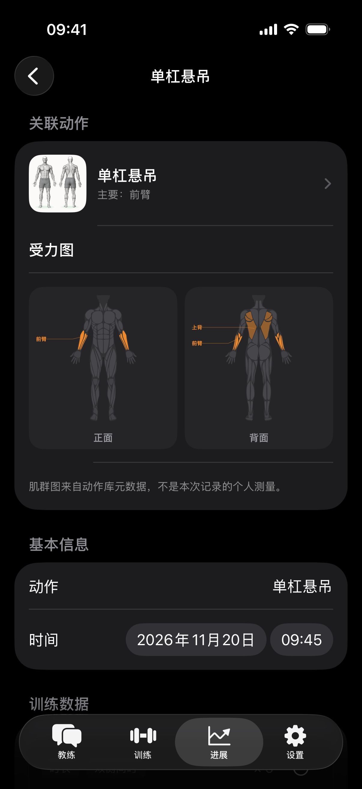

# PRD 083 · 教练输入稳定性与训练元数据

- 状态：已实现
- 日期：2026-11-20
- 版本：0.0.38
- 修订自：[PRD 082](082-coach-progress-reliability.md)（补餐输入、进展明细与动作元数据）
- 下游落地：[ADR 0154](../adr/0154-exercise-muscle-map-ids.md)、[BUG 0078](../bugs/0078-exercise-muscle-map-missing.md)

## 教练

- 补餐、发送文字或照片时，键盘和输入框正常切换。关闭待补餐提醒只影响当前访问，下一次进入教练时继续显示尚未补齐的餐次。
- 教练记录训练时优先复用动作库中的规范名。名称可唯一识别时说明对应关系，存在影响动作身份的歧义时先询问用户。
- 教练新建动作时选择主要和辅助受力块 ID。动作库、训练详情和分享使用同一份动作标注。

## 进展

- 日常活动行采用与训练、饮食记录一致的样式，显示实际来源图标。
- 消耗明细省略零值，单日按训练记录展示对应估算。训练列表、总消耗和明细使用同一口径，周期明细仍按日均展示。

## 模拟器截图

 

  

## 验收

补记餐次、发送和重进教练的路径可正常使用。新建动作后可读取主要和辅助受力标注。进展日消耗同时展示各条有效训练热量，记录缺项和零值分别处理。
